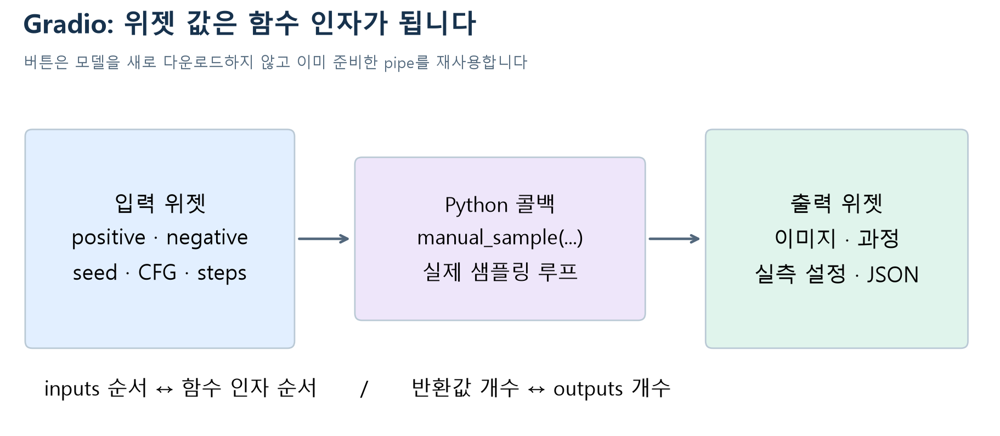
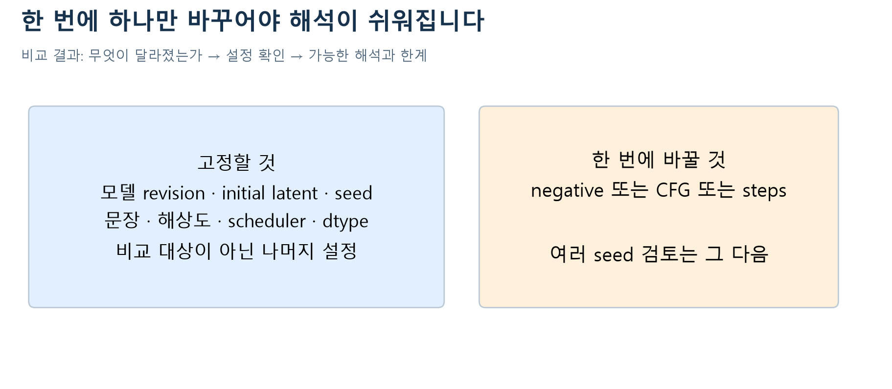

# W07a · 3. 내 실험을 조절하는 Gradio 앱

2026-10-12 · 주교재 5.6(229–231쪽), 5.7 연습 연결

**목표:** 입력 위젯 → Python 함수 → 출력 위젯을 연결하고, 같은 시작점에서 조건 하나를 바꾸어 결과를 설명합니다. 웹 앱은 계산 원리를 대신하지 않습니다. 앞에서 배운 샘플링 루프를 관찰하기 위한 조작 화면입니다.

## 1. 버튼 하나 안의 세 부분

그림 1. 입력의 순서와 함수 인자의 순서, 반환값의 개수와 출력 위젯의 개수를 함께 확인합니다. 수업용 원본 도식.

Gradio의 가장 작은 구조는 `Interface(fn=..., inputs=..., outputs=...)`입니다. 텍스트를 받아 텍스트를 반환하는 함수라면 텍스트 입력과 출력 위젯을 놓습니다. 이미지 생성 함수를 연결하면 입력은 여전히 문장일 수 있지만 출력은 이미지가 됩니다. 라이브러리가 함수의 잘못된 논리를 고쳐 주지는 않습니다.

이번 완성 앱은 여러 실험을 탭으로 나누기 위해 `Blocks`를 사용합니다. 버튼의 `click`에 함수를 연결하고 위젯 목록을 지정합니다. [Gradio 공식 Quickstart 원문](https://github.com/gradio-app/gradio/blob/main/guides/01_getting-started/01_quickstart.md)

| 위젯 | 함수에 전달되는 값 | 의미 |
| --- | --- | --- |
| positive prompt | 문자열 | 원하는 장면 |
| negative prompt | 문자열 | CFG의 기준 조건 |
| seed | 정수 | 초기 잡음 생성기의 출발 상태 |
| guidance scale | 실수 | 두 조건 차이를 반영할 크기 |
| sampling steps | 정수 | 방문할 추론 단계 수 |

함수는 최종 PIL 이미지, 중간 미리보기 목록, 실제 설정 사전, 내려받을 JSON 경로를 반환합니다. 설정에는 장치·dtype·모델 revision·실행시간·안전 검사 상태가 포함됩니다. 이미지와 그 설정이 한 묶음이어야 나중에 비교를 설명할 수 있습니다.

## 2. 모델 준비와 버튼 클릭을 분리하기

모델 로딩에는 가중치 다운로드와 메모리 준비가 필요합니다. 버튼을 누를 때마다 모델을 다시 내려받으면 느려지고 오류 원인을 이해하기 어렵습니다. 먼저 한 번 로드한 `pipe`를 콜백에 전달하고 반복해서 사용합니다.

`build_sampling_app(pipe=pipe)`는 화면과 함수 연결을 만듭니다. 이 호출 자체가 모델을 학습하거나 서버를 시작하지는 않습니다. `launch()`는 웹 서버를 시작하는 별도 단계입니다. Gradio가 반환한 공유 URL은 Colab 런타임 동안 유지되며 영구 사이트 주소가 아닙니다.

## 3. Colab 실행 순서

| 실습 | 기본 환경 | 핵심 활동 |
| --- | --- | --- |
| A · 샘플링 원리와 기록 | CPU | CFG·DDIM 계산, shape, seed, 실제 저장 trace 읽기 |
| B · 실제 생성과 앱 | CPU 기록 / T4 선택 | 모델 준비, 직접 루프와 pipeline 비교, 조건 실험, 앱 조립 |

각 노트북은 새 사본으로 열어 첫 셀부터 실행합니다. 설치 tag는 `2026-fall-w07a`, 패키지는 `0.1.11`입니다. 이전 버전 모듈을 이미 import한 상태라면 런타임을 재시작합니다. 모델 다운로드는 GPU 경로의 최초 실행에 약 2.7GB와 의존성 저장공간이 필요하고, 이후 캐시를 재사용합니다. 유료 API 키·개인 이미지 업로드·유료 업그레이드는 필수가 아닙니다. GPU 할당은 Colab 상황에 따라 달라집니다.

GPU가 없을 때는 **기록 분석 모드**를 사용합니다. 이 모드는 사전에 실제 생성하여 저장한 이미지와 텐서를 읽습니다. 모델 생성 실패를 숨겨 기록으로 바꾸는 자동 대체가 아닙니다. 노트북의 실행 모드 출력과 앱 탭 설명을 확인합니다.

## 4. 공정한 비교를 만드는 실험 절차

그림 2. 두 그림이 다르다는 관찰만으로 원인을 특정할 수 없습니다. 비교표의 고정 조건을 먼저 기록합니다.

1. 기본 문장 `a studio photograph of a red ceramic mug on a white table`을 사용합니다. 뜻은 ‘흰 탁자 위 빨간 도자기 머그컵의 스튜디오 사진’입니다.
2. seed 42, CFG 7.5, DDIM 20단계의 기본 결과를 확인합니다.
3. negative prompt만 `red`로 바꿉니다. 색·컵 형태·배경을 각각 관찰합니다.
4. 기본으로 되돌아가 CFG만 4로 바꾸거나 steps만 10으로 바꿉니다.
5. 이미지와 JSON을 저장하고 예상·관찰·해석·한계를 따로 기록합니다.

**활동 B2 · 비교 설계.** A실험은 seed42·CFG4·20단계, B실험은 seed43·CFG7.5·10단계였습니다. “CFG를 높였더니 컵 모양이 변했다”는 해석의 문제를 설명하고 CFG 효과를 비교할 새 두 설정을 제안하세요. 힌트: 바뀐 조건을 먼저 세어 보세요. 자가 점검: 한 번에 하나의 조건만 바꾸었는지 확인합니다.

## 5. 앱의 네 탭을 읽는 방법

| 탭 | 확인할 것 | 혼동하지 않을 것 |
| --- | --- | --- |
| 실제 생성 기록 분석 | base/negative-red/cfg-4/steps-10, 단계별 trace | 저장 기록을 지금 생성으로 부르지 않음 |
| SD 지금 생성 | 입력 다섯 개와 실제 출력 설정 | GPU·모델 준비 없이 실행되지 않음 |
| W06B 연결 | CFG 수계산과 이전 생성 기록 | 2차원 벡터가 실제 이미지 품질 점수는 아님 |
| 나의 실험 해석 | 직접 연결한 요약 함수 | 관찰과 원인 추정을 분리 |

중간 gallery를 눌러 확대해 보세요. 첫 noisy latent를 직접 디코딩한 그림은 사람이 읽을 수 있는 형태가 아닐 수 있습니다. 안전 검사에 차단된 미리보기에는 차단 상태와 검은 화면이 표시됩니다. 이를 정상적인 ‘검은 물체 생성’ 결과로 해석하지 않습니다. 최종 이미지가 차단되면 실제 생성 오류로 표시하며 예제 이미지로 대체하지 않습니다.

## 6. 학생이 연결할 작은 기능

**활동 B4 · 앱 조립.** `make_summary(setting, observation)`이라는 함수를 작성합니다. 두 문자열을 받아 “바꾼 조건: … / 관찰: … / 한계: 단일 비교만으로 일반화하지 않음”의 세 부분을 가진 문자열을 반환하게 하세요. 입력이 비어 있으면 먼저 기록하라는 안내를 반환합니다. 이 함수를 `build_sampling_app(summary_fn=make_summary, pipe=pipe)`에 전달하세요.

목표는 Gradio의 모든 메소드를 외우는 것이 아닙니다. 두 입력의 순서, 반환형, 함수 호출이 버튼과 연결되는 원리를 이해하는 것입니다. 힌트: 문자열을 만드는 순수 Python 함수부터 따로 호출해 보고 앱에 연결합니다. 자가 점검: 관찰을 바꾸면 출력도 바뀌고, 빈 입력을 넣어도 앱이 중단되지 않는지 확인합니다. 문제를 건너뛰어도 나머지 생성·기록 탭은 동작합니다.

## 7. 오류를 읽고 복구하기

| 현상 | 먼저 확인할 것 | 복구와 성공 확인 |
| --- | --- | --- |
| 설치했는데 함수가 없음 | 이전 모듈을 import했는지 | 런타임 재시작 → 첫 셀 → 버전0.1.11 확인 |
| GPU가 없다고 나옴 | T4 연결 여부 | 기록 모드를 선택하거나 T4 연결 후 준비 셀 실행 |
| 모델 다운로드 실패 | 네트워크·공간·오류 원문 | 연결을 확인하고 준비 셀 재실행; 캐시된 정상 파일 재사용 |
| 같은 seed인데 비교가 다름 | Generator 재초기화, 설정·환경 | 초기 latent 해시와 전체 설정을 비교 |
| 검은 중간 그림 | preview의 safety_status | 차단 상태를 기록; 최종 이미지와 구분 |
| 공유 URL이 열리지 않음 | Colab 런타임과 launch 출력 | 앱 셀 재실행 후 새 URL 사용 |
| 소수 seed/steps 오류 | 정수인지 | seed와 steps는 정수, CFG는 실수 사용 |

마지막 `W07A A 검증 통과`, `W07A B 검증 통과`를 확인합니다. 실제 생성 검사와 기록 분석 검사는 출력에서 별도로 표시됩니다. 웹 앱에서도 버튼을 누르고 이미지·설정·JSON 출력이 함께 바뀌는지 확인하세요.

**활동 B5 · 출구 설명.** ‘문장 → 이미지’를 여섯 단계 이내로 설명하되 U-Net, CFG, scheduler, VAE의 서로 다른 역할을 포함하세요. 그리고 이번 실험에서 고정해야 할 조건 두 가지와 관찰의 한계 한 가지를 덧붙이세요. 힌트: 그림 1의 화살표에 동사를 붙입니다.

참고: 주교재 5.6·5.7, [소스와 API 바로가기](https://github.com/lunalab-ai/genAI/blob/2026-fall-w07a/src/W07A-API.md). 원본 예시의 구조를 따르되 현재 패키지에 맞는 인자 이름과 검증 절차를 적용했습니다.
