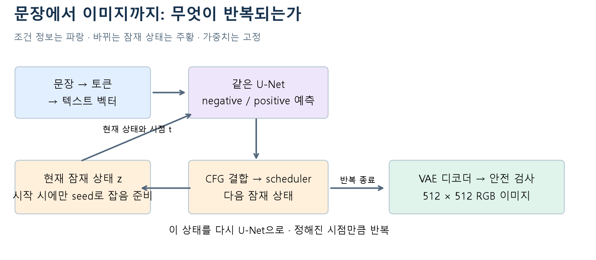

# W07a · 샘플링 한 장 지도

**2026-10-12 · 주교재 5.4–5.7 · 문장으로 조건을 주고 잠재 상태를 반복 갱신한다.**

| 순서 | 핵심 동작 | 놓치기 쉬운 구별 |
| --- | --- | --- |
| 1 | 문장 → 토큰별 표현 | 77은 단어 수가 아님 |
| 2 | seed → 초기 latent | seed 선언만으로 고정되지 않음 |
| 3 | 같은 U-Net → 두 잡음 예측 | 두 독립 모델이 아님 |
| 4 | CFG로 예측 결합 | 완성 이미지가 아님 |
| 5 | scheduler로 다음 상태, 반복 | optimizer의 가중치 갱신과 다름 |
| 6 | VAE 척도 복원 → 디코딩·검사 | noisy-z 미리보기와 x0 추정 구별 |

**비교의 약속:** 모델·초기 잡음·스케줄러·해상도·정밀도를 고정하고 negative / CFG / steps 중 하나만 바꿉니다. 이미지 옆에 설정과 실행 모드를 남깁니다.

**공개의 구별:** 코드 / 가중치 / 메타데이터 / 원이미지의 조건을 각각 확인합니다.

**앱의 연결:** 입력 위젯 → Python 인자 → 반환값 → 출력 위젯. 공유 URL은 실행 중인 런타임에 의존합니다.
