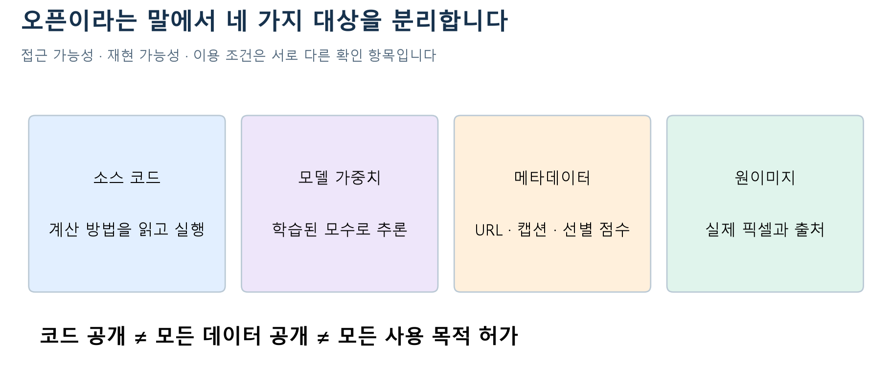

# W07a · 2. 오픈 데이터와 오픈 모델을 구별하기

2026-10-12 · 주교재 5.5(226–229쪽)

**학습목표:** ‘공개되어 있다’는 한마디를 코드, 가중치, 데이터 목록, 원이미지로 나누어 설명하고 모델 카드에서 확인할 항목을 찾습니다. 이번 시간에 대규모 이미지를 수집하거나 새 모델을 학습하지 않습니다.

## 1. 공개되는 대상부터 나누기

레시피를 볼 수 있는 것, 완성된 음식을 받을 수 있는 것, 재료 목록을 받을 수 있는 것은 서로 다른 일입니다. 이 비유에서 코드는 계산 방법, 가중치는 학습으로 얻은 수치 상태, 데이터 메타데이터는 자료를 설명하거나 찾는 목록에 가깝습니다. 비유는 역할을 구별하기 위한 것이며 학습 과정을 요리와 동일시하는 설명은 아닙니다.

그림 1. 한 층의 공개 여부가 다른 층의 이용 조건을 자동으로 결정하지 않습니다. 수업용 원본 도식.

| 공개 대상 | 얻을 수 있는 것 | 이것만으로 알 수 없는 것 |
| --- | --- | --- |
| 소스 코드 | 구조·추론·학습 절차의 구현 | 학습된 성능, 모든 데이터의 이용 조건 |
| 모델 가중치 | 학습된 모수를 사용한 실행 | 모든 학습 이미지의 출처·동의 여부 |
| URL·캡션 메타데이터 | 어떤 이미지와 문장이 연결되는지 | 원이미지에 대한 무제한 이용 권리 |
| 이미지 파일 | 실제 픽셀 자료 | 모든 사용 목적에 대한 허가 |

이번 실습에서 GitHub 수업 코드를 설치하는 것과 Hugging Face에서 모델 가중치를 내려받는 것은 다른 단계입니다. 전자는 우리가 작성한 설명 가능한 실행 코드이고, 후자는 이미 학습된 SD 1.5의 상태입니다. 라이선스와 모델 카드도 각각 확인합니다.

## 2. LAION을 ‘이미지 파일이 모두 들어 있는 폴더’로 생각하지 않기

LAION-5B 공식 설명의 데이터에는 이미지 URL, 텍스트, 유사도 같은 메타데이터가 포함됩니다. 인터넷에서 얻은 이미지–텍스트 후보를 선별하는 과정에서 CLIP 유사도 등을 사용합니다. CLIP 점수가 높다는 것은 그 모델의 표현 공간에서 관계가 크다는 뜻이지, 사실성·동의·권리·안전성을 모두 심사했다는 뜻이 아닙니다. [LAION-5B 공식 설명과 메타데이터·라이선스 항목](https://laion.ai/blog/laion-5b/)

예를 들어 URL과 “붉은 컵”이라는 캡션이 연결되어 있어도 링크가 사라질 수 있고, 캡션이 부정확할 수 있으며, 자료 제공자의 메타데이터 조건과 원이미지 권리자의 조건이 다를 수 있습니다. 따라서 목록의 규모와 모델 결과만으로 자료의 적절성을 판단할 수 없습니다.

## 3. 교재의 시점과 후속 공지를 구별하기

교재 5.5.1은 데이터의 문제와 당시 지원 중단을 설명합니다. 수업에서는 이 역사적 맥락을 보존하고, 이후 공지를 별도 정보로 덧붙입니다.

| 구분 | 읽을 내용 | 해석할 때의 경계 |
| --- | --- | --- |
| 교재 5.5.1 | 데이터의 한계와 당시 비활성화 | 교재 서술 시점의 상황 |
| 2024-08-30 공식 후속 공지 | Re-LAION-5B 정제·공개 발표 | 제공자의 발표이며 모든 문제 제거의 보장 아님 |
| 현재 실습 | 고정된 SD 1.5 가중치 사용 | 새로운 데이터셋을 수집·검증한 활동 아님 |

후속 공지에서는 문제 링크 제거 및 연구용 버전 공개를 설명합니다. 이를 “모든 이미지가 안전하고 어떤 목적으로도 자유롭게 사용 가능하다”로 바꾸어 읽지 않습니다. [Re-LAION-5B 공식 후속 공지](https://laion.ai/blog/relaion-5b/)

## 4. 대안은 이름보다 수집·확인 방법으로 비교하기

교재 5.5.2는 다른 데이터셋과 수집 방식의 대안을 소개합니다. 대안의 이름을 암기하는 데서 멈추지 말고 다음 기준으로 비교합니다.

| 비교 기준 | 확인할 근거 |
| --- | --- |
| 출처 추적 | 항목별 원출처·수집 시점·메타데이터 |
| 이용 조건 | 데이터 설명, 원자료 조건, 제외 항목 |
| 대표성 | 언어·지역·문화·대상 분포 |
| 정제와 검토 | 무엇을 어떤 기준으로 걸렀는지, 남은 한계 |
| 재현성 | 버전·해시·처리 과정 공개 여부 |

데이터를 작게 만든다고 모든 문제가 없어지는 것도 아니고, 크게 만든다고 대표성이 자동으로 확보되는 것도 아닙니다. 공개의 장점은 외부 연구자가 구조와 한계를 살펴보고 재현·비교할 수 있다는 점입니다. 그 기회와 이용 책임을 함께 읽습니다.

## 5. 모델 카드 읽기의 실제 순서

이번 실습 모델은 [Stable Diffusion v1.5 모델 카드](https://huggingface.co/stable-diffusion-v1-5/stable-diffusion-v1-5)와 가중치 revision `451f4fe16113bff5a5d2269ed5ad43b0592e9a14`를 사용합니다. 라이선스 표시는 OpenRAIL-M입니다. **라이선스 이름만 보지 말고 본문과 제한 사항을 확인하는 것이 활동의 목적**입니다.

1. **대상 확인:** 모델 ID, 버전, 입력 언어와 출력 형태를 확인합니다.
2. **의도한 용도:** 어떤 연구·활용을 염두에 두었는지 읽습니다.
3. **한계:** 편향, 재현의 불완전성, 프롬프트와 결과의 불일치를 확인합니다.
4. **조건:** 가중치 라이선스와 사용 제한, 함께 쓰는 코드·데이터의 조건을 분리합니다.
5. **우리 실습에 적용:** 영어 문장, 고정된 버전, 공개 수업용 사물 예제를 선택한 이유를 적습니다.

교재의 ‘공정하고 상업적인 사용’ 절은 쟁점을 이해하기 위한 범위입니다. 이 노트는 특정 사례의 법률적 허용 여부를 일괄 판정하지 않습니다. 구체적인 배포 목적과 지역·자료 조건에 대한 판단은 별도 검토 대상입니다.

**활동 B3 · 판단 사례.** “메타데이터가 공개되어 있고 모델도 내려받을 수 있으므로, 연결된 모든 이미지를 모아 아무 조건 없이 재배포할 수 있다”는 결론을 평가하세요. 공개된 대상을 네 층으로 나누고, 추가 확인할 문서 두 가지 이상을 적으세요. 힌트: 파일 접근 가능성과 이용 조건은 다른 질문입니다. 자가 점검: 허용·불허를 단정하기 전에 확인할 근거를 밝혔는지 봅니다.

## 6. 오늘 기억할 연결

실행 가능성은 `모델을 불러올 수 있는가`의 문제입니다. 재현 가능성은 `어떤 버전과 조건으로 얻었는가`의 문제입니다. 이용 조건은 `어떤 자료를 어떤 목적으로 쓸 수 있는가`의 문제입니다. 하나를 확인했다고 다른 둘이 자동으로 확인되지는 않습니다.

참고: 주교재 5.5 및 위 공식 자료. LAION 후속 공지와 모델 카드 읽기 활동은 교재 시점을 보완하기 위해 추가한 내용입니다.
