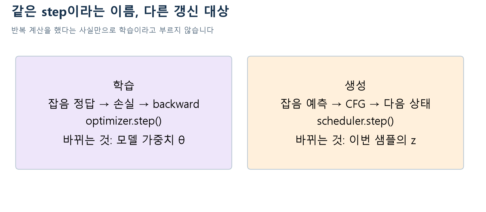
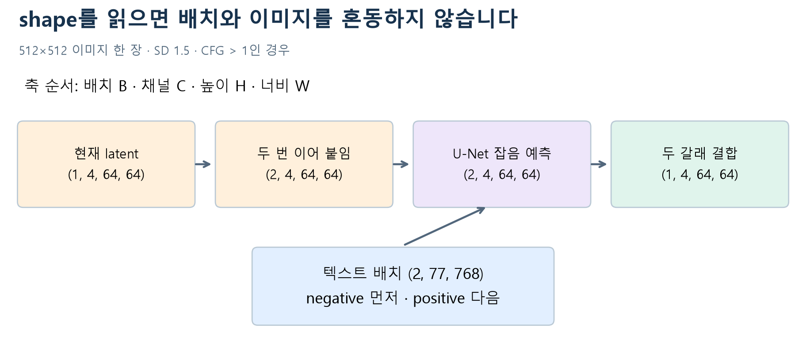
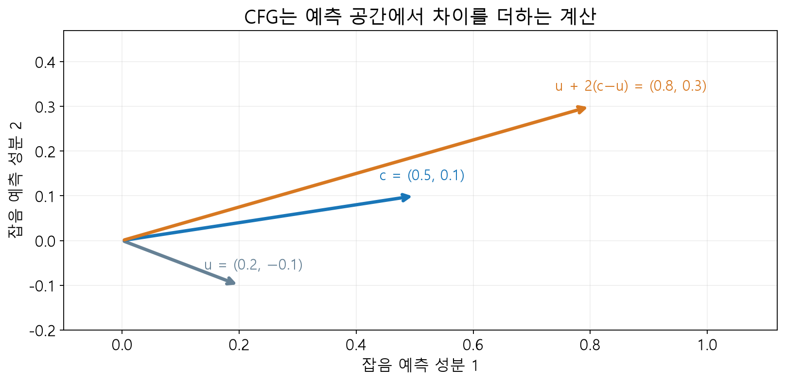
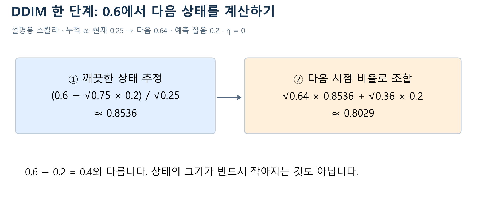
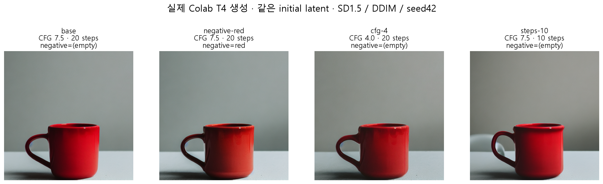
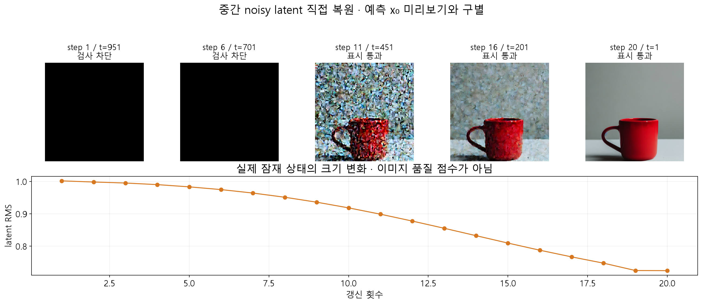

# W07a · 1. 한 줄의 생성 코드를 샘플링 루프로 펼치기

2026-10-12 · 생성형 인공지능 · 주교재 5.4(222–225쪽), 5.7(231–232쪽)

**오늘의 목표:** `pipe(prompt)` 안에서 반복되는 일을 자기 말로 설명하고, 각 단계의 입력·출력과 실제 코드를 연결합니다. 지난 실습을 끝내지 않았어도 이 노트와 새 Colab 사본으로 시작할 수 있습니다.

## 1. 먼저 연결할 네 가지 구성요소

“하얀 탁자 위 빨간 도자기 머그컵 사진”이라는 문장을 넣었다고 생각해 봅시다. 컴퓨터가 문장을 곧바로 그림으로 번역하는 한 번의 연산은 아닙니다. 문장을 수치 표현으로 바꾸고, 무작위 잠재 상태를 여러 번 갱신한 뒤 마지막 상태를 그림으로 복원합니다.


그림 1. 파란 경로는 **조건 정보**, 주황 경로는 **바뀌는 잠재 상태**입니다. 초록색 VAE 디코더는 마지막에 잠재 상태를 픽셀로 바꿉니다. 수업용 원본 도식.

| 구성요소 | 쉬운 역할 | 실제로 내보내는 것 |
| --- | --- | --- |
| 토크나이저·텍스트 인코더 | 문장을 모델이 읽을 수 있게 표현 | 토큰별 벡터 시퀀스 |
| 조건부 U-Net | 지금 상태와 조건에서 잡음을 예측 | 현재 latent와 같은 크기의 잡음 예측 |
| 스케줄러 | 예측과 노이즈 시점에 따라 다음 상태 계산 | 다음 잠재 상태 |
| VAE 디코더 | 잠재 표현을 픽셀로 복원 | RGB 이미지 |

**이름을 외우기보다 동사를 붙이세요.** 텍스트 인코더는 표현하고, U-Net은 예측하고, 스케줄러는 갱신하고, 디코더는 복원합니다. 텍스트에서 새 그림을 만드는 이 경로는 원본 이미지를 입력하지 않으므로 VAE 인코더를 반드시 호출하지 않습니다.

## 2. 생성 중에는 무엇이 바뀌는가

지난 확산 모델 학습에서는 잡음 예측 오차를 줄이기 위해 모델의 가중치를 수정했습니다. 오늘은 학습을 마친 모델을 가져와 사용합니다. 생성 중에 갱신하는 것은 그 모델이 아니라 **이번에 만들 그림의 잠재 상태**입니다.



그림 2. 두 코드에 모두 `step`이 들어가도 대상은 다릅니다. `optimizer.step()`은 모수를, `scheduler.step()`은 샘플을 갱신합니다. 수업용 도식.

| 구분 | 학습 | 오늘의 샘플링 |
| --- | --- | --- |
| 출발점 | 학습 이미지와 추가한 잡음 | 새로운 잠재 잡음 |
| 비교할 정답 | 실제로 추가한 잡음 | 새로운 생성 이미지의 정답 없음 |
| 대표 계산 | 손실, 역전파, optimizer | 잡음 예측, CFG, scheduler |
| 반복 중 바뀌는 것 | 모델 가중치 | 이번 샘플의 잠재 상태 |

**활동 A1 · 개념 진단.** “20번 생성 단계를 거치므로 U-Net을 20번 학습한다”를 고치세요. 바뀌는 것과 고정되는 것을 각각 하나 이상 쓰세요. 힌트: `backward()`와 optimizer가 있는지 살펴봅니다. 자가 점검: ‘반복’이라는 말만으로 학습이라 판단하지 않았는지 확인합니다.

## 3. 숫자 배열의 크기를 길 잃지 않고 읽기

이번 수업은 SD 1.5, 512×512 이미지, 한 번에 한 장이라는 조건을 고정합니다. 아래 크기는 모든 확산 모델의 보편적 상수가 아니라 **이 모델과 설정의 예**입니다.



그림 3. CFG를 위해 배치축만 1→2로 늘립니다. 이미지 해상도를 두 배로 늘리는 동작이 아닙니다. 수업용 도식.

| 값 | 크기 | 축의 뜻 |
| --- | --- | --- |
| 프롬프트 token IDs | (1, 77) | 문장 배치, 토큰 위치 |
| positive text hidden | (1, 77, 768) | 배치, 위치, 특징 |
| 초기 잠재 잡음 | (1, 4, 64, 64) | 배치, 잠재 채널, 높이, 너비 |
| CFG용 잠재 입력 | (2, 4, 64, 64) | 같은 latent를 두 조건으로 읽음 |
| CFG용 텍스트 입력 | (2, 77, 768) | negative 먼저, positive 다음 |
| 두 갈래 잡음 예측 | (2, 4, 64, 64) | 같은 U-Net 가중치로 계산 |
| CFG 결합 후 | (1, 4, 64, 64) | 한 샘플을 위한 잡음 예측 |
| 디코더 출력 | (1, 3, 512, 512) | 배치, RGB, 높이, 너비 |

77은 단어 수가 아닙니다. 시작·종료·패딩을 포함하는 토큰 위치 길이이며, 긴 문장은 잘릴 수 있습니다. 네 잠재 채널은 RGB나 ‘색·모양·배경·재질’처럼 이름 붙은 네 의미 축이 아닙니다. 768은 이미지의 픽셀 수가 아닙니다.

**활동 A4 · shape 추적.** U-Net 예측 `(2,4,64,64)`를 `chunk(2)`로 나누고 CFG로 합친 뒤의 크기를 순서대로 쓰세요. 두 갈래에 서로 다른 seed의 latent를 넣어도 같은 의미의 비교가 될지 설명하세요. 힌트: 조건 효과를 비교할 때 현재 상태는 같아야 합니다.

## 4. CFG는 두 예측의 차이를 사용하는 계산

같은 현재 상태와 같은 시점에서 조건을 달리하여 두 예측을 만듭니다. 빈 문자열을 조건으로 한 예측을 $u$, 원하는 문장의 예측을 $c$라 쓰면 다음과 같습니다.

$$
\hat\varepsilon = u+s(c-u)
$$

여기서 $s$가 guidance scale입니다. $c-u$는 같은 상태에서 조건 때문에 달라진 **잡음 예측의 방향**입니다. 이 식의 결과 역시 잡음 예측이지 완성 이미지가 아닙니다.



그림 4. 작은 2차원 설명 예시입니다. 실제 SD latent는 16,384개 수를 가집니다. 화살표 길이를 이미지 품질 점수로 읽지 않습니다.

**함께 계산할 예시.** $u=(0.2,-0.1)$, $c=(0.5,0.1)$, $s=2$로 놓습니다.

1. 조건 차이: $c-u=(0.3,0.2)$.
2. 차이를 두 배: $2(c-u)=(0.6,0.4)$.
3. 기준 예측에 더함: $u+2(c-u)=(0.8,0.3)$.

$s=1$이면 이 식은 $c$가 됩니다. 더 큰 값은 조건 차이를 더 크게 반영하지만 화질이나 충실도가 언제나 좋아지는 것은 아닙니다. 과한 대비, 부자연스러운 질감 같은 변화도 관찰 대상입니다.

**수학식과 API를 구별하세요.** 수학식에서 $s=0$이면 $u$입니다. 그러나 이번 Diffusers SD 파이프라인은 `guidance_scale <= 1`일 때 두 갈래 CFG를 건너뛰고 positive 조건만 사용합니다. 따라서 API에 0을 넣었다고 무조건 생성으로 해석하지 않습니다. 실습은 1 이상으로 제한합니다.

**활동 A2 · 손계산과 빈칸.** 위 $u,c$에 $s=3$을 적용하세요. `guided_student = u + s * (____)`의 빈칸을 채우고 각 성분의 계산 과정을 쓰세요. 힌트: 괄호는 ‘조건의 차이’입니다. 자가 점검: $s=1$을 대입했을 때 $c$가 되는 식인지 확인합니다.

## 5. 네거티브 프롬프트가 들어갈 자리

negative prompt를 사용하면 기준 예측을 빈 문자열의 $u$ 대신 negative 문장의 $n$으로 바꿉니다.

$$
\hat\varepsilon = n+s(c-n)
$$

예를 들어 positive는 빨간 머그컵, negative는 `red`로 둘 수 있습니다. ‘원하는 문장’과 ‘멀어지려는 기준’에 긴장이 생기는 실험입니다. 모델 내부에 빨간 픽셀을 찾아 반드시 삭제하는 규칙을 추가하는 것이 아닙니다. 같은 U-Net이 서로 다른 텍스트 조건을 읽어 낸 예측의 차이를 사용합니다.

실제 코드에서 텍스트는 `[negative, positive]` 순서로 연결합니다. 예측을 나눌 때도 같은 순서를 지켜야 합니다. 두 순서를 바꾸면 차이의 방향이 바뀔 수 있습니다. 단어를 넣었는지뿐 아니라 **어느 갈래로 전달했는지** 확인하세요.

**활동 A3 · 기준 변화.** $n=(0,-0.2)$, $c=(0.5,0.1)$, $s=2$일 때 결합값을 계산하세요. 계산값이 달라졌다는 사실만으로 특정 객체가 반드시 사라졌다고 말할 수 있는지도 적으세요. 힌트: 잡음 예측 공간의 수와 최종 이미지 해석은 다른 단계입니다.

## 6. 스케줄러는 잡음을 그대로 빼는 함수가 아니다

확산의 전방 관계를 잠재 공간에서 쓰면 다음과 같습니다. $\bar\alpha_t$는 그 시점에 남은 신호의 비율에 대응하는 누적 계수입니다.

$$
z_t=\sqrt{\bar\alpha_t}z_0+\sqrt{1-\bar\alpha_t}\varepsilon
$$

예측 잡음을 이용하면 깨끗한 상태의 추정치를 계산할 수 있습니다.

$$
\hat z_0=\frac{z_t-\sqrt{1-\bar\alpha_t}\hat\varepsilon}{\sqrt{\bar\alpha_t}}
$$

오늘 사용하는 결정론적 DDIM($\eta=0$, clipping 생략 설명)의 다음 상태는 다음과 같이 이해할 수 있습니다. $t'$는 다음으로 방문할 더 낮은 노이즈 시점입니다.

$$
z_{t'}=\sqrt{\bar\alpha_{t'}}\hat z_0+\sqrt{1-\bar\alpha_{t'}}\hat\varepsilon
$$



그림 5. 이 계산은 실제 이미지의 한 픽셀 측정이 아닌 독립적인 수계산 예입니다. 실습에서는 모델 설정을 반영하는 스케줄러 구현을 호출합니다.

**순서대로 풀기.** $z_t=0.6$, $\hat\varepsilon=0.2$, $\bar\alpha_t=0.25$, $\bar\alpha_{t'}=0.64$라 합시다.

1. 현재 계수는 $\sqrt{0.25}=0.5$, $\sqrt{0.75}\approx0.8660$입니다.
2. 잡음 기여 추정은 $0.8660\times0.2\approx0.1732$입니다.
3. 이를 뺀 뒤 신호 계수로 나누면 $\hat z_0\approx(0.6-0.1732)/0.5=0.8536$입니다.
4. 다음 계수는 $\sqrt{0.64}=0.8$, $\sqrt{0.36}=0.6$입니다.
5. 다음 상태는 $0.8\times0.8536+0.6\times0.2\approx0.8029$입니다.

단순히 $0.6-0.2=0.4$를 계산한 것과 다릅니다. 또한 다음 값이 더 커졌다고 잡음 제거가 실패한 것은 아닙니다. 모든 성분이나 latent의 크기가 매 단계 감소해야 한다는 조건은 없습니다. **단계별 norm은 상태를 관찰하는 통계이지 품질 점수가 아닙니다.**

## 7. 수식과 실제 코드의 대응

아래는 설명을 위한 핵심 순서입니다. 실행 가능한 전체 구현, 입력 검사, 기록, 안전 검사는 [sampling.py](https://github.com/lunalab-ai/genAI/blob/2026-fall-w07a/src/luna_genai/sampling.py)에 있습니다. 함수별 바로가기는 [W07A API 색인](https://github.com/lunalab-ai/genAI/blob/2026-fall-w07a/src/W07A-API.md)에서 확인합니다.

```python
context = torch.cat([negative, positive])
z = initial_noise * scheduler.init_noise_sigma
for t in scheduler.timesteps:
    model_input = torch.cat([z, z])
    model_input = scheduler.scale_model_input(model_input, t)
    prediction = unet(model_input, t, encoder_hidden_states=context).sample
    n, c = prediction.chunk(2)
    epsilon = n + guidance * (c - n)
    z = scheduler.step(epsilon, t, z).prev_sample
image = vae.decode(z / vae.config.scaling_factor)
```

이 코드는 CFG를 사용하는 경우의 골격입니다. 실제 구현은 CFG=1에서 분기를 다르게 처리하고, DDIM의 $\eta=0$을 지정합니다. 디코더 직후의 텐서를 곧바로 학생 화면에 보내지 않고 안전 검사와 이미지 변환도 수행합니다.

`scale_model_input`은 스케줄러가 요구하는 입력 척도를 맞추는 단계입니다. 이번 DDIM에서는 값이 그대로일 수 있지만, 다른 스케줄러까지 동일하다고 가정해 삭제하지 않습니다. 디코딩의 나눗셈도 shape를 바꾸지 않지만 **값의 척도**를 바꿉니다. 상수 0.18215를 모든 모델에 외워 쓰지 말고 config를 읽습니다.

**활동 B1 · 순서는 맞아 보여도 틀린 코드.** `z = z - epsilon`으로 갱신한 줄과 `vae.decode(z)`로 복원한 줄의 문제를 각각 설명하고 올바른 호출 형태를 쓰세요. 힌트: 단계 계수와 VAE 척도를 빠뜨렸는지 확인합니다.

## 8. seed를 쓴다는 말과 같은 시작점의 차이

`seed=42`라는 변수를 선언하는 것만으로 `torch.randn`의 결과가 고정되지는 않습니다. 난수 생성기에 seed를 넣고 실제 난수 호출에 그 생성기를 전달해야 합니다. 동일한 Generator 객체를 계속 사용하면 내부 상태가 소비되어 다음 난수가 나옵니다.

```python
generator = torch.Generator(device="cpu").manual_seed(42)
noise = torch.randn((1, 4, 64, 64), generator=generator)
```

같은 시작점 비교에는 매번 새 Generator를 만들거나, 만들어 놓은 초기 latent를 복사해 두 경로에 전달합니다. seed뿐 아니라 모델 revision, 장치·dtype, 해상도, 스케줄러, steps, prompt도 기록합니다. 서로 다른 환경 사이의 비트 단위 동일성은 보장하지 않습니다. [공식 재현성 설명](https://huggingface.co/docs/diffusers/using-diffusers/reusing_seeds)

**활동 A5 · 디버깅.** `seed=42; z=torch.randn(1,4,64,64)`에서 누락된 연결을 설명하고 고치세요. 같은 Generator로 두 번 연속 뽑은 값을 비교하는 검사도 왜 잘못될 수 있는지 적으세요. 자가 점검: 새 Generator 두 개를 같은 seed로 초기화해 `torch.equal`을 확인합니다.

## 9. 직접 관찰할 실제 실행 기록



실제 관찰: 이 seed의 `negative-red` 결과에도 컵의 붉은색이 남았습니다. 색의 정도·표면·형태 차이는 보이지만, negative 단어를 입력하면 해당 색이 반드시 없어지는 것은 아닙니다. 한 장만으로 일반적인 효과 크기를 추정하지 않습니다.

그림 6. 본 수업의 실제 SD 1.5 실행 결과입니다. `base`에서 negative, CFG, steps를 각각 하나씩 바꿉니다. 모든 차이를 “개선”이라 부르지 않고 객체·색·구도·질감의 관찰로 적습니다.



그림 7. 중간 그림은 갱신된 **noisy latent 직접 복원**이며 $\hat z_0$ 미리보기가 아닙니다. 검사가 차단한 미리보기는 검은 화면과 차단 상태로 표시합니다. 최종 생성 성공과 중간 화면의 표시 상태를 따로 읽으세요.

Colab A는 이 실제 기록의 파일 해시를 검사한 뒤 수치를 분석합니다. 지금 모델을 실행한 결과는 아닙니다. Colab B의 GPU 경로는 실제 모델을 로드하여 새 이미지를 만듭니다. 두 실행 모드를 보고서에서 구별합니다.

참고: 주교재 5.4·5.7, [Diffusers 구성요소와 직접 파이프라인](https://huggingface.co/docs/diffusers/using-diffusers/write_own_pipeline), [StableDiffusionPipeline API](https://huggingface.co/docs/diffusers/api/pipelines/stable_diffusion/text2img). 교재 설명을 따르되 수업 예제·도식·검증 코드는 새로 구성했습니다.
