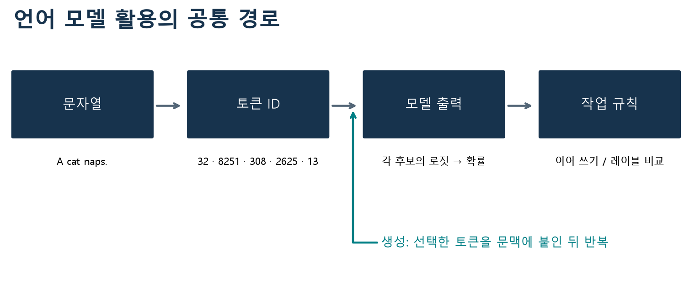
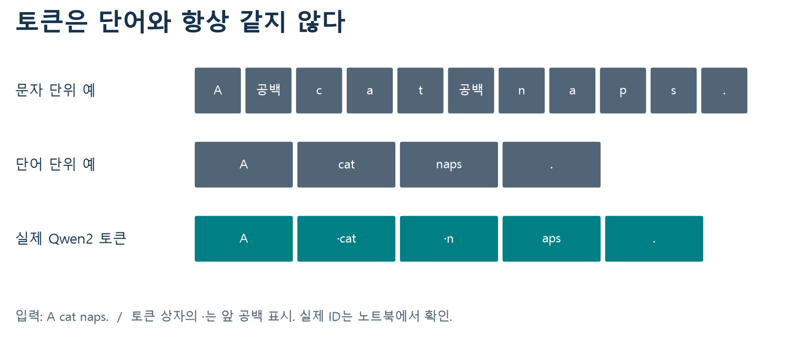
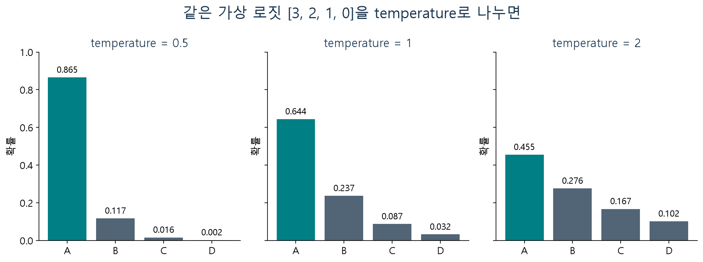
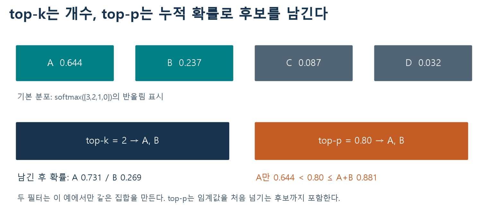
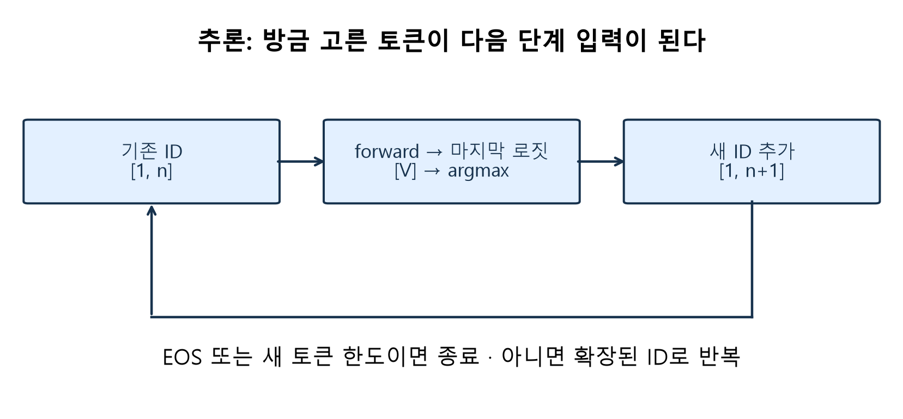
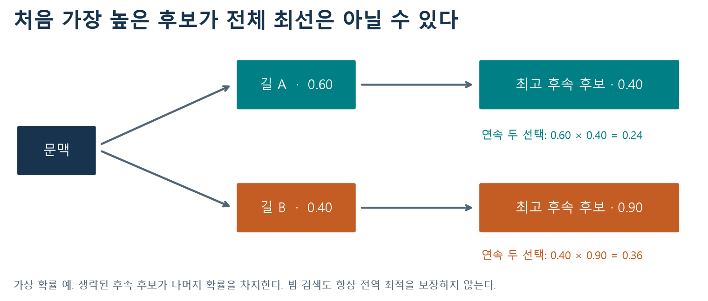
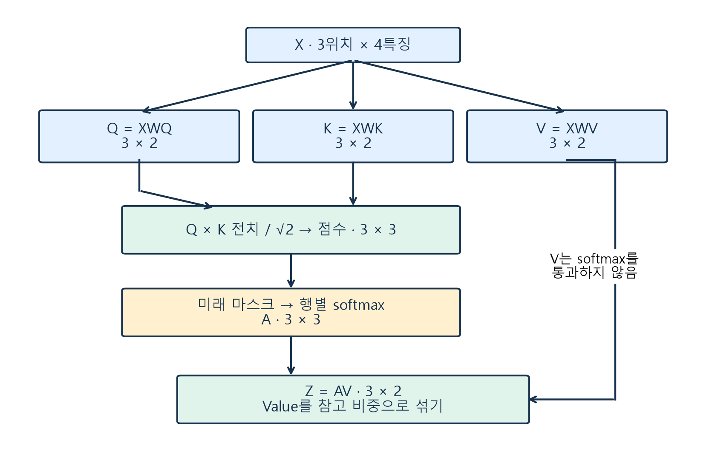
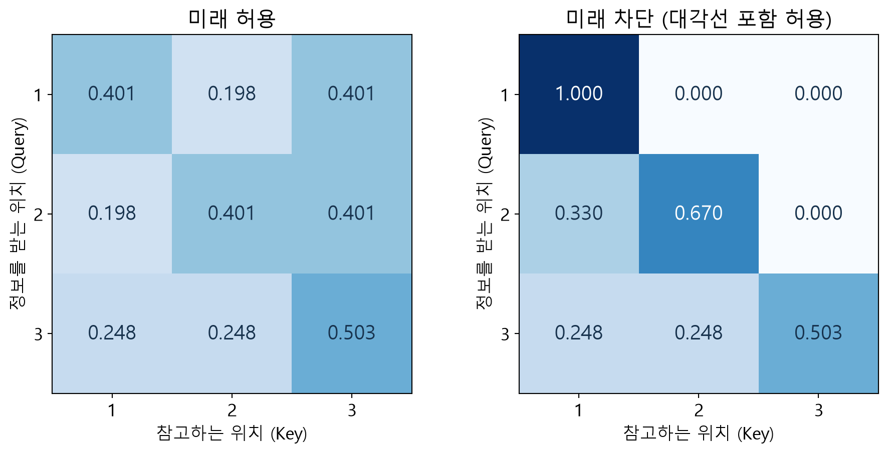
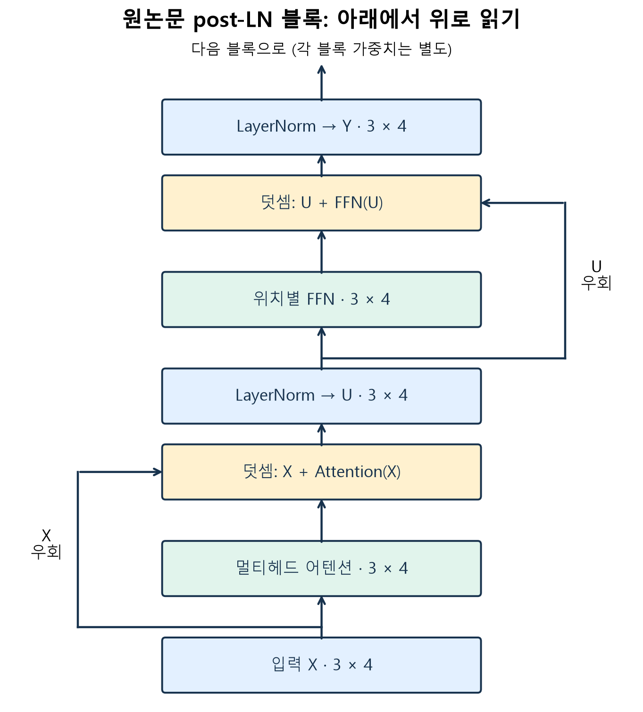
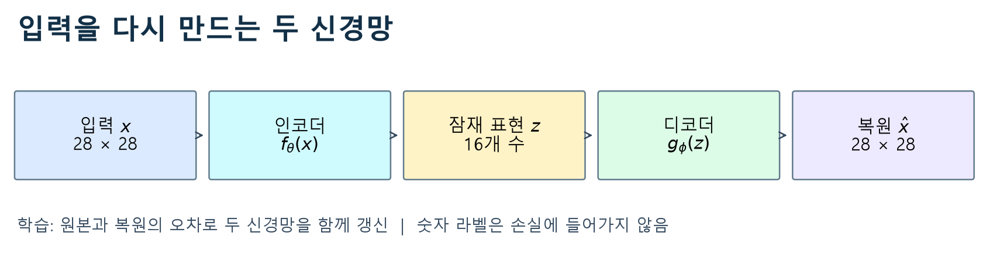

# W07b ·중간고사 대비 복습 ①

데이터 사이언스를 위한 생성형 인공지능 ·동덕여자대학교 데이터 사이언스 전공 ·유원상 교수 ·2026년 10월 14일

처음 배울 때 놓친 부분이 있어도 괜찮습니다. 이번에는 새 내용을 더하기보다, 우리가 사용한 말과 계산이 무엇을 뜻하는지 다시 연결합니다. **그림에서 대상 찾기 → 작은 계산 → 코드의 중간값 → 자신의 말로 설명** 순서로 공부하세요.

이번 범위는 1~4주차의 실제 진행 내용입니다. 생성형 AI 입문, Colab과 문자 bigram, 언어 모델의 활용, 트랜스포머, AE 개념·기본 구조까지입니다. VAE·CLIP·확산·스테이블 디퓨전의 세부는 다음 복습에서 다룹니다. 다음 복습은 공지된 **10월 20일: 5주차~7주차 1차시**입니다.

[80문항 문제지](w07b-questions.md) ·[Colab A: 토큰·확률·생성](https://colab.research.google.com/github/lunalab-ai/genAI/blob/2026-fall-w07b/notebooks/student/w07b_review_a.ipynb) ·[Colab B: 어텐션·블록·웹 앱](https://colab.research.google.com/github/lunalab-ai/genAI/blob/2026-fall-w07b/notebooks/student/w07b_review_b.ipynb) ·[함수 정의와 입력·출력](https://github.com/lunalab-ai/genAI/blob/2026-fall-w07b/src/W07B-API.md)

문제는 일반 52문항과 Python 28문항입니다. 일반 문제도 답만 쓰지 말고 조건·원리·중간 과정·의미를 짧게 남기세요. 코딩 문제는 특정 라이브러리 이름을 외우는 시험이 아닙니다. 코드 실행이 성공한 것과 자신의 풀이가 맞는 것은 다르므로 먼저 예상한 뒤 확인합니다. 새 성적 반영 과제나 제출 기한은 없습니다.

## 1. 먼저 기호와 Python을 편하게 읽기

벡터는 숫자 목록, 행렬은 숫자 표입니다. 이 수업에서 행은 주로 토큰 위치, 열은 특징입니다. 단, 어텐션 점수표의 행과 열은 모두 위치이고, 임베딩 표의 행은 어휘 항목입니다. **모양만 외우지 말고 축의 이름을 붙이세요.**

| 표기 | 읽는 뜻 | 작은 예 |
|---|---|---|
| $x_i$ | 목록의 i번째 값 | 수학의 번호와 Python의0-based 번호를 문제마다 확인 |
| $\sum_i x_i$ | 해당 원소를 모두 더함 | 2+4+6=12 |
| $q\cdot k$ | 같은 좌표끼리 곱한 뒤 더함 | [1,3]·[2,1]=2+3=5 |
| $e^z$ | 자연지수 함수 | $e^0=1$ |
| $\ln a$ | 자연로그 | $e^{\ln a}=a$ |
| $\sqrt d$ | 양의 제곱근 | $\sqrt9=3$ |
| $P(a\mid b)$ | b라는 조건 아래 a의 확률 | 모든 사건이 같은 분모를 쓰지는 않음 |

Python의 `=`는 값을 저장하고 `==`는 같은지 비교합니다. `a[0]`은 첫 원소, `a[-1]`은 마지막 원소입니다. `range(3)`은0,1,2이고 `len(a)`는 길이, `sum(a)`는 합입니다. `a.append(v)`는 끝에 v를 추가하며 `break`는 반복 전체를 끝냅니다. 리스트의 `+`는 원소별 덧셈이 아니라 **연결**입니다.

```python
u = [2, 5]
v = [1, -2]
joined = u + v                       # [2,5,1,-2]
added = [u[i] + v[i] for i in range(2)]  # [3,3]
```

위 코드는 원리 설명 예제이며 문제은행의 정답 코드가 아닙니다. 필요한 표준 함수는 [Python math 문서](https://docs.python.org/3.13/library/math.html)에서 확인할 수 있습니다. `exp(x)`는 $e^x$, `sqrt(x)`는 제곱근입니다.

## 2. 생성형 AI: 무엇이 바뀌고 무엇이 고정되는가

생성형 모델은 데이터의 패턴을 학습하여 텍스트·이미지·오디오 같은 산출물을 구성합니다. 언어 모델은 내부적으로 다음 토큰을 예측하고, 그 선택을 반복하여 문장을 생성합니다. 따라서 “생성 모델에는 예측이 없다”는 설명은 잘못입니다. 사용 목적의 분류와 내부 계산을 구별합니다.

**학습**은 손실과 데이터에 따라 모수를 갱신하는 과정이고, **추론**은 주어진 모수로 입력에 대한 결과를 계산하는 과정입니다. 프롬프트를 바꿔 출력이 달라졌어도 가중치가 고정되어 있다면 그 실험은 추론입니다. 프롬프트는 조건이지 결과가 그대로 따라야 하는 보증서는 아닙니다.



그림1. 기존 W02B 수업에서 자체 제작한 흐름도. 왼쪽의 입력, 가운데 고정 모델, 오른쪽 선택 과정을 차례로 읽으세요. 모델의 점수계산과 사용자의 선택 설정은 다른 단계입니다.

재현성은 같은 조건에서 결과를 다시 얻는 성질입니다. 사실성은 외부 사실과 맞는 성질입니다. 동일한 오류도 재현됩니다. 토큰 확률이 높다는 것은 그 다음 토큰에 대한 모델의 선호가 높다는 뜻이며, 서술 내용이 사실일 확률과 같지 않습니다.

실습에는 합성 문장과 공개 가능한 자료를 사용합니다. 개인 상담 내용처럼 실습 목적에 필요하지 않은 정보는 입력하지 않습니다. 출력은 사실·편향·출처·공유 범위를 확인한 뒤 활용합니다. 이는 모든 생성 결과를 무조건 불신하라는 말이 아니라, **어떤 근거로 사용할지 분명히 하자**는 뜻입니다.

## 3. Colab과 작은 문자 생성 모델

Colab 파일과 런타임 메모리는 다릅니다. 파일에 코드가 저장되어 있어도 새 런타임에 변수는 없습니다. 첫 설치·import·데이터 셀부터 순서대로 실행하세요. 예전 출력은 현재 변수가 존재한다는 증거가 아닙니다.

문자 bigram은 직전 문자만 보고 다음 문자를 정하는 작은 모델입니다. 예를 들어 수업용 문자열 `xyxz`의 인접쌍은 `xy,yx,xz`입니다. 끝에서 처음으로 연결하지 않습니다. x에서 출발한 두 전이를 정규화하면 y와z가 각각1/2입니다.

$$
P(b\mid a)=\frac{C(a,b)}{\sum_c C(a,c)}.
$$

분모는 a의 모든 출현 수가 아니라 **다음 문자가 관찰된 a 출발 전이의 수**입니다. 마지막 문자는 뒤가 없으므로 전이를 만들지 않습니다. bigram이 같은 마지막 문자의 서로 다른 긴 문맥을 구별하지 못한다는 한계도 함께 기억합니다.

seed는 난수 선택의 시작 상태를 기록하는 수단입니다. 모델의 지식을 바꾸지 않습니다. 모델·입력·버전·설정이 달라지면 seed만 같아도 출력이 같다고 보장하지 못합니다. 한 조건만 바꾸어 비교하고, 바꾼 조건과 고정한 조건을 따로 적습니다.

## 4. 토큰 ID에서 문맥 표현까지



그림2. W02B 자체 제작, 주교재 그림2-1~2-3의 단위 비교를 새 예문으로 설명한 자료. 실제 Qwen2 토크나이저의 고정 버전 예시와 교육용 문자·단어 분할을 구별합니다. **한 단어가 여러 토큰이 될 수 있음**을 먼저 보세요.

| 대상 | 역할 | 혼동하기 쉬운 것 |
|---|---|---|
| 토큰 | 모델이 처리하는 조각 | 자연어 단어와 항상1:1이 아님 |
| 토큰 ID | 어휘표의 식별 번호 | ID 차이를 의미 거리로 읽지 않음 |
| 초기 임베딩 | ID로 조회한 실수 벡터 | ID에 상수를 곱한 숫자가 아님 |
| 위치 표현 | 순서 단서 | 모든 모델이 같은 덧셈 구현을 쓰지는 않음 |
| 문맥 표현 | 블록을 지나 주변 정보가 반영된 벡터 | 같은 ID라도 문맥에 따라 달라질 수 있음 |

어휘4개·특징3개라면 임베딩 표 E는4×3입니다. ID열이[3,1]이면 E의4번째 행과2번째 행을 이 순서로 읽어2×3 표현을 만듭니다. 여기서 행은 두 토큰 위치입니다. 토큰 ID를 정렬하면 문장의 순서를 바꾸는 셈입니다.

원논문의 위치 결합 예는 $x_i=e_i+p_i$입니다. 같은 폭의 벡터를 원소별로 더합니다. 초기 토큰 임베딩이 같아도 위치·주변 표현이 다르면 블록 뒤 표현은 달라질 수 있습니다.

## 5. 로짓을 확률로: 분모를 직접 보기

로짓 z는 정규화 전 점수입니다. 음수일 수 있고 합1일 필요가 없습니다. softmax는 지수로 양수 가중치를 만든 뒤 같은 집합의 합으로 나눕니다.

$$
p_i=\frac{e^{z_i/T}}{\sum_j e^{z_j/T}},\qquad T>0.
$$

설명용 로짓이 $[0,\ln5]$이면 T=1에서 가중치는[1,5], 확률은[1/6,5/6]입니다. **지수화 → 가중치 합 → 각각 나누기**를 건너뛰지 마세요. 모든 로짓에 같은 상수를 더하거나 빼면 분자·분모의 공통 인자가 약분되어 같은 분포가 됩니다. 실제 계산에서 최댓값을 빼면 큰 지수의 넘침을 줄입니다.



그림3. W02B 자체 계산한 가상 로짓 분포. 주교재 그림2-6~2-7의 개념을 재구성했습니다. T가 커지면 분포가 평평해지지만 양수 T만으로 후보 순위가 뒤집히지는 않습니다. 이 그림은 정확도 비교가 아닙니다.

top-k는 높은 후보 k개를 남깁니다. top-p는 내림차순 누적 질량이 p 이상이 되는 최소 집합을 남깁니다. 경계를 처음 넘기는 후보를 포함하고 다시 정규화합니다. 예를 들어[0.55,0.25,0.20]에 p=0.7이면 앞 두 후보를 남기며 합0.8로 나눕니다.



그림4. W02B 자체 제작, 주교재 그림2-8의 후보 제한 관계를 새 수치로 설명. 그림의 top-k와top-p가 같은 집합을 남기는 것은 이 예의 결과이며 일반 법칙이 아닙니다. 두 필터를 함께 쓰면 적용 순서와 중간 재정규화를 확인합니다.

전체 어휘에서 확률이0.09,0.01인 두 레이블만 보였다고 합시다. 그 집합의 전체 질량은0.10이고 첫 레이블의 집합 내 비율은0.9입니다. 원확률0.09, 제한 비율0.9, 실제 분류 정확도는 서로 다른 값입니다.

## 6. 생성은 문맥을 갱신하는 반복



그림5. W03B 자체 제작. 새 토큰을 추가한 뒤 다음 계산으로 돌아가는 화살표를 따라가세요. 처음의 분포를 계속 재사용하는 고정 분포 추출과 다릅니다.

greedy는 현재 최고 후보 하나를 고릅니다. 샘플링은 확률에 따라 선택하므로 낮은 후보도 나올 수 있습니다. beam은 여러 부분 경로를 유지하지만 유한한 폭으로 전역 최적이 보장되지는 않습니다. 같은 길이의 경로를 비교할 때 결합확률은 단계별 조건부 확률의 곱입니다.



그림6. W02B 자체 제작, 주교재 그림2-4~2-5 개념의 새 수치 예. 첫 가지0.6×0.4=0.24, 다른 가지0.4×0.9=0.36입니다. 가지의 첫 숫자만 보고 문장 전체 점수를 정하지 않습니다. 생략된 경로가 있으므로 그림 전체가 완전한 탐색 공간이라고 보지 않습니다.

다음 토큰 학습은 전체열에서 입력과target을 한 칸 어긋나게 만듭니다. 예를 들어[시작,별,빛,끝]에서 입력은[시작,별,빛], target은[별,빛,끝]입니다. 추론에서는 미래 정답을 모르므로 한 토큰씩 생성합니다.

zero-shot은 시범 예시 없이 작업을 제시하고, few-shot은 소수의 완성 예시를 문맥에 넣습니다. 가중치를 고정한 실습에서 few-shot은 프롬프트 변화이지 미세조정이 아닙니다. 예시 선택용 자료와 최종 평가자료를 구별하여 결과를 평가합니다.

## 7. 어텐션은 다른 위치에서 정보를 가져오는 계산



그림7. W03B 자체 제작. 세 갈래는 단어 품사가 아니라 같은 입력의 다른 투영입니다. 점수 경로와 Value 경로가 마지막에 만나는 것을 보세요.

$$
Q=XW_Q,\quad K=XW_K,\quad V=XW_V,
$$
$$
S=\frac{QK^\top}{\sqrt{d_k}},\quad
A=\operatorname{softmax}_{\mathrm{row}}(S+M),\quad O=AV.
$$

Query는 지금 위치가 찾는 단서, Key는 각 위치가 비교에 내놓는 단서, Value는 실제로 가져올 정보라는 비유입니다. $S_{ij}$의 i는 받는 위치, j는 참고하는 위치입니다. d_k는 Q/K의 특징 폭입니다.

**한 행의 설명 예제**: 두 scaled 점수가 모두0이면 지수는[1,1], 확률은[1/2,1/2]입니다. Value가[2,0],[4,6]이면 출력은[3,3]입니다. 확률의 합은1이지만 특징 출력의 좌표 합은1일 필요가 없습니다.



그림8. W03B 수계산 도식. Query 행을 하나 고른 뒤 허용 Key 열만 읽으세요. 현재 위치까지 허용하고 미래 위치를 차단합니다. 금지 점수는 개념적으로 $-\infty$여서 지수가0이 됩니다. 점수0으로 치환하면 지수1이 되어 금지되지 않습니다.

어텐션 softmax의 대상은 **Key 위치**입니다. 마지막 언어 모델 softmax의 대상은 **어휘 후보**입니다. 공식이 비슷해도 축과 사건이 다릅니다. 높은 어텐션 한 값만으로 모델 전체가 인간처럼 이해했다거나 정답이라고 결론내릴 수 없습니다.

## 8. 블록은 섞고, 더하고, 특징을 바꾼다



그림9. W03B 자체 제작, 원논문 post-LN 순서. 어텐션은 위치 간 정보 교환, 잔차는 원입력과 변환 결과의 원소별 덧셈, FFN은 위치별 특징 변환입니다. 모든 현대 모델의 세부 정규화 순서가 이 그림과 같다고 외우지 않습니다.

$$
U=\operatorname{LN}(X+\operatorname{MHA}(X)),\qquad
Y=\operatorname{LN}(U+\operatorname{FFN}(U)).
$$

멀티헤드는 서로 다른 학습된 투영으로 여러 참고 관계를 계산합니다. head 출력을 특징축으로 이어붙인 뒤 출력 투영을 합니다. 예를 들어 head3개가 각각2개 특징을 내면 concat폭은6입니다. 이는 세 층을 순서대로 통과하는 것과 다릅니다.

LayerNorm은 **한 위치의 특징** 평균·분산으로 스케일을 조정합니다.

$$
\mu=\frac1d\sum_j r_j,\quad v=\frac1d\sum_j(r_j-\mu)^2,\quad
\operatorname{LN}(r)_j=\gamma_j\frac{r_j-\mu}{\sqrt{v+\epsilon}}+\beta_j.
$$

작은 양수epsilon은0으로 나누는 상황을 피하는 데 쓰입니다. 음수 특징이 가능하고 합1일 필요가 없습니다. 학습된gamma/beta를 적용하면 최종 평균과 분산이 항상0과1인 것도 아닙니다. 기본 FFN은 한 행 안의 특징을 바꾸며 다른 토큰행을 직접 가중합하는 어텐션과 다릅니다.

## 9. 원논문 구조를 필요한 만큼 읽기


그림10. Vaswani et al., *Attention Is All You Need*, Figure1 원본. [원논문](https://arxiv.org/html/1706.03762v7). 원논문에 명시된 출처 표시 조건부 학술적 그림 재사용 허용에 따라 사용했습니다. 교재 그림2-10의 원출처이며 번역 편집 원본을 복제한 것은 아닙니다.

아래에서 위로 읽습니다. 왼쪽은 입력encoder, 오른쪽은 출력decoder입니다. 오른쪽 중간의cross-attention은 왼쪽encoder 출력을 참고합니다. decoder-only모델에는 이 별도encoder가 필수로 존재하지 않습니다. 우회 화살표는 잔차, 맨 위softmax는 다음 어휘 분포입니다. 어텐션 내부softmax와 구별하세요.

## 10. AE는 입력 자체를 다시 만드는 목표



그림11. W04A 자체 제작, 주교재 그림3-1·3-2의 개념을 참고한 도식. 입력과 복원의 비교 화살표를 먼저 보세요. 이번 범위는 이 기본 역할까지입니다.

$$
z=f_{\theta}(x),\qquad \hat{x}=g_{\phi}(z),\qquad \text{target}=x.
$$

인코더는 입력을 잠재 표현으로, 디코더는 잠재표현을 복원 출력으로 바꿉니다. 낮은 차원은 유용한 표현을 유도하는 제약일 수 있지만, 완벽 복원이나 의미 학습을 자동 보장하지는 않습니다. decoder라는 이름도 항상 정확한 역함수를 뜻하지 않습니다.

앞의 언어 모델은 다음 토큰을, 기본AE는 원입력을 target으로 삼았습니다. 두 경우 모두 원 데이터에서 학습 신호를 만들 수 있지만 목표가 같다는 뜻은 아닙니다. 이번 복습에서는 AE 합성곱·손실 미분·VAE생성 계산을 추가하지 않습니다.

## 11. 연습과 웹 앱으로 연결하기

| 약한 개념 | 먼저 볼 요약 | 연습문항 |
|---|---|---|
| 학습·추론·책임 구별 | 2 | Q01–08 |
| 런타임·전이 횟수 | 3 | Q09–16 |
| ID·행 조회·차원 | 4 | Q17–28 |
| 분모·후보 필터 | 5 | Q29–44 |
| 문맥 갱신·학습 target | 6 | Q45–56 |
| 내적·마스크·가중합 | 7 | Q57–68 |
| 잔차·정규화·계열 | 8–9 | Q69–76 |
| 입력과복원 구별 | 10 | Q77–80 |

Colab A와B는 독립적으로 실행됩니다. CPU, Python3.12/3.13 대상이며 필수 실습에 API키·GPU·대형모델 다운로드·개인파일 업로드가 필요 없습니다. 작은 표와 말뭉치는 자동 준비됩니다. 설치 후 이전 패키지가 메모리에 남아 있다면 런타임을 재시작하고 첫 셀부터 실행하세요.

B의 마지막 앱은 확률·후보 필터, 어텐션 한 행, 한 문자 생성의 세 패널입니다. 앞서 계산한 함수를 버튼에 연결하고 자신의 요약함수를 수정합니다. 공유URL은 현재 런타임 동안 유지되므로 다음실습은 고정Colab링크에서 다시 시작하세요. 함수 이름 옆의 GitHub 링크는 설치태그와 같은 실제 정의 행을 가리킵니다.

80문항을 한꺼번에 완벽히 풀 필요는 없습니다. 먼저 혼자 시도한 흔적을 남기고, 막힌 지점에 “분모/축/순서/목표” 중 무엇이 불확실했는지 적어 보세요. 중간고사는 이 자료의 문제를 조금씩 변형하여 출제할 예정이므로 숫자보다 풀이 원리를 이해하는 것이 중요합니다.

참고: 기존 W01/W02A/W02B/W03A/W03B/W04A 강의, 주교재 『핸즈온 생성형 AI』1–2장 및3.1 도입. [토큰화 공식 설명](https://huggingface.co/docs/transformers/main/en/tokenizer_summary), [생성 방식 공식 설명](https://huggingface.co/docs/transformers/main/en/generation_strategies), [Python 기본 자료구조](https://docs.python.org/3.13/tutorial/datastructures.html), [AE 공개 교재](https://www.deeplearningbook.org/contents/autoencoders.html). 새 숫자 예제와 문제는 수업용으로 직접 작성했습니다.
