# W08a · 중간고사 대비 복습 ②

데이터 사이언스를 위한 생성형 인공지능 · 동덕여자대학교 데이터 사이언스 전공 · 유원상 교수 · **2026년 10월 19일(월), 8주차 1차시**

이번 범위는 **5주차~7주차 1차시의 실제 수업**입니다. 이미지 표현, AE·VAE, CLIP 검색, 확산의 원리와 설계, 조건·잠재 확산, Stable Diffusion의 구성과 샘플링, 공개 모델과 웹 앱을 연결합니다. 앞서 안내한 다음 복습 날짜는 **10월 19일로 정정**되었습니다.

그림에서 대상을 찾고, 작은 수를 계산하고, 코드의 중간값을 확인한 뒤 자신의 말로 설명하세요. 처음 배울 때 놓친 부분이 있어도, **입력·학습 정답·출력·바뀌는 대상**을 나누면 다시 연결할 수 있습니다.

[60문항 문제지](w08a-questions.md) · [Colab A: 표현·검색](https://colab.research.google.com/github/lunalab-ai/genAI/blob/2026-fall-w08a/notebooks/student/w08a_review_a.ipynb) · [Colab B: 확산·조건 생성·앱](https://colab.research.google.com/github/lunalab-ai/genAI/blob/2026-fall-w08a/notebooks/student/w08a_review_b.ipynb) · [함수의 입력·출력과 정의 바로가기](https://github.com/lunalab-ai/genAI/blob/2026-fall-w08a/src/W08A-API.md)

[핵심 요약 PDF](https://github.com/lunalab-ai/genAI/raw/2026-fall-w08a/course/handouts/w08a-review.pdf) · [60문항 문제지 PDF](https://github.com/lunalab-ai/genAI/raw/2026-fall-w08a/course/handouts/w08a-questions.pdf)

60문항은 일반 39문항과 Python 21문항입니다. 문제은행은 수업과 자율 복습에 함께 사용합니다. 답만 적기보다 **조건 → 적용 원리 → 중간 과정 → 결과의 의미**를 남기세요. 새로운 성적 반영 과제나 제출 기한은 없습니다. 중간고사는 복습 자료의 문제를 조금씩 변형하여 출제할 예정이므로 입력 숫자보다 풀이 원리를 이해하는 것이 중요합니다.

## 1. 먼저 축과 기호에 이름 붙이기

벡터는 숫자 목록, 행렬은 숫자 표입니다. shape은 각 축의 길이입니다. 같은 shape이라도 값의 의미는 다를 수 있습니다. 이미지의 축은 보통 `(B,C,H,W)`이며, CLIP의 표현 표는 `(항목 수, 특징 수)`입니다. SD의 텍스트 조건은 `(B,토큰 위치,특징)`을 사용합니다.

| 기호 | 읽는 뜻 | 먼저 확인할 것 |
|---|---|---|
| $B,C,H,W$ | 배치 개수·채널·높이·너비 | 픽셀과 latent의 C가 같은가? |
| $x,\hat x$ | 원본과 복원 | 무엇과 무엇을 비교하는가? |
| $\mu,\ell,\sigma$ | 평균·로그분산·표준편차 | $\ell=\ln\sigma^2$인지 확인 |
| $\epsilon$ | 표준정규 잡음 | 실제로 뽑은 정답 잡음과 예측을 구별 |
| $\hat\epsilon$ | 모델이 예측한 잡음 | 정답과 항상 같지는 않음 |
| $\alpha_t,\bar\alpha_t$ | 한 단계 계수와 누적 곱 | 위의 막대가 뜻을 바꿈 |
| $\odot$ | 같은 위치끼리의 곱 | 행렬곱·리스트 연결과 다름 |
| $\sum_i,\frac{1}{n}\sum_i$ | 합과 평균 | 분모가 픽셀 수인지 배치 수인지 확인 |

이번 수치 예제의 로그는 자연로그입니다. `math.exp(v)`는 $e^v$, `math.sqrt(v)`는 제곱근입니다. `range(n)`은 0부터 n−1까지, `a[i]`는 0부터 세는 i번째 원소입니다. `zip(a,b)`는 같은 위치의 원소를 짝지으며, 두 목록의 길이가 다르면 짧은 쪽에서 끝나므로 먼저 길이를 확인합니다.

```python
from math import exp, sqrt
values = [0.2, 0.4, 0.8, 1.0]
mean_value = sum(values) / len(values)
print(mean_value, sqrt(9), exp(0))
```

이 노트의 숫자는 원리를 설명하는 예제이며 문제지의 풀이를 대신하지 않습니다. 코드 실행 성공과 모든 연습문제의 정답 완성도 구별하세요.

## 2. 모델 이름보다 학습 목표를 먼저 읽기

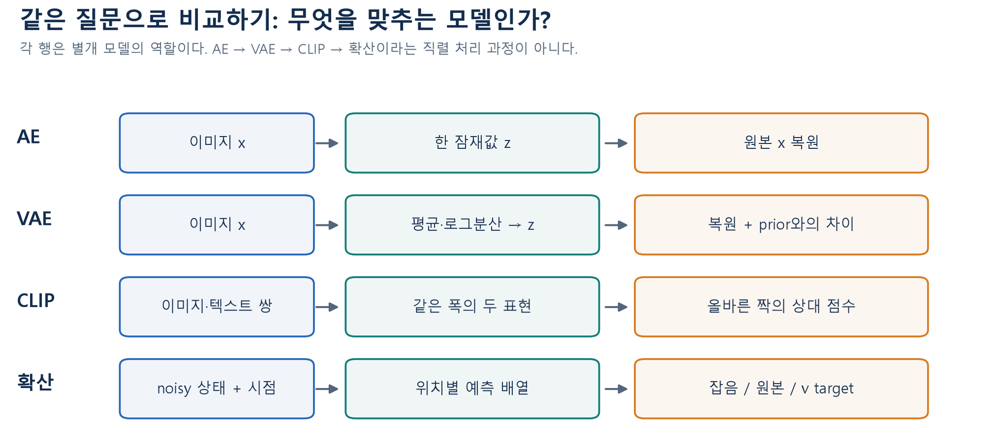

그림 1. 기존 W05A–W07A의 역할을 재구성한 자체 도식입니다. **행을 하나씩** 읽으세요. 네 모델이 차례로 연결된 하나의 처리 파이프라인을 그린 것이 아닙니다.

| 모델 | 목적·입력 | 학습 정답과 손실 | 학습과 추론에서 바뀌는 것 |
|---|---|---|---|
| AE | 이미지에서 유용한 표현을 얻고 복원 | target은 입력 이미지 자체, 복원 오차 | 학습은 인코더·디코더 모수, 추론은 입력·표현·복원값 |
| VAE | 입력별 잠재 분포와 디코더 학습 | 복원항과 prior에 대한 KL | 학습은 인코더·디코더 모수, 추론은 주어진 모수의 계산과 잠재 샘플 |
| CLIP | 이미지와 텍스트의 대응 표현 학습 | 짝인 항목의 상대 점수를 높이는 대조학습 | 사전학습은 두 인코더 모수, 수업 검색은 고정 인코더의 표현·점수 |
| 확산 | noisy 상태에서 정해진 target 예측 | epsilon·원본·v 중 선언한 target과의 오차 | 학습은 예측 모델 모수, 생성은 고정 모수 아래 현재 상태 |
| SD1.5 예시 | 텍스트 조건으로 latent를 반복 갱신 | 이 수업의 사전학습 U-Net은 epsilon 예측 | 수업 추론에서는 텍스트 조건·latent가 바뀌고 가중치는 고정 |

모든 모델의 모든 구성요소를 한꺼번에 학습한다는 뜻은 아닙니다. 예를 들어 수업의 SD 생성은 이미 학습된 VAE·텍스트 인코더·U-Net을 가져와 사용합니다. 프롬프트나 CFG를 바꾸었다고 재학습한 것은 아닙니다.

## 3. AE와 VAE: 복원·분포·샘플을 구별하기

기본 AE는 $z=f_\theta(x)$를 만들고 $\hat x=g_\phi(z)$로 복원합니다. 이때 target은 $x$입니다. 낮은 차원의 잠재값을 쓴다고 완벽한 복원이나 사람이 원하는 의미 축이 자동으로 생기지는 않습니다. 학습 이미지에서 얻은 잠재값을 디코딩하는 복원과 임의의 잠재값에서 시작하는 생성도 다릅니다.

설명용 네 픽셀을 $x=(0.2,0.4,0.8,1.0)$, 복원을 $\hat x=(0.3,0.5,0.6,0.9)$라고 합시다. 차이는 $(-0.1,-0.1,0.2,0.1)$이고, 각 제곱은 $(0.01,0.01,0.04,0.01)$입니다.

$$
\mathrm{SSE}=\sum_{p=1}^{4}(x_p-\hat x_p)^2=0.07,
\qquad \mathrm{MSE}=\frac{0.07}{4}=0.0175.
$$

같은 오차라도 합과 평균은 다른 숫자입니다. 이미지 여러 장에서는 이미지 안의 픽셀 합과 배치 평균도 따로 확인해야 합니다.

VAE 인코더는 입력마다 평균 $\mu$와 로그분산 $\ell=\ln\sigma^2$를 예측합니다. `exp(logvar)`는 분산이고 **`exp(0.5*logvar)`는 표준편차**입니다. 로그분산은 음수여도 되지만 지수로 변환한 분산은 양수입니다.

$$
q_\theta(z\mid x)=\mathcal N\!\left(\mu,\operatorname{diag}(e^\ell)\right),\qquad
\sigma=e^{\ell/2},\qquad z=\mu+\sigma\odot\epsilon.
$$

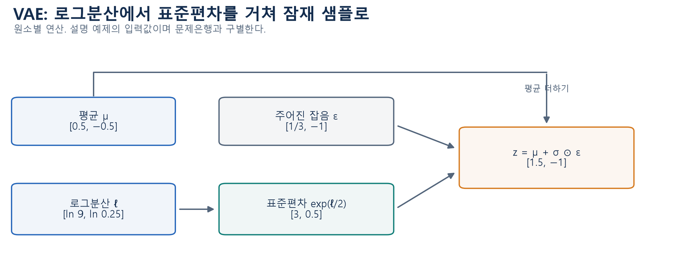

그림 2. 자체 수계산입니다. 분산 $(9,0.25)$의 제곱근은 $(3,0.5)$입니다. 잡음 $(1/3,-1)$을 곱하면 $(1,-0.5)$이고, 평균 $(0.5,-0.5)$을 더하면 $z=(1.5,-1)$입니다. **로그분산을 그대로 잡음에 곱하지 않습니다.**

재매개변수화는 무작위성을 없애는 방법이 아닙니다. 외부 잡음 $\epsilon$을 따로 두고 평균·표준편차의 미분 가능한 연산으로 샘플을 만들어, 그 값을 예측한 네트워크까지 학습 신호를 전달합니다. 입력별 근사 분포 $q(z\mid x)$, 생성 때 쓰는 prior $p(z)$, 잠재값에서 이미지를 설명하는 $p(x\mid z)$를 나누어 읽으세요.

## 4. VAE 손실: reduction과 상대 가중치

기존 수업은 이미지 안의 복원 오차를 **합**하고 잠재 좌표의 KL도 **합**한 뒤, 이미지들에 대해 **평균**했습니다.

$$
L=\frac1B\sum_{b=1}^{B}\left[\sum_{p=1}^{P}(x_{bp}-\hat x_{bp})^2
+\beta\,\frac12\sum_{j=1}^{d}\big(\mu_{bj}^2+e^{\ell_{bj}}-1-\ell_{bj}\big)\right].
$$

KL은 입력별 근사 분포가 표준정규 prior에서 멀어지는 것을 비용으로 부과합니다. $\mu=0$이고 모든 분산이 1이면 KL은 0입니다. 그렇다고 디코더의 복원 오차까지 0인 것은 아닙니다. $\beta$를 키우면 같은 KL을 더 비싸게 평가하지만, 모든 실행에서 복원 품질이 단조롭게 바뀐다는 보장은 없습니다.

복원항을 SSE에서 MSE로 바꾸면 픽셀 수만큼 작아집니다. KL을 그대로 두면 같은 $\beta$라도 두 항의 상대적인 영향이 달라집니다. 서로 다른 reduction의 손실 숫자를 그대로 비교하지 마세요. 이번 복습은 손실의 역할과 작은 계산을 확인하며 ELBO 전체 증명을 새 필수 범위로 추가하지 않습니다.

## 5. CLIP: 정규화·점수·검색 평가

CLIP은 이미지와 텍스트를 각각 인코딩하여 같은 폭의 표현을 만듭니다. 이미지 자체를 복원하거나 픽셀을 생성하는 모델로 설명하지 않습니다. 사전학습은 짝인 이미지·텍스트의 상대 점수를 높이는 방향으로 두 인코더를 학습합니다. 검색에서는 보통 고정 인코더로 후보 표현을 계산합니다.

$$
\tilde i_r=\frac{i_r}{\lVert i_r\rVert_2},\qquad
\tilde t_c=\frac{t_c}{\lVert t_c\rVert_2},\qquad
S_{rc}=\tilde i_r^\top\tilde t_c.
$$

분모는 **해당 행 벡터 하나의 길이**입니다. 행렬 전체의 길이로 모든 항목을 한꺼번에 나누는 것과 다릅니다. 영벡터는 길이가 0이므로 별도 처리가 필요하며, 이번 작은 연습은 영벡터를 입력으로 주지 않는 조건을 명시합니다.

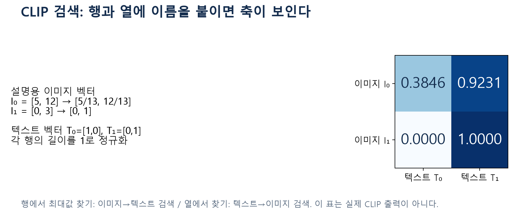

그림 3. 학습용 가상 벡터를 직접 계산한 표입니다. $[5,12]$의 길이는 $13$이므로 $[5/13,12/13]$입니다. 첫 이미지와 두 텍스트의 점수는 각각 약 0.3846, 0.9231입니다. 행을 읽으면 이미지에 맞는 텍스트, 열을 읽으면 텍스트에 맞는 이미지를 찾습니다. **실제 CLIP 모델의 측정 결과가 아닙니다.**

후보 점수를 softmax로 바꾸면 지정한 후보 안의 상대 비율을 얻습니다. 후보를 추가하거나 교체하면 분모가 바뀝니다. 이 수치를 그대로 “설명이 객관적으로 참일 확률”이나 실제 정확도라고 읽지 않습니다.

$$
p_c=\frac{e^{s_c/T}}{\sum_{j\in\mathcal C}e^{s_j/T}},\quad T>0,
\qquad \mathrm{Precision@}k=\frac{\text{상위 }k\text{개 중 관련 항목 수}}{k}.
$$

예를 들어 상위 5개 중 4개가 사전에 정한 기준으로 관련 있다면 Precision@5는 $4/5$입니다. 점수 정렬과 관련성 판정은 별개의 단계입니다. 동률 처리, 후보 집합, k, 관련성 기준을 고정해야 비교가 가능합니다. 대조학습의 배치 내 상대 점수와 최종 검색 평가도 같은 수치가 아닙니다.

## 6. 확산: 전방·학습·생성 세 과정을 나누기

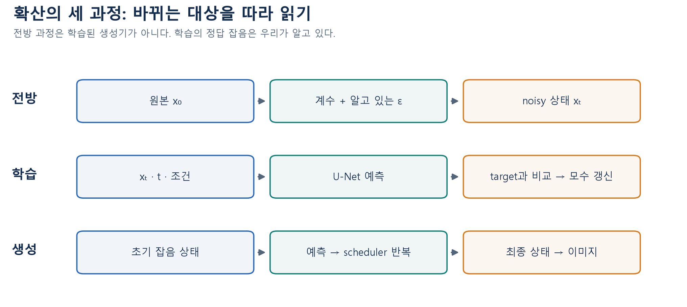

그림 4. W06A를 재구성한 자체 도식입니다. 전방 과정에서 만든 잡음을 학습에서는 정답으로 알고 있습니다. 생성에서는 최종 원본을 모르므로 모델의 예측으로 현재 상태를 반복 갱신합니다.

$$
\alpha_t=1-\beta_t,\qquad \bar\alpha_t=\prod_{s=1}^{t}\alpha_s,
\qquad x_t=\sqrt{\bar\alpha_t}\,x_0+\sqrt{1-\bar\alpha_t}\,\epsilon.
$$

이 노트의 수학 단계는 1부터 셉니다. Python 배열 인덱스는 0부터 셀 수 있으므로 문제의 정의를 확인하세요. $\beta_t$는 한 단계에서 추가하는 잡음의 분산과 연결되며, 원본에 곱하는 계수는 $\bar\alpha_t$ 자체가 아니라 **그 제곱근**입니다. $a_t=\sqrt{\bar\alpha_t}$, $b_t=\sqrt{1-\bar\alpha_t}$로 줄여 쓸 수 있습니다.

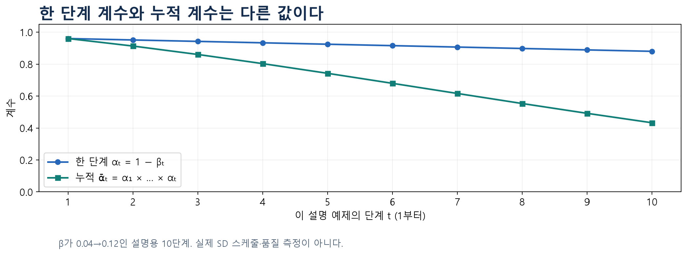

그림 5. $\beta$가 0.04에서 0.12로 변하는 설명용 10단계 계산입니다. 실제 SD 스케줄이나 모델 품질 실험이 아닙니다. 누적 계수는 이전 단계까지의 영향을 함께 담습니다. 여러 작은 감소를 곱한 결과를 현재 단계의 계수 하나와 혼동하지 마세요.

학습에서는 원본과 시점을 고르고 잡음을 뽑아 $x_t$를 만듭니다. 모델은 noisy 상태와 시점·조건을 받아 target을 예측하고 손실로 모수를 갱신합니다. 생성에서는 가중치를 고정하고 noisy 상태를 새 값으로 바꿉니다. **학습의 반복 횟수, 생성의 추론 단계 수, diffusion의 시점 값 t는 서로 다른 개념**입니다.

## 7. U-Net·스케줄·입력 척도를 함께 읽기

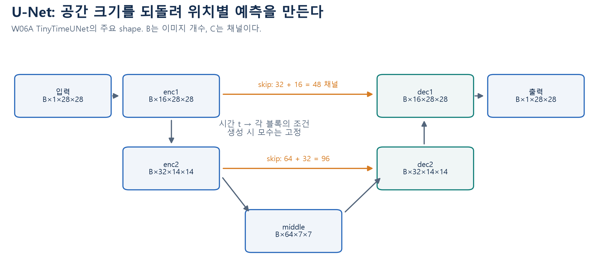

그림 6. 기존 TinyTimeUNet의 주요 shape입니다. 아래로 내려가며 넓은 문맥을 요약하고, 위로 올라가며 공간 크기를 되돌립니다. skip은 앞쪽 특징을 전달합니다. 이 수업 구현의 concat은 채널 수를 더하므로 dec2 입력은 $64+32=96$, dec1 입력은 $32+16=48$채널입니다. 교재의 다른 구현처럼 특징을 더하는 skip에서는 대응 shape이 같아야 합니다. 그림에 닮았다는 이유만으로 같은 연산이라고 보지 않습니다.

시간 임베딩은 모델에 noisy 상태가 어느 시점인지 알려 주는 별도 조건입니다. 텍스트 조건과도 다릅니다. U-Net 출력 shape이 입력과 같아도, 출력이 이미 완성 이미지라는 뜻은 아닙니다. 모델이 무엇을 예측하도록 학습되었는지 함께 봐야 합니다.

입력에 상수 c를 곱하면 신호의 분산은 $c^2$배가 됩니다. 같은 잡음 계수를 사용해도 원본의 척도가 달라지면 신호·잡음 비율이 달라집니다. 학습과 추론의 정규화 규칙을 맞추세요. 해상도도 공간의 중복성과 계산량을 바꾸므로 같은 단계 수만으로 공정한 비교가 되지는 않습니다.

스케줄·구조·학습량을 동시에 바꿔 결과가 좋아졌다면 어느 하나의 효과라고 단정할 수 없습니다. validation 자료로 설정을 선택한 뒤, 최종 평가는 선택에 쓰지 않은 자료로 확인합니다. 작은 학습 loss, 한 장의 예쁜 결과, 한 번의 seed만으로 일반적인 우수성을 확정하지 않습니다.

## 8. epsilon·원본·v: shape이 같아도 target은 다르다

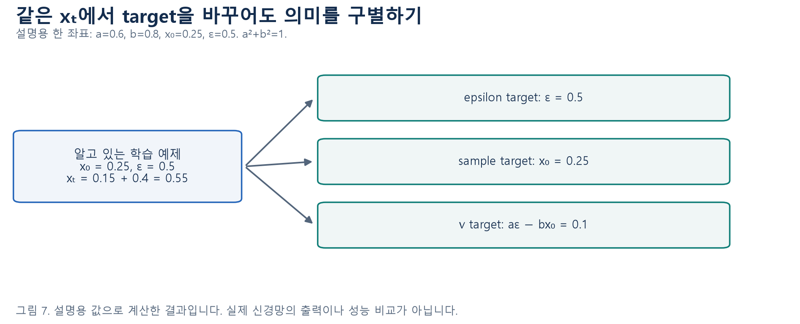

| 학습 target | 정의 | 예측에서 원본을 추정하는 식 |
|---|---|---|
| epsilon | $\epsilon$ | $\hat x_0=(x_t-b\hat\epsilon)/a$ |
| sample | $x_0$ | $\hat x_0=$ 모델 출력 |
| v | $v=a\epsilon-bx_0$ | $\hat x_0=ax_t-b\hat v$ |

기존 수업은 **빼기 부호의 v 정의**를 사용합니다. 제공 교재 일부의 표기와 다르므로 원자료를 임의로 바꾸지 않고 이 수업의 관례를 명시합니다. $a^2+b^2=1$일 때 변환과 역변환은 다음처럼 확인할 수 있습니다.

$$
\begin{pmatrix}x_t\\v\end{pmatrix}
=\begin{pmatrix}a&b\\-b&a\end{pmatrix}
\begin{pmatrix}x_0\\\epsilon\end{pmatrix},\qquad
\begin{pmatrix}x_0\\\epsilon\end{pmatrix}
=\begin{pmatrix}a&-b\\b&a\end{pmatrix}
\begin{pmatrix}x_t\\v\end{pmatrix}.
$$

설명 예제에서 $(0.55-0.8\times0.5)/0.6=0.25$이고 $0.6\times0.55-0.8\times0.1=0.25$입니다. 두 식의 검산이 맞아도 실제 모델이 target을 정확히 예측한다는 증거는 아닙니다. **역변환 오차 0은 대수적 일치, 모델 품질은 별도 평가**입니다.

epsilon 예측 오차가 $\delta$이면 원본 추정 오차는 $-(b/a)\delta$입니다. v 예측 오차라면 $-b\delta$입니다. 목표의 척도와 오차 전달 방식이 다르므로 epsilon loss와 v loss의 숫자만 비교해 우열을 정하지 않습니다. 이미 학습된 가중치를 불러오고 설정 이름만 바꾸는 것도 target에 맞춰 다시 학습한 것과 다릅니다.

## 9. 조건·latent·텍스트: SD의 두 입력 경로

클래스 번호나 텍스트는 모델에 원하는 방향을 알려 주는 **조건**입니다. epsilon을 예측하는 학습에서 클래스 번호가 갑자기 손실의 정답으로 바뀌지는 않습니다. 조건을 바꾸는 추론과 클래스 분류 학습을 구별하세요.

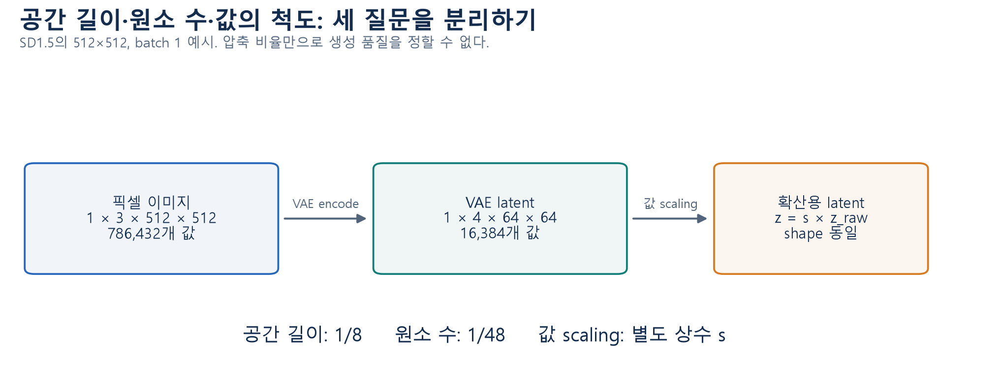

그림 8. SD1.5의 대표 shape를 설명한 자체 도식입니다. 공간 길이는 1/8, 원소 수는 $3\times512\times512/(4\times64\times64)=48$분의 1입니다. 값에 scaling 상수 s를 곱하는 것은 원소 수를 바꾸지 않습니다. 복원 때도 정해진 역변환을 맞춰야 합니다.

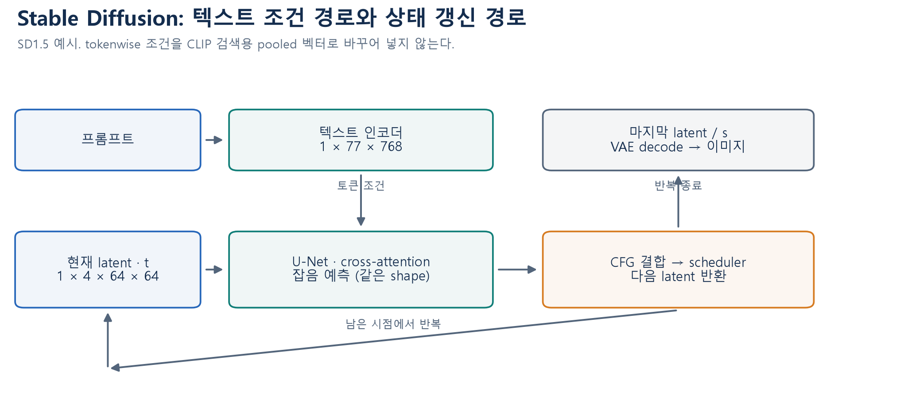

그림 9. SD1.5의 텍스트 경로와 latent 경로입니다. 검색용 CLIP에서는 이미지·텍스트마다 하나의 pooled 표현을 비교했지만, 여기서는 텍스트의 **토큰별 조건**을 U-Net에 전달합니다. 기존 예시는 최대 77개 토큰 위치와 768차원 특징을 사용합니다. 다른 모델 계열의 차원까지 동일하다고 일반화하지 않습니다.

cross-attention은 이미지 쪽 위치의 특징이 텍스트 토큰 조건을 참고하도록 연결합니다. 그 결과도 latent의 공간 구조와 맞춰 다음 계산에 전달되어야 합니다. 토큰 수와 이미지 채널 수는 서로 다른 축입니다. 기본 단계는 다음과 같습니다.

1. 프롬프트를 토큰화하고 텍스트 조건을 준비합니다.
2. 현재 latent와 시점을 U-Net에 넣어 잡음 예측을 얻습니다.
3. 필요한 두 조건의 예측을 CFG 식으로 결합합니다.
4. scheduler가 현재 상태와 예측을 이용해 다음 상태를 반환합니다.
5. 모든 추론 단계를 마친 뒤 정해진 scaling을 되돌리고 VAE로 디코딩합니다.

이 과정은 VAE에 매번 이미지를 다시 인코딩하여 새로운 원본을 만드는 과정이 아닙니다. 텍스트 조건·U-Net 예측·scheduler의 상태·VAE의 이미지 출력을 따로 표시해 보세요.

## 10. CFG와 DDIM: 예측을 결합하고 상태를 갱신하기

두 조건의 예측 순서를 먼저 확인합니다. 기존 수업의 배치는 negative 조건이 먼저, positive 조건이 나중입니다. negative prompt를 사용했다면 첫 항을 엄밀하게 “아무 조건도 없음”이라고 부르기보다 negative 조건의 예측이라고 읽습니다.

$$
\hat\epsilon_g=\hat\epsilon_{\mathrm{neg}}+
w(\hat\epsilon_{\mathrm{pos}}-\hat\epsilon_{\mathrm{neg}}).
$$

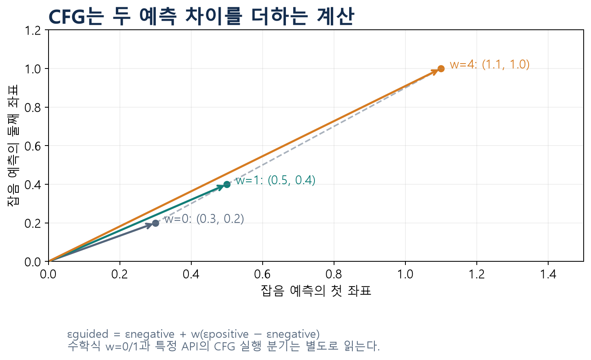

그림 10. 자체 수치 도식입니다. 첫 좌표가 negative 0.3, positive 0.5이고 w=4이면 $0.3+4(0.5-0.3)=1.1$입니다. 예측값이 커졌다는 사실만으로 더 좋은 이미지라고 결론내리지 않습니다.

수학식에 w=0을 넣으면 negative 예측, w=1이면 positive 예측이 됩니다. 그러나 **기존 Diffusers 0.40.0 SD 파이프라인은 `guidance_scale>1`에서 두 조건 CFG 경로를 켜는 분기**를 사용합니다. 따라서 해당 API에 0을 넣는 것이 위 수학식의 negative-only 계산과 같다고 주장하면 안 됩니다. 수학식의 값과 프로그램의 실행 분기를 함께 확인하세요.

DDIM 한 단계의 간단한 설명에서는 추가 난수를 넣지 않는 $\eta=0$, clipping 등 추가 변환 없음, epsilon 예측이라고 가정합니다. 현재 누적계수를 $\bar\alpha_t$, 다음으로 이동할 덜 noisy한 시점의 계수를 $\bar\alpha_s$라고 하면 다음과 같습니다.

$$
\hat x_0=\frac{x_t-\sqrt{1-\bar\alpha_t}\,\hat\epsilon}{\sqrt{\bar\alpha_t}},\qquad
x_s=\sqrt{\bar\alpha_s}\,\hat x_0+\sqrt{1-\bar\alpha_s}\,\hat\epsilon.
$$

첫 식의 원본 추정과 둘째 식의 다음 상태는 같은 대상이 아닙니다. 실제 `scheduler.step`의 `pred_original_sample`과 `prev_sample`도 구별합니다. `prev_sample`을 다음 반복의 현재 상태로 연결합니다. 추론 단계가 띄엄띄엄 배치되면 다음 시점은 언제나 t−1인 것도 아닙니다. 위 간단한 식을 모든 scheduler 설정에 그대로 적용하지 마세요.

## 11. 실행 기록을 읽을 때 관찰과 주장을 분리하기

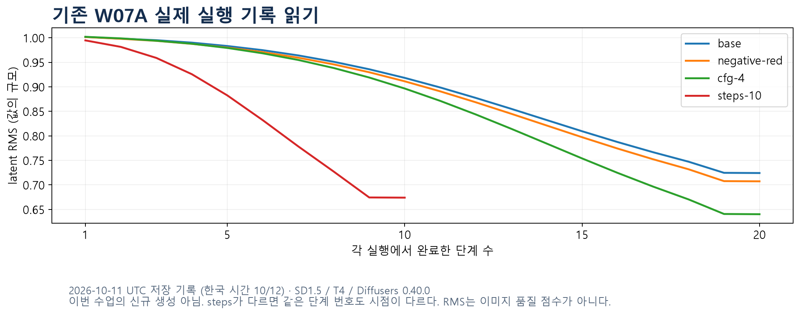

그림 11. **2026년 10월 11일 UTC(한국 시간 10월 12일) W07A 준비 때 저장한 실제 SD1.5/T4 실행 기록**을 다시 그렸습니다. 이번 복습에서 새 모델 추론을 수행한 그림이 아닙니다. 세 실행은 20단계, `steps-10`은 10단계입니다. 같은 단계 번호라도 입력 시점 t가 다를 수 있으므로 trace의 시점 값을 함께 확인합니다. latent RMS는 값의 규모이며 품질 점수가 아닙니다. 중간 미리보기의 차단 상태와 최종 이미지 상태도 구별해야 합니다.

seed는 난수 상태를 초기화하는 수단입니다. 같은 Generator 객체를 계속 사용하면 상태가 진행됩니다. 두 실행을 같은 시작점에서 비교하려면 같은 초기 latent를 재사용하거나, 동일한 설정과 시드로 생성기를 각각 새로 만들고 실제 시작 상태를 확인해야 합니다. 모델 revision, 라이브러리, 장치와 연산도 달라지면 seed 숫자만 같다고 동일 결과를 보장하지 못합니다.

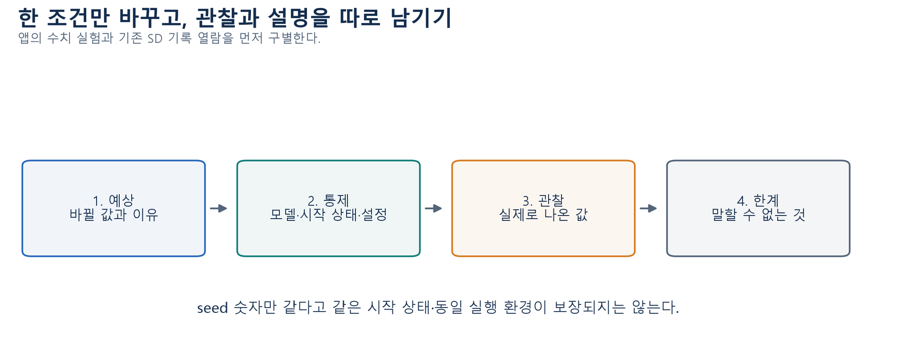

그림 12. W07A의 실험 읽기 원칙을 재구성했습니다. “이미지가 달라졌다”는 관찰과 “CFG 때문에 좋아졌다”는 원인·품질 판단은 서로 다른 주장입니다. 바꾼 조건, 고정한 조건, 비교 기준을 먼저 적으세요.

공개 모델을 볼 때에는 **코드, 학습된 가중치, 데이터 메타데이터·URL, 원본 이미지**가 각각 제공되는지 구별합니다. 한 항목이 공개되었다고 나머지가 모두 제공되는 것은 아닙니다. 모델 카드는 모델 버전·의도한 용도·제약·평가 조건·이용 조건을 확인할 근거입니다. 이름에 open이 들어간다는 사실만으로 모든 용도를 허용한다고 판정하지 않습니다. 이번 복습에서는 새로운 라이선스의 법적 해석을 요구하지 않고, 기존 수업에서 배운 제공 대상과 근거 읽기를 확인합니다.

## 12. Colab A/B와 마지막 웹 앱

두 노트북은 각각 새 사본에서 첫 셀부터 실행합니다. **CPU 기본, API 키·개인 파일 업로드·대형 모델 신규 다운로드가 필요 없는 경로**입니다. 작은 배열과 가상 임베딩은 자동 준비되고, 기존 SD 기록은 수업 패키지에 포함된 파일을 검증해 읽습니다. 실제 SD 새 생성은 기존 [W07A 선택 실습](https://colab.research.google.com/github/lunalab-ai/genAI/blob/2026-fall-w07a/notebooks/student/w07a_sampling_app.ipynb)에서 별도로 진행할 수 있습니다.

| 실습 | 계산과 관찰 | 문제 연결 |
|---|---|---|
| A · 표현·검색 | 작은 픽셀 오차, VAE 표준편차·샘플, 정규화·유사도·순위 | Q01–Q20의 Python 문항 |
| B · 확산·조건 생성 | 노이즈·target·CFG·한 단계 갱신, 기존 SD 기록 해석, 앱 연결 | Q21–Q60의 Python 문항 |

마지막 앱에는 네 탭이 있습니다. **복원·VAE 계산 / 검색 유사도·순위 / 노이즈·예측 목표 / CFG·샘플링 기록**입니다. 각 탭에서 먼저 출력이 무엇을 뜻하는지 읽고, 한 조건을 바꾸어 관찰하세요. 수치 시연을 새로운 이미지 생성 결과로 부르지 않습니다.

Q60에서는 준비된 앱의 기록을 받아 짧은 설명을 만드는 callback 하나를 연결합니다. 입력은 실행 모드·바꾼 조건·관찰·한계가 담긴 기록이고 출력은 문자열입니다. 모델을 다시 학습하는 함수가 아닙니다. 자신의 함수가 아직 미완성이면 준비된 기본 안내로 앱을 사용할 수 있으며, 이것이 Q60을 풀었다는 뜻은 아닙니다.

설치 버전은 `0.1.13`, 공개 ref는 `2026-fall-w08a`로 고정합니다. 이미 이전 버전을 import한 런타임에서는 설치 후 런타임을 다시 시작하고 첫 셀부터 실행하세요. 함수 이름의 바로가기는 설치 ref와 같은 실제 정의 줄을 가리킵니다. 마지막 실행 검사 문구와 앱 출력을 확인하세요. 공유 URL은 현재 Colab 런타임 동안 유지되므로 다음 실습 때는 고정 Colab 링크에서 다시 시작합니다.

## 13. 막힌 지점에 맞춰 다시 읽기

| 막힌 지점 | 이 노트 | 문제지 |
|---|---|---|
| 입력·정답·손실을 혼동 | 2–4절 | Q01–Q10 |
| 정규화 축·후보·관련성 구별 | 5절 | Q11–Q20 |
| 단계 계수·target·학습/생성 구별 | 6–8절 | Q21–Q34 |
| 조건·shape·값 scaling 구별 | 9절 | Q35–Q44 |
| CFG·다음 상태·시작점 통제 | 10–11절 | Q45–Q54 |
| 제공 대상·관찰 근거·callback | 11–12절 | Q55–Q60 |

빈칸을 바로 못 채워도 현재 알고 있는 변수의 값과 shape부터 적으세요. 계산이 끝나면 “이 값은 무엇을 뜻하며 무엇을 뜻하지 않는가”를 한 문장으로 정리합니다. 다른 숫자가 주어져도 같은 과정을 설명할 수 있으면 복습의 목적에 가까워집니다.

참고: 기존 W05A·W05B·W06A·W06B·W07A 수업과 주교재 『핸즈온 생성형 AI』 3장 표현·검색, 4장 확산, 5장 조건 생성·샘플링·공개 모델·앱 범위. 표와 새 숫자 예제·도식은 수업용으로 직접 작성했습니다. 그림 11의 실행 날짜와 조건은 과거 기록을 따릅니다.

[CLIP 원논문 공식 소개](https://proceedings.mlr.press/v139/radford21a.html) · [Latent Diffusion 원논문](https://arxiv.org/html/2112.10752v2) · [Diffusers의 pipeline·model·scheduler 설명](https://huggingface.co/docs/diffusers/using-diffusers/write_own_pipeline)
