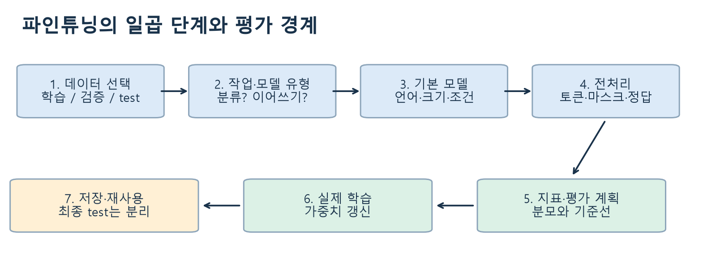
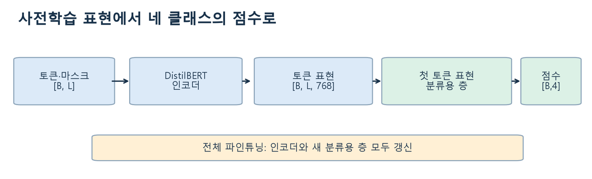
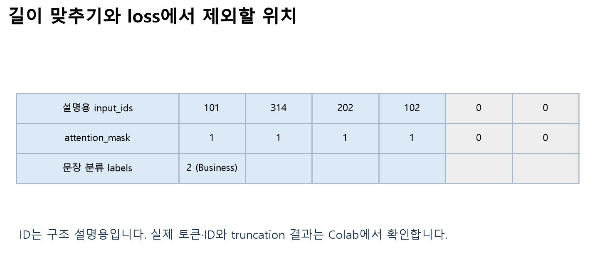
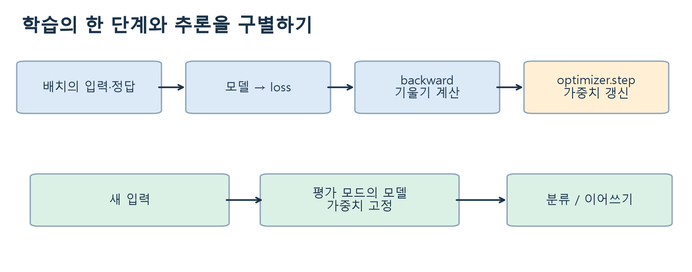
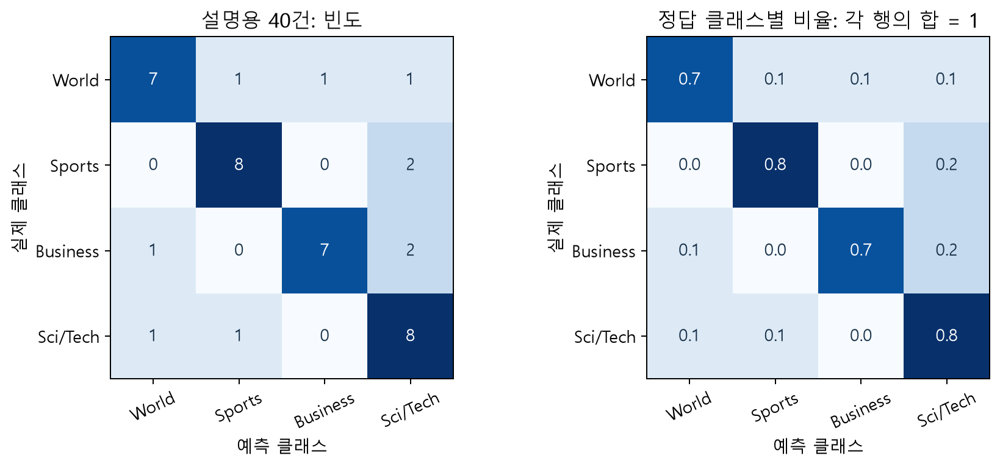

# W09B · 6.1 · 뉴스 분류 모델은 무엇을 학습하는가

주교재 6.1.1–6.1.7 · 238–257쪽 · Colab A와 함께 읽는 노트

## 1. 프롬프트로 분류하기에서 학습하는 분류기로

이전 W02B 실습은 문맥 뒤의 `positive`와 `negative` 후보 토큰 확률을 비교했습니다. 예시나 지시를 프롬프트에 추가해도 그 과정에는 `backward()`나 가중치 갱신이 없었습니다.

이번에는 뉴스와 주제 라벨을 짝지어 모델을 학습합니다. 사전학습 인코더는 언어의 표현을 제공하고, 새 분류용 층은 그 표현을 네 클래스 점수로 바꿉니다. 전체 파인튜닝에서는 **인코더와 분류용 층 모두** 손실의 기울기를 받아 갱신됩니다.

파인튜닝은 이미 배운 언어 표현을 이용하면서 새로운 목적에 맞게 모수를 조정하는 과정입니다. 기본 모델을 불러오는 것만으로 AG News 분류 학습이 끝나는 것은 아닙니다.

**A1 · 필수 · 먼저 예상하기:** 분류 결과가 달라졌을 때, 입력을 바꾼 효과인지 가중치를 학습한 효과인지 구별하려면 무엇을 고정하고 어떤 값을 확인해야 할까요? Colab A의 A1에 자신의 예상과 이유를 남기세요.

## 2. 데이터부터 선택하기 — 6.1.1

교재는 AG News를 사용합니다. 공식 학습 데이터는120,000개, test는7,600개이며 다음 네 주제의 영어 뉴스로 구성됩니다.

| 라벨 ID | 원래 클래스 이름 | 한국어로 읽기 |
|---:|---|---|
| 0 | World | 세계 뉴스 |
| 1 | Sports | 스포츠 |
| 2 | Business | 비즈니스·경제 |
| 3 | Sci/Tech | 과학·기술 |

한 행의 핵심은 `text: str`, `label: int`입니다. 클래스 이름의 나열 순서가 곧 출력 열의 의미입니다. `2`를 두 번째 클래스라고 읽으면 잘못된 대응이 됩니다. Python의 ID는0부터 시작합니다.

수업 로더 `load_news()`는 고정된 데이터 revision을 내려받고 캐시를 재사용합니다. 기본 작은 실험은 클래스마다 학습64개·검증32개·최종 test32개를 선택합니다. 검증은 공식 train에서 분리하며, 대소문자·공백을 정규화한 중복 문서가 서로 다른 분할에 들어가지 않게 합니다. 이 검사는 의미가 비슷한 기사나 바꿔 쓴 문장까지 모두 찾아내는 것은 아닙니다.

학습 데이터는 가중치 계산에, validation은 설정·학습 상태 점검에 사용합니다. test를 반복해서 보며 설정을 고르면 최종 평가의 독립성이 약해집니다. 테스트 문서를 학습에 넣는 것뿐 아니라, 같은 기사의 복사본이 검증에 섞이는 것도 주의해야 합니다.



그림 읽기: 지표는 학습이 끝난 뒤 갑자기 정하지 않습니다. **무엇을 잘해야 하는지와 평가 분할을 먼저 정하고** 학습합니다. 출처: 주교재239쪽 그림6-1의 일곱 단계 개념을 수업 흐름에 맞게 재구성.

## 3. 모델 유형과 기본 모델 — 6.1.2–6.1.3

| 유형 | 기본적인 정보 흐름 | 적합한 작업의 예 |
|---|---|---|
| 인코더 | 입력 문맥의 표현을 계산 | 문장 분류·개체명 인식 |
| 디코더 기반 causal LM | 앞선 토큰으로 다음 토큰을 예측 | 문장 이어쓰기 |
| 인코더–디코더 | 입력을 인코딩하고 별도 출력 시퀀스를 생성 | 번역·요약 |

작업과 구조는 일대일의 절대 규칙이 아닙니다. 생성 모델도 지시로 분류할 수 있습니다. 이번에는 **고정된 네 주제 분류**를 위해 인코더와 분류 헤드를 선택하여 학습 과정과 평가를 명확히 살펴봅니다.

기본 모델은 교재와 같은 `distilbert/distilbert-base-uncased`입니다. 실제 로드한 분류 모델은 약6,696만 파라미터, 인코더6층, 표현 차원768입니다. 영어 소문자 처리를 전제로 하므로 영어 기사에 맞습니다. 이 선택을 한국어 뉴스의 성능 보장으로 확장하면 안 됩니다.

모델 선택에는 언어·입력 길이·모델 크기·메모리·학습 시간·평가 결과·이용 조건이 함께 필요합니다. 이번 작은 CPU 실험에서 좋은 모델이 다른 과제에서도 최선이라고 결론 내리지는 않습니다.

## 4. 토큰·마스크·분류 헤드 — 6.1.4



그림 읽기: 인코더가 만드는 토큰별 표현과, 최종 문장 분류 점수는 다릅니다. 출처: 주교재248쪽 그림6-2의 인코더·분류 헤드 관계를 실제 DistilBERT 차원에 맞춰 새로 도식화. DistilBERT의 분류용 층은 첫 토큰 표현에 추가 변환·활성화·dropout·선형 층을 적용합니다.

배치 크기를 $B$, 배치 안에서 맞춘 토큰 길이를 $L$, 표현 차원을 $H$라 하면 다음처럼 읽을 수 있습니다.

| 값 | 크기 | 의미 |
|---|---|---|
| `input_ids` | $[B,L]$ | 어휘 사전의 정수 토큰 ID |
| `attention_mask` | $[B,L]$ | 실제 토큰1, padding0 |
| 마지막 은닉 표현 | $[B,L,H]$, 여기서는 $H=768$ | 각 입력 토큰의 문맥 표현 |
| 분류 `logits` | $[B,4]$ | 네 클래스의 정규화 전 점수 |
| 분류 `labels` | $[B]$ | 문장마다 하나의 정답 클래스 |

토큰 ID는 단어의 점수나 클래스 번호가 아닙니다. ID 숫자가 크다고 의미가 강해지는 것도 아닙니다. `logits`는 확률이 아니며, 클래스 축에 softmax를 적용해야 확률처럼 합이1인 값으로 바뀝니다.



**padding**은 서로 다른 길이를 배치의 최대 길이에 맞추는 작업입니다. **truncation**은 길이 제한을 넘는 내용을 자르는 작업입니다. 마스크는 원래 잘린 뒷부분을 복구하지 않습니다. 수업에서는 계산량을 줄이기 위해 최대64토큰을 사용하므로 기사 뒷부분의 유용한 정보가 사라질 수 있습니다. 길이512를 지원하는 모델이라고 항상512로 학습해야 하는 것은 아닙니다.

**A3 · 필수 · 관찰하기:** 길이가 다른 두 입력의 `input_ids`, `attention_mask`, `labels`를 확인하고 padding과 truncation이 각각 어떤 위치에 영향을 주는지 설명하세요. 힌트는0의 위치와 실제 토큰 수입니다. 자기 점검: 문장당 정답 개수와 토큰당 입력 개수를 구별했나요?

## 5. 손실에서 가중치 갱신까지 — 6.1.6

분류의 목표는 정답 클래스에 높은 확률을 주는 것입니다. 문장 $i$의 정답 ID를 $y_i$, 모델의 클래스 확률을 $p_\theta(k\mid x_i)$라 하면 평균 cross-entropy는 다음과 같습니다.

$$
\mathcal{L}_{\mathrm{cls}}=-\frac{1}{B}\sum_{i=1}^{B}\log p_\theta(y_i\mid x_i).
$$

설명용 예에서 정답 확률이0.8이면 그 문장의 손실은 $-\log(0.8)\approx0.223$입니다. 정답 확률이0.2이면 손실은 약1.609로 커집니다. 이 수계산은 실제 AG News 평가 수치가 아닙니다.

**A2 · 확장 · 작은 계산:** Colab의 다른 확률 예에서 정답 라벨을 바꾸고 손실을 계산하세요. 목표는 같은 출력 점수라도 정답에 따라 손실이 달라짐을 확인하는 것입니다.



학습의 기본 흐름은 다음과 같습니다.

```python
optimizer.zero_grad(set_to_none=True)
output = model(**batch)
loss = output.loss
loss.backward()
optimizer.step()
```

`model(**batch)`는 사전의 이름을 함수 인자로 풀어 전달하는 Python 문법입니다. `labels`를 함께 주면 이 작업에 맞는 손실도 계산합니다. `backward()`는 기울기를 계산하고, `optimizer.step()`이 그 기울기로 가중치를 갱신합니다. 이 두 작업은 같은 의미가 아닙니다. 다음 배치 전에 기울기를 초기화하는 이유는 PyTorch가 기본적으로 기울기를 누적하기 때문입니다.

`model.train()`과 `model.eval()`은 dropout 등의 동작 모드를 바꿉니다. `eval()`만 호출해 기울기 기록까지 꺼지는 것은 아니므로 추론에는 `torch.inference_mode()`도 사용합니다. `eval()`이 모델을 이전 가중치로 되돌리는 것도 아닙니다.

교재의 `Trainer`는 이러한 학습·평가 루프를 감싸는 도구입니다. 이번 최소 실험은 공통 `FineTuningLab.fit()`의 짧은 루프를 읽어 중간 과정을 추적합니다. 실제 설정은 AdamW·고정 학습률·weight decay0.01·기울기 norm clipping1.0입니다. 이 최소 루프에는 학습률 스케줄러가 없으며, 교재의 cosine 스케줄과 구분합니다.

**A4 · 필수 · 디버깅:** `backward()`만 호출한 코드와 `optimizer.step()`만 호출한 코드를 점검하세요. 실제 학습 후에는 분류용 층과 인코더의 지정된 파라미터 일부가 변했는지 확인합니다. 힌트: 기울기 계산과 모수 갱신을 분리해 설명하세요.

처음 모델을 불러올 때 분류용 층의 가중치가 새로 초기화되었다는 메시지는 예상되는 상황입니다. 기존 사전학습 목적의 출력 층과 이번 분류 헤드가 다르기 때문입니다. 이를 학습을 마친 분류기라는 증거로 읽으면 안 됩니다.

## 6. 무엇으로 평가할까 — 6.1.5

정확도는 전체 예측 중 맞힌 비율입니다. 특정 클래스의 precision은 그 클래스로 **예측한 것** 중 정답 비율, recall은 실제 그 클래스인 것 중 **찾아낸 비율**입니다.

$$
\mathrm{Precision}_k=\frac{TP_k}{TP_k+FP_k},\qquad
\mathrm{Recall}_k=\frac{TP_k}{TP_k+FN_k},\qquad
F1_k=\frac{2TP_k}{2TP_k+FP_k+FN_k}.
$$

분모가0인 클래스의 지표는 이번 구현에서0으로 정합니다. macro F1은 클래스별 F1을 같은 비중으로 평균내고, 교재 코드의 weighted F1은 실제 클래스별 표본 수를 가중치로 사용합니다. 클래스가 불균형하면 정확도와 weighted F1이 높아도 소수 클래스의 recall이 낮을 수 있습니다.



행은 실제 클래스, 열은 예측 클래스입니다. 오른쪽은 각 행의 표본 수로 나눈 값이므로 같은 실제 클래스가 어디로 분류됐는지 읽습니다. 그림은 직접 만든 설명용40건이며 실제 학습 성능표가 아닙니다.

**A5 · 확장 · 비교하기:** 다수 클래스만 예측한 작은 예의 정확도·macro F1·weighted F1을 계산하고 소수 클래스에서 놓친 것을 설명하세요. 자기 점검: precision과 recall의 분모를 구별했나요?

## 7. 전체 학습과 표현 추출, 그리고 실용성 — 6.1.6–6.1.7

인코더를 고정하고 분류용 층만 학습하면 학습 대상이 줄어듭니다. 인코더를 고정한 표현에 별도 로지스틱 회귀 같은 분류기를 붙이는 방식도 가능합니다. 이들은 전체 파인튜닝과 갱신되는 파라미터가 다릅니다. 어떤 방식이 더 나은지는 데이터 양·계산 자원·목표와 실제 평가에 따라 확인합니다.

**A6 · 확장 · 가설 세우기:** 인코더를 고정하면 학습 가능한 파라미터 수, 시간, 표현 변화가 어떻게 달라질지 먼저 예상하세요. 수를 확인한 결과와 성능 효과를 검증한 결과를 구별합니다.

작은 분류기는 빠른 대량 처리, 일관된 라벨 공간, 제한된 자원에서 유용할 수 있습니다. 교재는 문서 품질 필터링 등에도 이러한 모델을 연결합니다. 다만 뉴스 분류 정확도는 다른 도메인의 품질 판정이나 편향 없는 판단을 보장하지 않습니다. 지표와 함께 실제 오류 문장, 사용 목적, 데이터 범위, 처리 시간을 확인해야 합니다.

## 실습 API와 출처

`load_news()`의 분할 목록을 `FineTuningLab.batch/fit/evaluate`에 전달하고, 웹앱은 같은 객체의 `predict()`를 호출합니다. `fit`은 현재 모델을 계속 갱신하므로 설정 비교에는 같은 seed의 새 객체를 준비합니다. [실제 정의와 입력·출력 설명](https://github.com/lunalab-ai/genAI/blob/2026-fall-w09b/src/W09B-API.md)을 먼저 읽으세요.

- 주교재: 『핸즈온 생성형 AI』 6.1,238–257쪽. 수업용 수계산·작은 표본·도식·학습 루프·macro F1 비교는 추가 설명입니다.
- [Hugging Face 분류 안내](https://huggingface.co/docs/transformers/tasks/sequence_classification)
- [AG News 데이터 카드](https://huggingface.co/datasets/fancyzhx/ag_news)
- [DistilBERT 모델 카드](https://huggingface.co/distilbert/distilbert-base-uncased)
