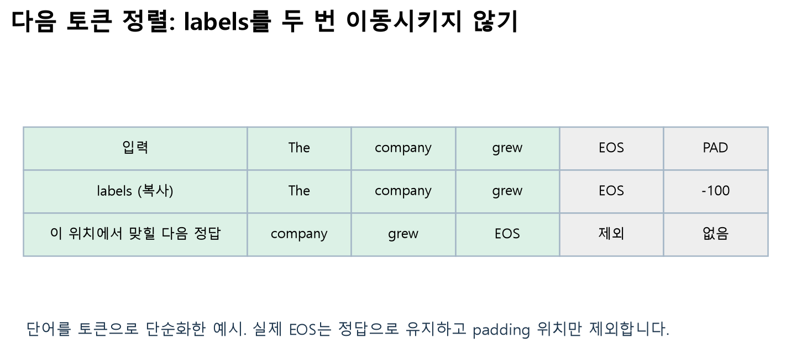

# W09B · 6.2 · 클래스 라벨 없이 무엇을 정답으로 학습할까

주교재 6.2.1–6.2.2 · 257–268쪽 · Colab B와 함께 읽는 노트

## 1. 같은 뉴스가 다른 학습 문제가 된다

뉴스 분류에서는 기사 하나에 `Business` 같은 정답 클래스가 있었습니다. 뉴스 이어쓰기에서는 앞선 토큰을 보고 **바로 다음 토큰**을 맞힙니다. 원래 문장 자체가 다음 토큰의 정답을 제공하므로 사람이 모든 위치의 정답을 따로 붙일 필요는 없습니다.

따라서 데이터의 주제 `label` 열을 제거하는 것과 학습용 정답이 사라지는 것은 다릅니다. 생성 모델을 학습할 때 쓰는 `labels`는 토큰화한 문장에서 구성하는 별도의 텐서입니다.

**B1 · 확장 · 먼저 예상하기:** Business 기사만 고른 뒤 원래 클래스 열을 제거하면, 모델이 맞히는 정답은 어디서 올까요? 다른 뉴스 주제를 선택했을 때 바뀌는 입력 분포와 그대로인 학습목표를 구별하세요.

## 2. 생성 모델 선택의 기준 — 6.2.1

이번 모델은 교재와 같은 `HuggingFaceTB/SmolLM-135M`입니다. 실제 로드한 모델은 약1억3,452만 파라미터, 은닉 차원576, 어휘 크기49,152인 causal LM입니다. 사전학습 base 모델이며 대화 지시 이행을 보장하는 챗봇으로 소개하지 않습니다.

| 선택 기준 | 확인할 내용 | 이번 실습에 주는 의미 |
|---|---|---|
| 모델 크기 | 파라미터 수·가중치 dtype·학습 상태 메모리 | 작은 모델로 실제 갱신을 관찰 |
| 학습 데이터와 언어 | 데이터 출처·언어·정제·편향 | 영어 뉴스 실험이며 한국어 품질을 보장하지 않음 |
| 컨텍스트 길이 | 모델 한도와 실제 학습 길이 | 모델 한도2048, CPU 필수 실험은32토큰 |
| 라이선스·사용 조건 | 모델 카드·코드·데이터 조건을 각각 확인 | 접근 가능성과 원자료 재배포를 구별 |
| 평가 결과 | 무엇을 어떤 조건에서 평가했는지 | 순위 하나로 뉴스 생성 품질을 확정하지 않음 |

가중치의 메모리는 대략 **파라미터 수 × 원소당 바이트 수**로 계산할 수 있습니다. 그러나 학습에는 기울기·optimizer 상태·중간 활성값도 필요합니다. 모델 파일541 MB를 받았다는 사실이 학습 메모리도541 MB라는 뜻은 아닙니다. 실제 장치와 실행 시간을 기록해야 합니다.

교재의 모델·벤치마크 표는 책이 쓰인 시점의 비교 자료입니다. 이번 선택은 작은 모델의 학습 원리를 관찰하기 위한 것이며 최신 최고 성능 순위를 뜻하지 않습니다.

## 3. Business 기사와 입력·정답 구성 — 6.2.2

Colab B는 고정된 AG News에서 Business 문서를 선택합니다. 공식 train 안에서 학습·validation을 분리하고 official test는 최종 점검에만 사용합니다. 문서마다 `id`와 `text`를 남기고 원래 주제 라벨은 학습 입력에서 제거합니다.

토큰화 뒤 배치에는 다음 값이 있습니다.

| 값 | 크기 | 의미 |
|---|---|---|
| `input_ids` | $[B,L]$ | 본문의 토큰 ID |
| `attention_mask` | $[B,L]$ | 실제 토큰1·padding0 |
| 생성 학습 `labels` | $[B,L]$ | 입력에서 복사한 정답 토큰; padding은`-100` |
| 생성 `logits` | $[B,L,V]$ | 위치마다 전체 어휘에 대한 점수, $V=49{,}152$ |

분류의 출력 크기 $[B,4]$와 비교해 보세요. 생성 모델은 문장 하나에 주제 네 개의 점수만 내놓지 않습니다. **각 토큰 위치마다 다음 토큰 후보 전체의 점수**를 계산합니다.

그림은 단어를 토큰으로 단순화한 설명입니다. 실제 토큰 경계와 ID는 `target_table(batch, tokenizer)`의 출력으로 확인합니다. 수업용 신규 도식이며 실제 모델의 토큰 배열이라고 표시하지 않습니다.

## 4. 다음 토큰 정렬과 두 가지 마스크

causal LM은 현재 위치에서 미래의 정답 토큰을 미리 볼 수 없도록 **causal attention**을 사용합니다. 여기에 입력 길이를 맞추기 위한 **padding mask**가 추가됩니다. 학습 손실에서 무시할 위치를 지정하는 `labels=-100`은 다시 별도의 역할입니다.

수업 수집기는 `labels=input_ids.clone()`으로 정답을 복사한 뒤 `attention_mask==0`인 위치만`-100`으로 바꿉니다. 이 단계에서는 정답 배열을 옆으로 이동시키지 않습니다. 모델의 손실 계산에서 **앞 위치의 logits와 바로 다음 위치의 labels**를 한 번 맞춥니다. 수집기에서도 이동시키고 모델에서도 이동시키면 한 칸을 더 건너뛰는 잘못된 문제가 됩니다.

SmolLM의 기본 토크나이저에는 padding 토큰이 없어 이번 실습은 EOS를 PAD로도 사용합니다. 하지만 같은 ID라고 같은 역할인 것은 아닙니다. 문장 끝의 **실제 EOS**는 학습 정답으로 남기고, 길이를 맞추려고 붙인 **padding 위치**만 손실에서 제외합니다. `input_ids == pad_token_id`인 모든 곳을 무조건 지우면 실제 EOS 정답도 지워질 수 있습니다.

**B2 · 필수 · 디버깅:** Colab에서 길이가 다른 두 문장의 마스크를 확인하고, EOS와 PAD의 ID가 같은 상황에서 손실 제외 조건을 고치세요. 힌트: 토큰의 숫자만 보지 말고 그 위치가 실제 입력인지 확인합니다. 자기 점검: 마지막 실제 EOS와 뒤의 padding을 구별했나요?

## 5. 생성 학습의 손실과 평가 분모

토큰 시퀀스를 $x_1,\ldots,x_L$라 하면 다음 토큰 예측의 손실은 다음과 같이 표현할 수 있습니다. $\mathcal{T}$는 padding 등 무시할 위치를 제외한 유효한 다음 토큰 위치의 집합입니다.

$$
\mathcal{L}_{\mathrm{LM}}=-\frac{1}{|\mathcal{T}|}\sum_{t\in\mathcal{T}}\log p_\theta(x_t\mid x_{<t}).
$$

문장 분류는 문장마다 하나의 정답을, 생성 학습은 여러 토큰 위치의 정답을 사용합니다. `labels`의 크기와 손실의 분모가 달라지는 이유입니다. 두 작업 모두 cross-entropy를 사용할 수 있지만 같은 숫자의 손실을 같은 성능으로 비교하지는 않습니다.

길이가 다른 배치의 NLL을 모을 때는 각 배치의 유효 정답 토큰 수를 가중치로 사용합니다.

$$
\mathrm{NLL}_{\mathrm{all}}=\frac{\sum_b n_b\,\mathrm{NLL}_b}{\sum_b n_b},\qquad
\mathrm{PPL}=\exp(\mathrm{NLL}_{\mathrm{all}}).
$$

PPL은 사용한 토크나이저·분할·입력 길이·손실 계산 조건과 함께 읽습니다. 다른 어휘 사전을 쓰는 모델의 PPL을 그대로 나란히 놓고 순위를 정하면 안 됩니다. 낮은 NLL이 사실성이나 지시 이행을 직접 보장하는 것도 아닙니다.

**B3 · 확장 · 작은 계산:** 유효 토큰 수가 다른 두 배치의 평균 손실을 합쳐 보세요. 단순히 두 평균을 다시 평균내는 것과 어떤 차이가 생기나요? Colab의 `target_tokens`와 손실 분모를 함께 확인합니다.

## 6. 짧은 실제 학습을 관찰하기

생성 실습도 `forward → loss → backward → optimizer.step`으로 가중치를 갱신합니다. 모델 전체를 처음부터 학습하는 과정이 아니라 사전학습 SmolLM을 작은 뉴스 표본으로 더 학습하는 과정입니다.

실습에서 먼저 학습 전 validation NLL과 생성 문장을 기록합니다. 이어서 `fit()`을 실행하고 **같은 validation 문서·같은 프롬프트·같은 생성 설정**으로 비교합니다. 프롬프트도 바꾸고 학습도 하면 두 변화가 섞입니다.

학습률은 한 번의 갱신 크기에 영향을 주고, weight decay는 모수에 대한 규제를 더합니다. learning-rate scheduler는 단계에 따라 학습률을 바꾸는 도구입니다. 이번 최소 루프는 고정 학습률을 사용하며, 모델의 입력 문맥 길이·배치 크기·학습 횟수도 실행 기록에 남깁니다.

짧은 학습에서는 학습 손실이 매 단계 단조롭게 줄지 않을 수 있습니다. 매번 다른 문장과 dropout을 사용하기 때문입니다. 손실 그래프 한 점만으로 실패나 성공을 단정하지 말고, 같은 조건의 평가와 실제 파라미터 갱신을 함께 보세요.

모델이 Business 문체에 더 잘 맞춰져도 모든 뉴스 사실을 정확히 기억하거나 지시를 잘 따르게 되는 것은 아닙니다. 생성물은 실제 뉴스 보도로 사용하지 않습니다. 수업의 영어 시작 문장 `The company announced`는 “그 회사는 발표했다”라는 의미이며, 모델이 어떤 이어쓰기를 선호하는지 관찰하기 위한 예입니다.

## 7. 학습과 생성 설정의 효과를 분리하기

`temperature=0`은 이번 API에서 greedy 생성입니다. temperature가 양수이면 `top_p=0.9`를 사용해 샘플링합니다. 샘플링의 seed는 비교 조건을 재현하기 위한 기록값입니다. 입력·모델·정밀도·실행 환경도 함께 고정해야 하며 서로 다른 장치의 결과가 항상 바이트 단위로 같다고 보장하지 않습니다.

**B4 · 확장 · 통제 비교:** 학습 전후를 비교할 때와 temperature만 바꿔 비교할 때, 각각 무엇을 고정해야 할까요? 결과를 본 뒤 예상 문장을 수정하고, 문체 변화·반복·내용 오류를 구별해 적습니다.

생성은 여러 번 모델을 호출하여 문맥 뒤에 토큰을 붙이는 추론 과정입니다. 생성 길이만 늘리는 동안 `optimizer.step()`으로 가중치를 학습하는 것은 아닙니다. 이 점은 중간고사 전 샘플링에서 가중치를 고정했던 것과 연결됩니다.

## 8. 코드와 평가의 연결

`FineTuningLab('causal')`는 실제 모델을 한 번 준비합니다. `batch()`는 입력·마스크·정답 텐서를 만들고, `fit()`은 그 객체의 가중치를 갱신합니다. `evaluate()`는 유효 토큰 수로 집계한 NLL을 반환하며, `generate()`는 프롬프트를 제외한 새 텍스트와 실제 설정을 반환합니다. `save()/load()`는 로컬 저장·복원이며 Hub 업로드가 아닙니다.

모든 함수의 인자·반환값·부작용과 실제 정의는 [W09B API 안내](https://github.com/lunalab-ai/genAI/blob/2026-fall-w09b/src/W09B-API.md)에 있습니다. 코드가 오류를 내면 마지막 오류를 읽고 원인을 해결합니다. 실패한 모델 출력을 가짜 결과로 바꾸어 학습 성공으로 표시하지 않습니다.

## 출처와 수업의 추가 설명

- 주교재: 『핸즈온 생성형 AI』 6.2,257–268쪽. 표본 축소·가중치 변화 관찰·EOS/PAD 회귀 검사·평가 분모 비교는 수업에서 추가한 설명입니다.
- [Hugging Face causal LM 안내](https://huggingface.co/docs/transformers/tasks/language_modeling)
- [Data collator의 labels·padding 계약](https://huggingface.co/docs/transformers/main_classes/data_collator)
- [SmolLM-135M 모델 카드](https://huggingface.co/HuggingFaceTB/SmolLM-135M)
