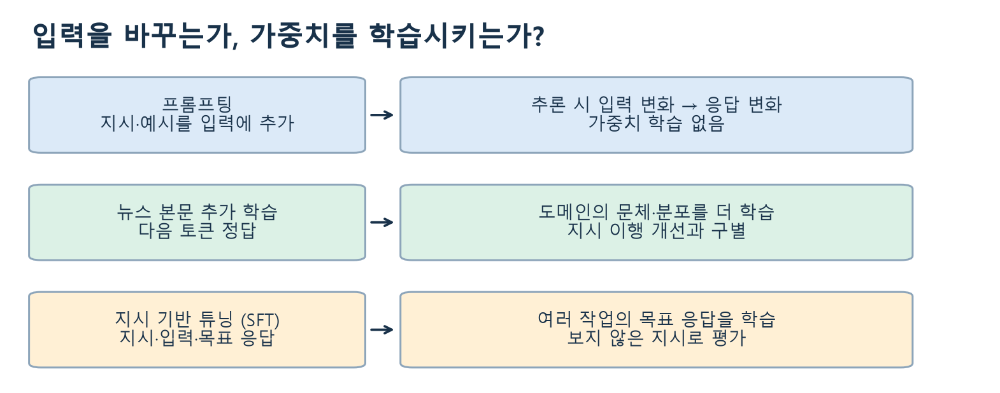
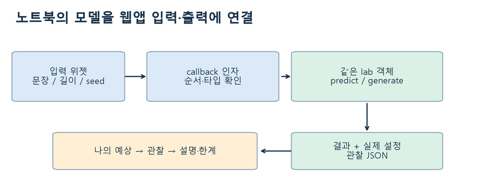

# W09B · 6.3 · 지시를 쓰는 것과 지시를 따르도록 학습하는 것

주교재 6.3 “지시 사항” · 268–273쪽 상부 · Colab B의 지시 데이터·웹앱 활동

## 1. 작업마다 모델을 다시 준비해야 할까

하나의 뉴스 분류기를 만들었다고 그 모델이 요약·번역·대화까지 모두 같은 방식으로 처리하는 것은 아닙니다. 교재는 이러한 상황에서 작업별 파인튜닝, 어댑터, 프롬프팅, 지도 기반 파인튜닝 등의 접근을 비교합니다.

작업별 모델은 목적과 평가를 명확히 정하기 쉽습니다. 대신 작업이 늘어나면 여러 모델의 학습·저장·운영을 관리해야 합니다. 프롬프팅은 이미 준비한 모델에 지시나 예시를 입력하는 방법입니다. 새 입력에 반응하는 추론이며 그 요청만으로 모델 가중치를 추가 학습하지는 않습니다.

지시 기반 튜닝은 **지시와 입력에 대해 어떤 응답을 해야 하는지 보여 주는 학습 예제**로 모델을 조정합니다. SFT는 supervised fine-tuning, 즉 지도 기반 파인튜닝을 뜻합니다. 지시 기반 튜닝은 이러한 학습을 지시문·응답 데이터에 적용하는 맥락에서 이해할 수 있습니다.

그림 읽기: 프롬프트와 학습 데이터의 내용을 함께 보세요. 뉴스 본문을 다음 토큰으로 학습한 모델과 지시·목표 응답을 학습한 모델은 데이터의 구성과 목적이 다릅니다. 출처: 주교재6.2–6.3을 연결해 새로 설계한 수업 도식.

## 2. 같은 뉴스를 지시 학습 예제로 바꾸기

다음은 수업에서 직접 만든 예문입니다. AG News 원문을 복제한 것이 아닙니다.

| 필드 | 설명용 예 |
|---|---|
| instruction | Rewrite the sentence as a short headline. |
| input | A company opened a new office in the city. |
| response | Company Opens New City Office |

`instruction`은 해야 할 작업, `input`은 작업할 자료, `response`는 학습에서 보여 줄 목표 응답입니다. 필드의 이름만 갖추었다고 좋은 데이터가 되는 것은 아닙니다. 지시가 애매하거나 목표 응답이 틀리면 그 데이터도 문제를 가집니다.

이를 하나의 문자열로 합치는 형식은 여러 가지가 있습니다. `### Instruction`, `### Input`, `### Response` 구분자는 이번 수업의 설명용 직렬화 형식입니다. 모든 실제 모델이 반드시 이 문자열을 사용한다는 뜻은 아닙니다. chat 모델은 자기 토크나이저의 chat template을 사용할 수 있습니다.

이번 버튼은 예제를 구성하고 구조를 보여 줍니다. **가중치를 갱신하는 SFT 학습은 이 활동에서 수행하지 않습니다.** 데이터를 만들었다는 기록, 실제 학습했다는 기록, 지시를 잘 따른다는 평가를 따로 남깁니다.

## 3. 학습목표로 연결하기

지시를 $I$, 입력을 $x$, 목표 응답 토큰을 $r_1,\ldots,r_T$라 할 때, 목표 응답을 학습하는 손실은 다음과 같이 생각할 수 있습니다.

$$
\mathcal{L}_{\mathrm{SFT}}=-\frac{1}{T}\sum_{t=1}^{T}\log p_\theta(r_t\mid I,x,r_{<t}).
$$

이 식은 응답 토큰에만 손실을 적용하는 설명입니다. 실제 도구의 데이터 수집기·템플릿·loss mask 설정을 확인해야 합니다. 지시·입력까지 포함한 모든 토큰에 손실을 적용하는 구성도 있으므로 “SFT이면 항상 같은 위치를 학습한다”고 단정하지 않습니다.

문장 분류의 네 클래스 정답, 뉴스 본문의 다음 토큰 정답, 지시·입력에 대한 응답 정답을 다시 비교해 보세요. 모델의 인터페이스 이름보다 **입력·정답·손실·갱신 대상**을 확인하는 것이 중요합니다.

## 4. 지시 데이터의 품질을 점검하기

| 점검할 것 | 살펴볼 사례 |
|---|---|
| 지시의 명확성 | “좋게 고쳐 줘”보다 목적·길이·출력 형식이 드러나는가? |
| 목표 응답의 정확성 | 뉴스 주제와 다른 클래스 이름을 정답으로 넣지 않았는가? |
| 내용과 형식의 일관성 | 한 예제는 클래스만, 다른 예제는 장문 해설을 요구하는 이유가 있는가? |
| 중복·평가 누출 | 같은 뉴스의 다른 지시 버전이 train과 test에 동시에 들어갔는가? |
| 작업의 다양성과 균형 | 한 종류의 문장이나 쉬운 작업에만 치우치지 않았는가? |
| 평가 범위 | 학습 문장의 재현과 새로운 지시의 수행을 구별하는가? |

같은 뉴스에 지시문만 다르게 붙였다고 독립적인 평가 문서가 되지는 않습니다. **원문 문서 단위로 먼저 분리하고**, 각 분할 안에서 지시 변형을 만드는 것이 안전한 출발점입니다. 원문의 바꿔 쓰기나 매우 비슷한 사례가 섞이는 문제는 별도 점검이 필요합니다.

**B5 · 필수 · 설계하고 설명하기:** 새로운 뉴스 예문으로 지시·입력·목표 응답을 작성하고, 학습에 쓰지 않을 평가 사례도 만드세요. 목표는 형식화와 실제 학습을 구별하고 평가 누출을 찾는 것입니다. 힌트: 지시문만 바꾸지 말고 원문 문서가 겹치는지도 확인하세요. 자기 점검: 응답이 타당한 이유와 새로운 사례에서 평가할 기준을 적었나요?

## 5. 여러 작업의 지시를 섞는 이유

교재의 그림6-3은 다양한 입력 지시와 서로 다른 형태의 응답을 하나의 언어 모델에 연결합니다. 분류·짧은 답변·변환 등 여러 작업을 지시 형식으로 학습하면 작업의 관계를 활용할 수 있습니다. 다만 몇 개 예제를 작성했다고 새로운 작업에 일반화한다고 결론 내릴 수는 없습니다.

Flan 연구는 여러 작업의 지시 데이터를 학습에 사용하고, 학습에 포함하지 않은 과제에서 성능을 평가하는 설계를 제시합니다. 이번 수업에서는 대규모 학습을 재현하는 대신 **학습 예제와 전이 평가 사례를 구별하는 원리**를 가져옵니다.

평가에는 요청한 작업을 했는지, 내용이 맞는지, 요구한 형식을 지켰는지, 학습하지 않은 표현에서도 동작하는지를 포함합니다. 모델이 출력한 문자열이 자연스럽다는 이유만으로 모든 항목을 통과시켜서는 안 됩니다.

## 6. 어댑터와 SFT는 서로 배타적인가

어댑터는 주로 **어떤 파라미터를 추가·갱신하는가**에 관한 접근입니다. SFT는 **어떤 입력·정답으로 어떤 목적을 학습하는가**에 관한 접근입니다. 지시 데이터를 이용한 학습을 전체 파인튜닝으로 할 수도 있고, 적은 수의 파라미터를 갱신하는 방식과 조합할 수도 있습니다.

따라서 프롬프팅·SFT·어댑터를 모두 같은 기준의 선택지로 단순 나열하지 않습니다. 이번 필수 범위는6.3까지이며6.4 이후의 LoRA·양자화 구현은 다음 범위에서 다룹니다.

선택 활동으로 base와 Instruct 모델을 비교할 때도 모델 카드의 학습 이력을 확인합니다. 공개 모델 쌍은 SFT 이외의 학습·선호도 최적화·데이터 변경도 다를 수 있으므로 출력 차이를 SFT 하나의 인과 효과로 단정하지 않습니다.

## 7. 마지막 웹앱에서 방법론을 설명하기

앱은 노트북에서 준비한 동일한 모델 객체를 재사용합니다. 버튼을 누를 때마다 다시 모델을 내려받거나 새 학습을 시작하지 않습니다. 입력 위젯 순서와 함수 인자 순서, 반환값과 출력 위젯 순서를 맞춥니다.

**B6 · 필수 · 직접 연결하기:** 자신의 예상·관찰·설명을 정리하는 함수를 작성하여 앱의 입력 세 개와 출력에 연결하세요. 연결한 뒤 새로운 예문을 넣고 한 조건만 바꿉니다. 힌트: 먼저 함수를 직접 호출해 반환값을 확인합니다. 자기 점검: 앱이 실행된 것과 자신이 입력·결과 관계를 설명한 것을 각각 확인했나요?

실험 설명에는 사용한 모델·학습 상태·입력·바꾼 조건·관찰·판단의 한계를 남깁니다. 공유 링크는 런타임 동안 유지되므로 링크가 종료되면 노트북에서 다시 실행해 새 주소를 확인합니다.

## 출처와 추가 설명

- 주교재: 『핸즈온 생성형 AI』 6.3,268–273쪽 상부. 지시 데이터 예문·누출 사례·평가 기준·앱 활동은 수업용으로 새로 작성했습니다.
- [Scaling Instruction-Finetuned Language Models](https://arxiv.org/html/2210.11416v5)
- [SmolLM Instruct 학습 이력과 사용 예](https://huggingface.co/HuggingFaceTB/SmolLM-135M-Instruct)
- [수업 API 정의와 데이터 형식화의 실행 범위](https://github.com/lunalab-ai/genAI/blob/2026-fall-w09b/src/W09B-API.md)
