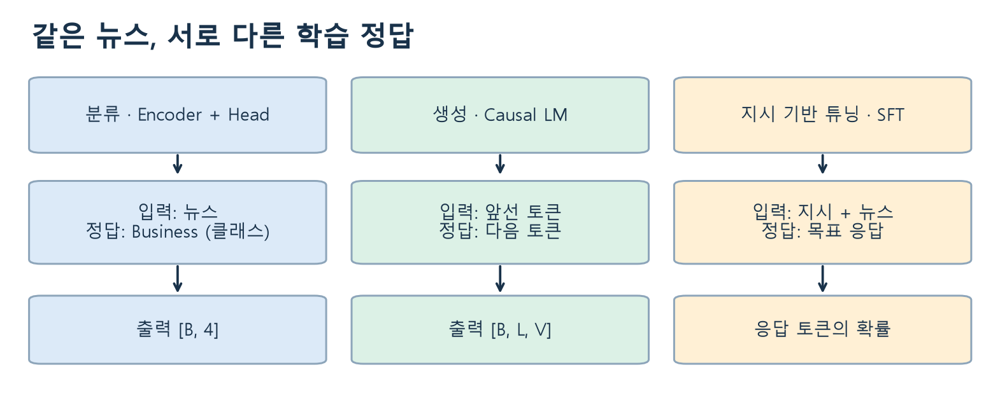

# W09B · 한 장 지도 · 같은 뉴스, 다른 학습 정답

2026-10-28 · 생성형 인공지능 9주차 2차시 · 『핸즈온 생성형 AI』 6.1–6.3

중간고사 전에는 사전학습 모델에 입력을 주고 결과를 관찰했습니다. 이제는 **입력과 정답으로 손실을 계산하고 모델의 가중치를 실제로 조정**합니다. 지난 실습의 실행 결과나 저장 변수가 없어도 새 Colab 사본에서 시작할 수 있습니다.

그림 읽기: 각 열에서 **입력 → 정답 → 출력의 형태**를 따라가세요. 오른쪽의 지시 데이터 구성과 실제 SFT 학습은 구분합니다. 출처: 주교재 6.1–6.3의 개념을 바탕으로 새로 설계한 수업 도식.

| 작업 | 모델에 주는 것 | 손실에서 맞히려는 것 | 확인할 결과 |
|---|---|---|---|
| 뉴스 분류 | 뉴스의 토큰·마스크 | World/Sports/Business/Sci/Tech 중 정답 ID | 네 클래스 점수·혼동행렬 |
| 뉴스 이어쓰기 | 앞선 토큰 | 바로 다음 토큰 | 검증 NLL·생성 문장 |
| 지시 기반 튜닝 | 지시문·입력 | 목표 응답의 토큰 | 보지 않은 지시에서의 이행·내용·형식 |

## 읽고 실행하는 순서

1. [분류 노트](w09b-classification.md)를 읽으며 **Colab A**의 토큰·분류 헤드·짧은 학습을 관찰합니다.
2. [생성 노트](w09b-generation.md)와 **Colab B**에서 다음 토큰 정답과 학습 전후를 비교합니다.
3. [지시 사항 노트](w09b-instructions.md)에서 지시 데이터와 평가 사례를 설계합니다.
4. 마지막 웹앱에서 입력과 함수의 연결을 확인하고 [실험 기록지](w09b-workbook.md)에 예상·관찰·설명을 남깁니다.

각 Colab은 **Drive에 새 사본을 저장하고 첫 셀부터** 실행합니다. CPU 기본, API 키·개인 파일 업로드·유료 업그레이드는 필수가 아닙니다. 최초 모델 파일은 A 약269 MB, B 약541 MB이며 데이터와 의존성 다운로드가 추가됩니다. 받은 파일은 캐시에서 재사용합니다.

## 실습 바로가기

- [Colab A · 뉴스 분류 파인튜닝](https://colab.research.google.com/github/lunalab-ai/genAI/blob/2026-fall-w09b/notebooks/student/w09b_classification.ipynb)
- [Colab B · 뉴스 생성과 지시 데이터](https://colab.research.google.com/github/lunalab-ai/genAI/blob/2026-fall-w09b/notebooks/student/w09b_generation.ipynb)
- [함수·클래스·메소드 설명과 실제 정의](https://github.com/lunalab-ai/genAI/blob/2026-fall-w09b/src/W09B-API.md)

패키지는 `luna-genai 0.1.15`, 설치 기준은 `2026-fall-w09b`입니다. 이미 이전 버전을 import했다면 런타임을 재시작하고 첫 셀부터 실행합니다. 웹앱 공유 URL은 실행 중인 Colab 런타임에 의존합니다.

## 이번 수업의 확인 기준

실행 전에는 결과를 예상하고, 실행 후에는 **무엇을 정답으로 삼았는지·무엇이 학습됐는지·비교 조건을 어떻게 고정했는지·이 결과로 어디까지 설명할 수 있는지**를 적습니다. 학습이 실행됐다는 사실과 성능이 좋아졌다는 판단은 별도로 확인합니다.

짧은 학습은 작동 원리를 관찰하는 실험입니다. 교재의 장시간 학습 결과나 상용 서비스의 품질을 재현했다고 해석하지 않습니다. 별도 성적 반영 과제나 새로운 제출 기한은 없습니다.
