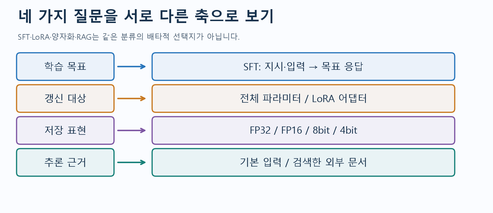
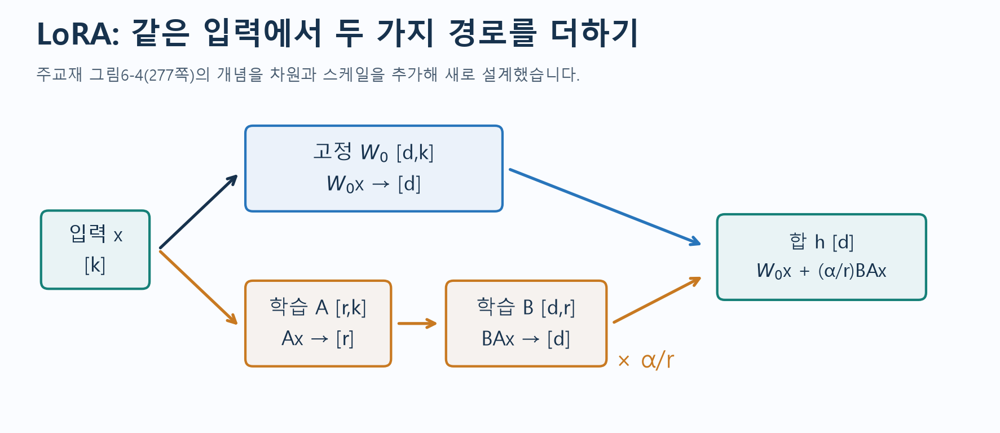
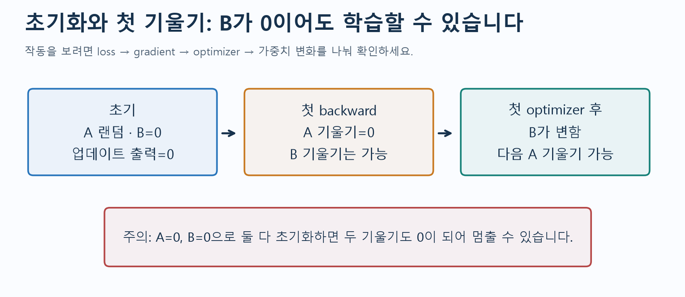
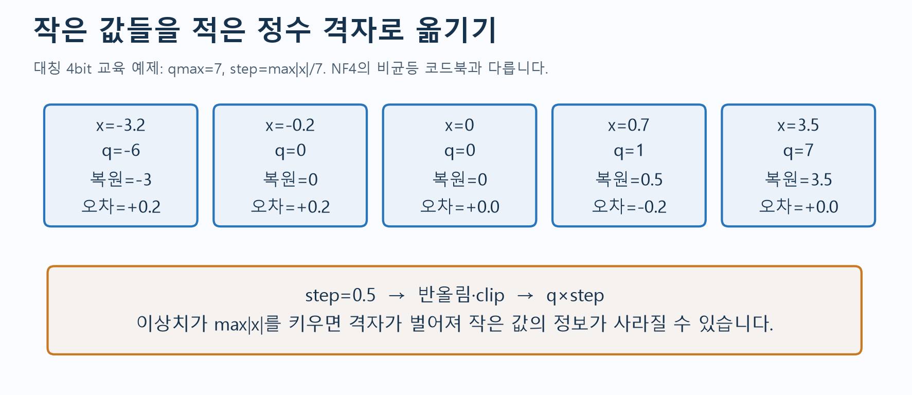
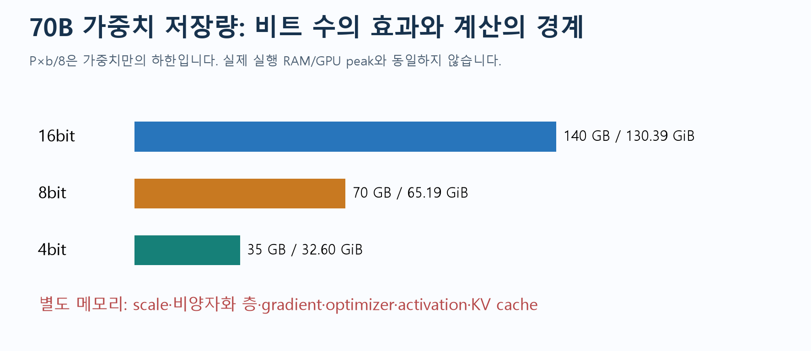
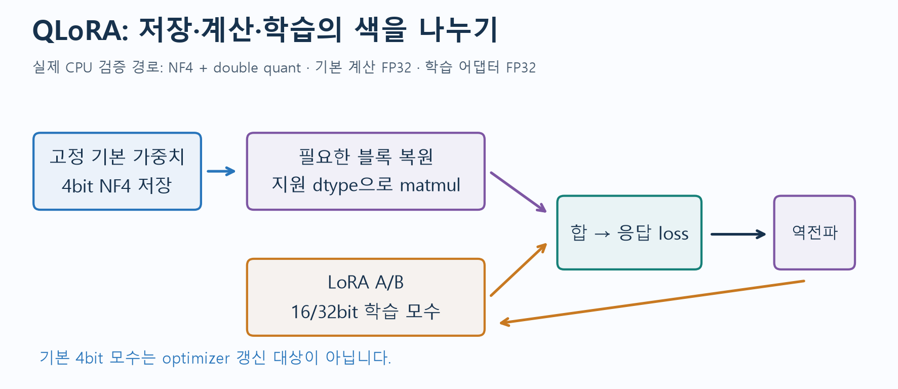
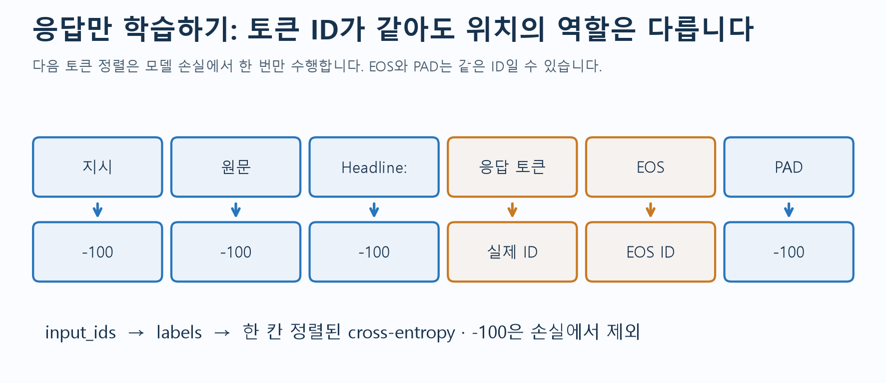
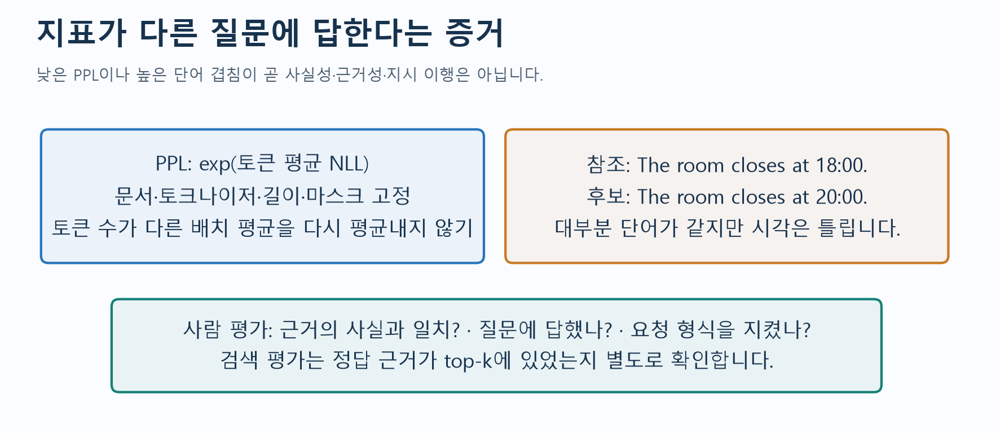
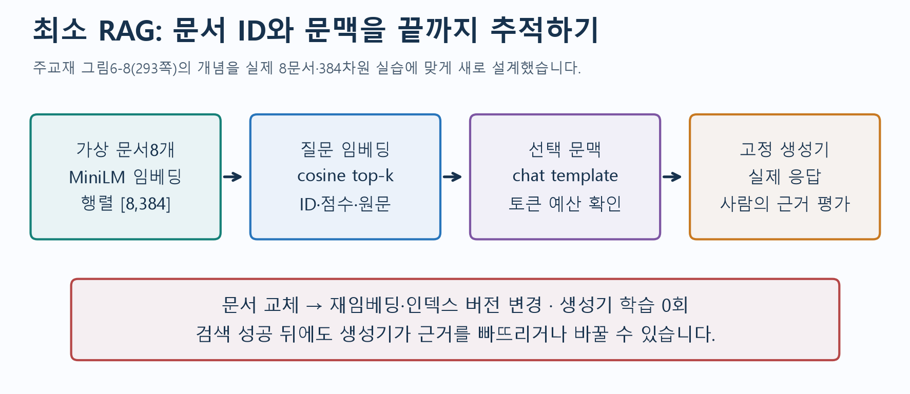
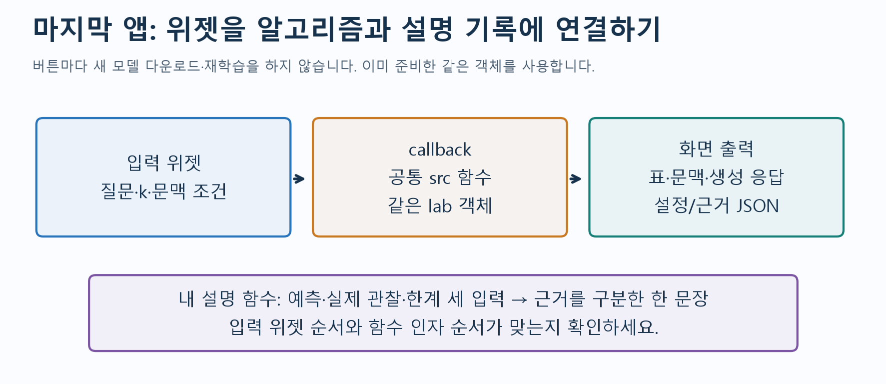

# W10A · 적은 자원으로 언어 모델 바꾸기

2026-11-02 · 생성형 인공지능 10주차 1차시 · 『핸즈온 생성형 AI』 6.4부터 6장 끝

지난 수업에서는 입력·정답·손실·가중치 갱신을 연결했습니다. 이번에는 **어떤 가중치를 바꾸는가, 어떤 정밀도로 저장하는가, 답의 근거를 어디서 가져오는가**를 나누어 봅니다. 작은 계산을 먼저 이해하고 실제 모델의 중간값과 대조합니다.

[Colab A · LoRA·양자화·QLoRA](https://colab.research.google.com/github/lunalab-ai/genAI/blob/2026-fall-w10a/notebooks/student/w10a_adaptation.ipynb) · [Colab B · 평가·RAG·앱](https://colab.research.google.com/github/lunalab-ai/genAI/blob/2026-fall-w10a/notebooks/student/w10a_rag.ipynb) · [활동 기록지와 점검](w10a-workbook.md) · [공통 API와 실제 정의](https://github.com/lunalab-ai/genAI/blob/2026-fall-w10a/src/W10A-API.md)

두 Colab은 각각 **Drive에 새 사본을 저장하고 첫 셀부터** 실행합니다. A의 저장 어댑터를 B에 옮길 필요가 없습니다. CPU 기본이며 API키·개인 파일 업로드·유료 GPU는 필수가 아닙니다. 패키지 `luna-genai 0.1.16`과 고정 태그 `2026-fall-w10a`를 사용합니다. 이전 버전을 이미 import했다면 런타임을 재시작합니다.

모델 선택 파일은 A 약541MB, B 약363MB이고 의존성 다운로드가 추가됩니다. 받은 캐시는 재사용합니다. 영어 중심의 작은 모델이므로 짧은 영어 입력·출력에 한국어 설명을 붙였습니다. 실행 성공과 답변 품질은 구별합니다. 새 성적 과제나 제출 기한은 없습니다.

## 1. 지난 수업에서 이번 수업으로

문장 분류는 문장당 클래스 하나를, causal LM은 다음 토큰을 정답으로 사용했습니다. 지시·원문·목표 응답을 작성하는 일은 학습 데이터 구성이고, loss와 backward·optimizer로 모수를 바꾸는 일이 실제 학습입니다. SFT는 지시 예제로 학습하는 목표/데이터 방식이며 LoRA는 갱신할 모수를 정하는 방식입니다. 둘은 함께 사용할 수 있습니다.



그림 읽기: 왼쪽 질문 하나에 오른쪽 설정 하나가 대응합니다. 예를 들어 **SFT + LoRA + 4bit 기본 모델 + RAG**는 네 축을 조합한 구성입니다. 출처: 주교재 6.3–6.8의 개념을 바탕으로 새로 설계한 수업 도식.

| 축 | 이번에 선택할 수 있는 것 | 확인할 증거 |
|---|---|---|
| 학습 목표 | 일반 다음 토큰 학습 / 지시-응답 SFT | 어떤 위치가 labels이고 loss에 포함되는가 |
| 갱신 대상 | 전체 파라미터 / LoRA A·B | requires_grad·기울기·전후 변화량 |
| 저장 표현 | FP32/FP16/BF16 / 8bit/4bit | 실제 계층·저장 dtype·계산 dtype |
| 추론 근거 | 기본 입력 / 검색한 외부 문서 | 선택 문서·실제 문맥·답변의 근거 일치 |

이번 실험의 기록은 **예측 → 실제 관찰 → 한 조건 변경 → 근거와 한계 → 새 사례 설명**으로 통일합니다. 버튼을 눌렀다는 사실보다, 코드 없이도 결과의 이유를 설명할 수 있는지가 중요합니다.

## 2. 6.4 어댑터 소개: 큰 가중치를 고정하고 작은 경로를 학습하기

PEFT는 사전학습 모델 전체를 바꾸는 대신 적은 수의 모수로 적응시키는 방법들의 범주입니다. LoRA는 선형층의 가중치 변화가 낮은 rank의 곱으로 표현될 수 있다는 가정 아래, 기본 가중치 옆에 작은 두 행렬을 둡니다. 실제 최적 업데이트가 항상 정확히 낮은 rank라는 보장은 없습니다.

고정 가중치와 입력의 차원을 다음처럼 둡니다.

$$
W_0\in\mathbb{R}^{d\times k},\quad x\in\mathbb{R}^{k},\quad A\in\mathbb{R}^{r\times k},\quad B\in\mathbb{R}^{d\times r}
$$

$$
h=W_0x+\Delta W x,\qquad \Delta W=\frac{\alpha}{r}BA
$$

기본 경로는 입력에서 이미 배운 표현을 계산하고, 어댑터 경로는 그 위에 작업별 변화를 더합니다. 두 경로 모두 출력이 d차원이므로 더할 수 있습니다. A는 k차원 입력을 r차원으로, B는 r차원을 d차원으로 보냅니다.



출처: 주교재 277쪽 그림6-4의 고정/학습/병합 개념을 참고해 **새로 설계한 도식**. 원래 스캔을 복제한 그림이 아닙니다. 읽는 순서는 x → W0 또는 A → B → 스케일 → 합입니다.

### 완성 예제 E1 · 행렬 곱의 중간값

다음은 차원을 이해하기 위한 작은 예입니다. rank1, alpha2이므로 스케일은2입니다.

$$
W_0=\begin{bmatrix}1&0&0&0\\0&1&0&0\\0&0&1&0\end{bmatrix},\quad
x=\begin{bmatrix}1\\2\\0\\-1\end{bmatrix},\quad
A=\begin{bmatrix}1&0&1&-1\end{bmatrix},\quad
B=\begin{bmatrix}1\\-2\\0.5\end{bmatrix}
$$

$$
W_0x=\begin{bmatrix}1\\2\\0\end{bmatrix},\quad Ax=2,\quad
BAx=\begin{bmatrix}2\\-4\\1\end{bmatrix},\quad
h=\begin{bmatrix}1\\2\\0\end{bmatrix}+2\begin{bmatrix}2\\-4\\1\end{bmatrix}=\begin{bmatrix}5\\-6\\2\end{bmatrix}
$$

Ax의 스칼라2와 최종 스케일2는 서로 다른 계산입니다. A1에서는 다른 숫자로 중간값부터 다시 계산합니다.

### 완성 예제 E2 · 얼마나 적은 모수를 학습하는가

한 선형층에서 bias를 제외하면 전체 학습은 dk개, LoRA는 r(d+k)개입니다.

$$
\frac{N_{\mathrm{LoRA}}}{N_{\mathrm{full}}}=\frac{r(d+k)}{dk}
$$

| 선택 층 | 전체 dk | 어댑터 r(d+k) | 해석 |
|---|---:|---:|---|
| d3,k4,r1 | 12 | 7 | 작은 차원 설명용, 큰 축소의 예는 아님 |
| d4096,k4096,r8 | 16,777,216 | 65,536 | 1/256, 약0.391% |

실제 A의 SmolLM-135M은 30개 층의 q_proj/v_proj에만 어댑터를 둡니다. q_proj의[576,576]과 v_proj의[192,576]을 사용하므로 r4에서 층당 4,608+3,072=7,680개, 전체 **230,400개**가 학습 대상입니다. 기본 파라미터 134,515,008개는 고정됩니다. 이 숫자는 선택한 모델/target_modules의 결과이며 모든 LoRA의 고정 비율이 아닙니다.

### 완성 예제 E3 · B=0인데 왜 학습이 가능한가

일반적인 LoRA 초기화는 A 랜덤, B=0입니다. 처음에는 BA=0이므로 기본 모델의 함수에서 출발합니다. 출력 손실의 기울기를 g라고 하면 스케일을 제외한 관계는 다음과 같습니다.

$$
\frac{\partial L}{\partial B}=g(Ax)^T,\qquad
\frac{\partial L}{\partial A}=B^Tgx^T
$$

첫 단계에서는 B=0 때문에 A의 기울기가0이지만, Ax가0이 아니면 B의 기울기는 생길 수 있습니다. B가 한 번 바뀌면 다음 단계에서 A도 바뀔 수 있습니다. 반대로 A와B를 **둘 다0**으로 초기화하면 두 기울기가 모두0이 되어 멈출 수 있습니다.



실제 CPU 실행에서도 첫 A 기울기 합은0, B는0이 아니었으며 다음 단계부터 A도 변했습니다. 기울기의 정확한 크기는 환경·데이터·초기화에 따라 달라집니다. “A의 첫 기울기0=학습 실패”라는 판단은 피합니다.

### r·alpha·dropout·target_modules와 저장/병합

| 설정 | 의미 | 이번 기본값/주의 |
|---|---|---|
| r | 업데이트의 rank 상한과 모수 수 | 4. 클수록 항상 좋은 것은 아님 |
| lora_alpha | alpha/r의 스케일을 결정 | 8, 따라서 스케일2 |
| lora_dropout | 어댑터 경로의 학습 dropout | 0, 비교를 간단히 관측 |
| target_modules | 어느 선형층에 붙일지 | q_proj/v_proj. all-linear는 더 넓은 선택 |
| task_type | 모델 작업과 wrapper의 연결 | CAUSAL_LM |
| use_dora | 방향/크기 분리 DoRA 확장 | False. 이번에 DoRA를 학습한 것은 아님 |

rank 비교에서 alpha도 그대로 두면 rank뿐 아니라 alpha/r까지 바뀝니다. X1에서는 alpha=2r로 스케일을 고정하고 동일 base/seed/데이터/학습량을 비교합니다.

어댑터 저장은 작은 A/B와 설정을 저장하는 일입니다. **같은 base revision**이 있어야 함수를 복원할 수 있습니다. float 가중치에서는 다음처럼 병합해 별도 어댑터 경로를 제거할 수도 있습니다.

$$
W_{\mathrm{merged}}=W_0+\frac{\alpha}{r}BA
$$

이번 재로딩 검사에서는 logits가 일치했고, 별도 float 모델에 병합한 결과도 허용오차 내에서 일치했습니다. 덧셈/곱셈 순서 차이의 부동소수점 오차가 있으므로 비트 단위 동일성을 요구하지 않습니다. 양자화 모델의 병합은 같은 검사로 단정하지 않습니다. 수업에서 사용하는 원래 어댑터 객체는 유지합니다.

## 3. 6.5 양자화 소개: 표현할 수 있는 숫자의 격자를 바꾸기

적은 수의 모수만 학습해도 기본 모델을 보관할 공간은 필요합니다. 양자화는 그 가중치 등을 더 적은 비트의 표현으로 저장하는 방법입니다. LoRA는 **갱신 대상**, 양자화는 **저장 표현**에 관한 선택입니다.

| 표현 | 비트 | 주로 구별할 점 |
|---|---:|---|
| FP32 | 32 | 지수8bit·가수부23bit |
| FP16 | 16 | 지수5bit·가수부10bit, 최대 유한값65,504 |
| BF16 | 16 | 지수8bit·가수부7bit, FP32와 비슷한 지수 범위 |
| int8/int4 양자화 | 8/4 | scale 또는 codebook으로 실수 값을 연결 |

BF16은 FP16보다 범위가 넓지만 가수 정밀도는 낮습니다. “16bit이므로 FP16과 완전히 같다”거나 “BF16은 모든 값에서 더 정밀하다”라고 설명하지 않습니다. 단순 dtype cast와 양자화도 구별합니다.

### 완성 예제 E4 · absmax, 반올림, 복원, 오차

이번 교육용 대칭 균등 격자는 다음과 같습니다. qmax는 양의 최대 정수, s는 원래 값과 같은 단위를 가진 격자 간격입니다.

$$
q_{\max}=2^{b-1}-1,\quad s=\frac{\max_i|x_i|}{q_{\max}},\quad
q_i=\operatorname{clip}\left(\operatorname{round}(x_i/s),-q_{\max},q_{\max}\right),\quad \hat{x}_i=sq_i
$$

교재의 “실수에 곱하는 scale” 표기와는 역수 관계일 수 있습니다. **여기서는 s를 복원에 곱하는 간격으로 정의**합니다. 양쪽 표기를 섞지 않습니다.

4bit, x=(-3.2,-0.2,0,0.7,3.5)이면 qmax7, s0.5입니다.

| x | x/s | q | 복원값 | 오차: 복원−원래 |
|---:|---:|---:|---:|---:|
| -3.2 | -6.4 | -6 | -3.0 | +0.2 |
| -0.2 | -0.4 | 0 | 0 | +0.2 |
| 0 | 0 | 0 | 0 | 0 |
| 0.7 | 1.4 | 1 | 0.5 | -0.2 |
| 3.5 | 7 | 7 | 3.5 | 0 |



이 예의 MAE는0.12이며, 반올림 오차의 절댓값은 s/2 이내입니다. 반올림은 NumPy ties-to-even 규칙을 사용합니다. 영벡터는 나눗셈0을 피하기 위해 s1로 두고 모두0을 반환합니다. 이상치 하나가 최대 절댓값을 키우면 격자가 벌어져 작은 값이0으로 뭉칠 수 있습니다. A3에서 같은 작은 값들과 이상치 하나만 바꿉니다.

이 대칭 예는 -7부터7까지15개 값을 쓰고 한 signed 코드를 사용하지 않습니다. **NF4는 학습 가중치의 분포를 고려한 비균등16개 코드값**을 사용하므로 같은 알고리즘이 아닙니다. 화면의 q 배열도 관측용 int64이지 실제4bit 압축 파일이 아닙니다. 참고로 unsigned8bit 범위는0–255이고 이번 대칭8bit 예는-127–127입니다.

### 완성 예제 E5 · 가중치 저장량과 실제 실행 메모리

P개 모수를 모수당 b비트로 저장할 때 가중치만의 하한은 다음과 같습니다.

$$
M_{\mathrm{weights}}=\frac{Pb}{8}\;\mathrm{bytes}
$$

| 70B 모수 | 바이트 | GB: 10억bytes | GiB: 2의30승bytes |
|---|---:|---:|---:|
| 16bit | 140,000,000,000 | 140 | 약130.39 |
| 8bit | 70,000,000,000 | 70 | 약65.19 |
| 4bit | 35,000,000,000 | 35 | 약32.60 |



실제 실행에는 scale/codebook metadata, 양자화하지 않은 층, gradient, optimizer state, activation, KV cache 등이 더 필요합니다. “35GB이면35GB GPU에 반드시 들어간다”는 결론은 낼 수 없습니다. CPU/disk offload는 공간과 전송 지연을 교환하며 무조건 빠르게 만드는 설정이 아닙니다.

보완 계산: 100GB 모델10개를 각각 보관하면1,000GB입니다. base100GB 하나와1GB 어댑터10개면110GB입니다. 이 수치는 저장 예시이며 실제 serving RAM 전체를 계산한 값이 아닙니다.

## 4. 6.6 통합 구현: 고정4bit 기본 모델 위의 LoRA SFT

QLoRA는 기본 모델을4bit로 저장·고정하고 LoRA만 학습합니다. 핵심에는 NF4, 양자화 상수를 압축하는 double quantization, 메모리 급증을 완화하는 paged optimizer가 있습니다. **수업은 NF4+double quant+LoRA를 실행하며 paged optimizer와 대규모 논문 실험은 재현하지 않습니다.**



그림 읽기: 파란 기본 모수에는 optimizer 업데이트가 없습니다. 보라색은 계산 경로, 주황색은 학습 어댑터입니다. CPU 검증에서는 기본 계층 계산과 어댑터가FP32였습니다. 지원 GPU에서는 계산 dtype을 달리 고를 수 있으며 그 장치의 실제 실행 검증은 별도로 필요합니다.

코드의 연결은 다음 순서입니다. 실제 구현은 [AdapterLab](https://github.com/lunalab-ai/genAI/blob/2026-fall-w10a/src/W10A-API.md)에 있습니다.

```python
BitsAndBytesConfig(load_in_4bit=True,
    bnb_4bit_quant_type="nf4", bnb_4bit_use_double_quant=True,
    bnb_4bit_compute_dtype=compute_dtype)
# 고정 revision 기본 모델 로드
prepare_model_for_kbit_training(model, use_gradient_checkpointing=False)
# LoRA를 붙인 뒤 SFTConfig / SFTTrainer로 실제 loss·역전파·갱신
```

CPU에서는FP32, CUDA에서는 BF16 지원 시BF16·미지원 시FP16 계산을 선택하는 경로를 제공합니다. T4처럼 BF16 미지원인 장치를 BF16으로 단정하지 않습니다. `device_map="auto"`는 주로 추론의 자동 배치 설정이며 학습의 무조건 기본값으로 복사하지 않습니다.

현재 수업 패키지는 TRL1.17.1의 양자화 모델 초기화가 어댑터를 BF16으로 바꾸는 동작을 고려해, optimizer를 만들기 전에 학습 어댑터를FP32로 유지합니다. 기본4bit 저장과 bitsandbytes 계산 dtype은 그대로입니다. dtype 이름은 추정하지 않고 `state()`의 실제값으로 확인합니다.

### 지시 형식과 loss 마스크

base 모델용 A 실습은 직접 정의한 `Return a short headline / Text / Headline:` 형식입니다. Instruct 모델용 B는 그 모델의 **실제 tokenizer chat template**과 `add_generation_prompt=True`를 사용합니다. 모델마다 역할 구분 토큰이 다르므로 다른 모델의 제어 토큰을 무조건 복사하지 않습니다.



이번 SFT는 prompt/PAD를-100으로 하고 응답/EOS를 정답으로 유지한 **사전 토큰화 labels**를 Trainer에 전달합니다. 모델 내부에서 다음 토큰과 한 번 정렬합니다. EOS와PAD가 같은ID여도 진짜EOS는 지우지 않습니다. `assistant_only_loss=True`는 필요한 generation mask를 제공하는 템플릿인지 확인해야 하며 설정 하나만 켠다고 모든 채팅 데이터에 성립하지 않습니다. packing은False로 두어 경계를 읽습니다.

| 교재의 원 구현 | 수업에서 적용한 선택 |
|---|---|
| 큰 Mistral7B 등 | CPU 필수 경로는SmolLM-135M |
| 예전 max_seq_length/tokenizer 인자 | 설치한 TRL의max_length/processing_class 계약 사용 |
| Hub 업로드 포함 | Hub 업로드·로그인·API키 없이 로컬 저장 |
| packing 등 효율 설정 | 우선False로 두어 정답 경계/마스크 관찰 |

**필수:** float LoRA 실제 학습, QLoRA 경로와 사전 검증 기록 해석. **선택:** 지원 장치에서 `RUN_REAL_4BIT=True`로 실제4bit 학습. 기본False인 셀을 실행했을 때는 “기록 분석 모드”라고 표시합니다. 사전 기록은 Windows CPU에서270개4bit계층·기본 동결·어댑터 갱신·유한 loss를 확인한 결과이며 Colab GPU 또는7B 성공 기록이 아닙니다.

## 5. 6.7 평가 방법을 더 깊이 이해하기

학습 loss가 유한하고 어댑터가 변했으면 **학습 작동의 근거**가 됩니다. 어떤 목적에서 더 좋아졌는지는 보지 않은 예제와 적절한 지표로 따로 평가합니다. 같은 원문의 지시 표현만 바꿔 train/test로 나누면 원문 누출을 막지 못합니다. 분할은 원문 단위로 먼저 합니다.

### 완성 예제 E6 · PPL의 분모

정답 토큰의 음의 로그 확률을 평균한 NLL에 exp를 취합니다. 확률0.5인 정답이 두 번이면 NLL은 약0.6931, PPL은2입니다. 이 숫자는 그 정답 시퀀스를 얼마나 예측하기 쉬운지와 연결되며 사실성을 직접 측정하지 않습니다.

배치마다 유효 토큰 수가 다를 때는 다음처럼 가중합니다.

$$
L=\frac{\sum_b n_bL_b}{\sum_b n_b},\qquad \operatorname{PPL}=e^L
$$

배치1은2토큰·평균손실2, 배치2는8토큰·평균손실4이면 전체NLL은(4+32)/10=3.6, PPL은 약36.598입니다. 배치 평균을 단순 평균한3은 다른 분모입니다. padding·prompt를 무시한 실습에서는 유효한 다음 응답 토큰 수만 셉니다. tokenizer·문서·문맥 길이·마스크가 다른 PPL을 그대로 비교하지 않습니다.

### 완성 예제 E7 · 겹침 지표의 반례

참조가 `The room closes at 18:00.`이고 후보가 `The room closes at 20:00.`이면 대부분 단어가 같아도 시각이 틀립니다. 반대로 `Closing time is six in the evening.`은 표현이 달라 겹침이 낮아도 같은 사실을 전달할 수 있습니다.

BLEU는 중복 n-gram의 일치를 참조의 개수로 제한한 precision을 사용하고, 여러 차수의 기하평균과 짧은 응답의 penalty를 결합합니다. ROUGE-N의 recall은 참조 n-gram 중 얼마나 회수했는지를 봅니다. ROUGE-L은 순서를 유지하는 최장 공통 부분수열을 봅니다. 참조 표현·토큰화·여러 참조·smoothing 선택이 값에 영향을 줍니다.

예를 들어 후보 `a a a`, 참조 `a b`의 clipped unigram 일치는1개입니다. 후보 기준 precision은1/3, 참조 기준 recall은1/2입니다. 같은 “겹침”이라도 분모와 질문이 다릅니다. 수업 함수는 단일 참조·소문자 단어/구두점·smoothing 없는 BLEU-2의 교육 구현이며 공식 벤치마크를 대체하지 않습니다.



사람 평가는 적어도 **근거의 사실과 일치 / 질문에 필요한 답을 제공 / 지시·형식 준수**를 나눕니다. 좋아 보인다는 인상만 기록하지 않고 실제 문서의 어떤 사실과 답의 어느 부분을 대조했는지 남깁니다. 한 기준의 성공으로 다른 기준을 대신하지 않습니다. 과거 LMSYS 순위 그림6-7은 당시 예시이며 현재 순위로 해석하지 않습니다.

## 6. 6.8 검색 증강 생성 프로젝트: 작은 실제 파이프라인

모델이 학습하지 않은 문서를 추론 시 검색해 질문과 함께 주는 것이 RAG의 기본 아이디어입니다. 문서가 바뀌면 검색 자산을 갱신할 수 있습니다. 이번 미니 파이프라인에서는 **임베딩 모델과 생성기를 모두 고정하고 학습하지 않습니다.** 원 RAG 논문의 공동학습 실험 전체를 재현한 것은 아닙니다.



출처: 주교재 293쪽 그림6-8과 6.8의 최소 프로젝트를 참고해 새로 설계한 도식. 문서ID·점수·실제 문맥을 추가했습니다.

| 단계 | 실제 입력/출력 | 이번 구현 |
|---|---|---|
| 문서 준비 | id/title/text/한국어 요약 | 자체 작성 가상 연구실 문서8개 |
| 임베딩 | 토큰[문서수,L] → [8,384] | MiniLM, mask-aware mean pooling/L2정규화 |
| 검색 | 질문벡터[1,384]와 문서행렬 | 정규화 벡터 내적의 정확cosine top-k |
| 문맥 | 선택ID·원문·질문 | 실제 chat template, 입력예산384토큰 |
| 생성 | 문맥 포함 입력 → 새 토큰 | 고정SmolLM-135M-Instruct, greedy·최대40토큰 |
| 평가 | 근거ID/원문과 생성답 | 검색hit와 답변 근거성을 별도 판정 |

**문서들은 실제 동덕여대나 연구실 규정이 아닙니다.** 숫자·주소·시각은 수업용 가상 사례입니다. 영어 모델에 맞추어 문서는 영어로 작성하고 한국어 요약을 제공합니다. MiniLM은 직접 Transformers로 실행하며 padding을 제외한 mean pooling과 정규화를 사용합니다. 별도 벡터DB·유료API·로그인은 필요하지 않습니다.

정규화한 문서벡터 zi와 질문벡터 q에서는 다음 점수로 순위를 정합니다.

$$
\operatorname{score}(q,z_i)=\frac{q^Tz_i}{\|q\|_2\|z_i\|_2};\qquad \|q\|_2=\|z_i\|_2=1\Rightarrow \operatorname{score}=q^Tz_i
$$

점수는 정답 확률이 아닙니다. 관련 문서가top-k에 있으면 검색hit로 볼 수 있지만, 생성기가 내용을 정확히 사용했는지는 답을 읽고 확인합니다. 문서ID가 출력에 있다는 이유만으로 답을 맞았다고 하지 않습니다.

### 완성 예제 E8 · 문맥 조건을 바꿔 끝까지 추적하기

B에서 `How many days can a member borrow a projector?`를 실행합니다. 실제 제작 검증의 top1은 D02, cosine점수는 약0.802였습니다. context에는 `Members may borrow one projector for two days.`가 들어갔고, chat template으로 만든 입력은86토큰이었습니다. 그런데 모델은 `The document ID is [D02] and the question is [D02]`를 반복해 대여 기간을 답하지 않았습니다. 따라서 이 관측은 **검색hit=성공 / 필요한 사실 응답=실패**로 판정합니다. ID가 출력된 것만으로 정답으로 보지 않습니다. 문서에 있는 정답을 프로그램이 대신 반환하지도 않습니다.

이어 열람실 마감 질문에서 같은 생성기·질문·k1·greedy 설정을 유지하고 문맥만 바꿉니다.

| 조건 | 생성기에 주는 근거 | 해석할 것 |
|---|---|---|
| none | 문서 없음 | 모델의 선행 지식/추측만으로 답했는지 |
| retrieved | top-k 문서 | 근거가 맞았는지, 필요한 사실을 답했는지 |
| low_rank | 최하위 점수 문서 하나 강제 | 실제 관련성·잘못된 근거의 영향 |
| 문서 갱신 | D01의18:00을20:00으로 변경 | 재임베딩·인덱스 버전·실제 문맥·출력 반영 |

제작 중 실제 실행에서는 D01을 정확히 검색해도 모델이 `The study room closes on weekdays.`처럼 **시각을 빠뜨리는 출력**을 냈습니다. 문서 갱신 뒤에도 같은 생략이 관찰됐습니다. 이것은 숨길 실패가 아니라, 검색과 생성 평가를 분리해야 하는 근거입니다. 실행 환경마다 문장은 달라질 수 있으므로 자신의 실제 출력을 기록합니다.

문서에 없는 질문은 근거 부족을 말하고 사실을 꾸며내지 않는 응답을 기대합니다. 이 작은 모델이 항상 그렇게 한다고 보장하지 않습니다. 인덱스 갱신은 LLM의 가중치 학습과 다릅니다. 문서를 고친 뒤 예전 벡터를 그대로 쓰면 새 내용을 제대로 검색할 수 없으므로 `replace_document()`가 재임베딩과 버전 갱신을 수행합니다.

문맥이 예산을 넘으면 낮은 순위 문서를 **통째로** 뺍니다. `retrieved` 목록과 실제 `used_document_ids`를 구분하고 dropped문서·토큰 수를 확인합니다. 질문과 역할 제어 토큰을 무작정 자르는 방식은 쓰지 않습니다.

## 7. 마지막 앱: 이미 만든 기능에 나의 설명 함수를 연결하기



A 앱은 같은 입력에서 어댑터 비활성/활성 출력을 비교하고 교육용 양자화 표를 보여 줍니다. B 앱은 질문·k·문맥 조건 → 검색표 → 실제 문맥 → 생성답 → 실행JSON을 연결합니다. 문서 교체 버튼은 인덱스를 갱신하며 생성기를 학습하지 않습니다.

학생은 `learner_note(prediction, observation, limitation)`를 작성해 세 입력 위젯과 설명 출력에 연결합니다. 아직 작성하지 않았다면 기본 기록기가 사용된다고 표시하고 모델 실험은 계속 실행됩니다. 입력 위젯 순서와 함수 인자 순서가 맞는지 확인합니다. 앱 버튼은 준비된 같은 모델을 사용하며 클릭마다 새로 다운로드하거나 재학습하지 않습니다.

공유URL은 현재 Colab 런타임 동안만 유지됩니다. 인라인JavaScript 로딩 오류가 뜨면 새 셀에서 `print(app.share_url)`을 실행해 나온 주소를 새 탭에서 엽니다. 다운로드 실패는 연결·캐시 상태를 확인한 후 준비 셀부터 재실행하며, 가짜 모델/정답으로 성공을 대신 표시하지 않습니다.

## 8. 6.9 장 정리와 다음 사례로의 전이

| 새로운 필요 | 조합할 방법 | 별도로 검증할 것 |
|---|---|---|
| 최신 문서의 사실을 답함 | 문서 갱신 + RAG | 검색hit·문맥·답의 근거 일치 |
| 특정 지시/출력 형식을 따름 | 지시 데이터 + SFT, 필요시LoRA | 미사용 지시/문서에서 내용·형식 |
| 가중치 저장량을 줄임 | 양자화 | 실제peak·지연·오차·품질 |
| 적은 학습 모수로 적응 | LoRA, 양자화와 조합하면QLoRA | 동결/갱신·학습조건·독립평가 |

6장은 분류/생성/지시 튜닝에서 시작해 어댑터·양자화·통합·평가·RAG로 이어집니다. 기법뿐 아니라 데이터 품질·양·다양성, 평가 조건이 결과를 좌우합니다. 작은 실험으로 작동을 확인했어도 원 논문의 성능이나 실제 서비스 품질을 재현한 것은 아닙니다.

[기록지](w10a-workbook.md)에는 필수A1–A4/B1–B4, 확장X1–X4, 교재295쪽 연습7개와296쪽 이미지 분류 도전의 대응을 모았습니다. 이미지 도전은 tokenizer를 image processor로 바꾸고 입력·라벨·평가를 전이하는 설계까지 다룹니다. Food101 전체 준비와 ViT 장시간 학습은 이번 필수 실행에 추가하지 않습니다.

## 참고자료

주교재: 『핸즈온 생성형 AI』 6.4–6.9, 인쇄273–297쪽(어댑터부터 장말 연습·도전·참고자료). 교재 설명을 보완한 수계산·자체 데이터·실측 실패 분석은 수업용 추가 설계입니다. 원교재 전체 스캔과 출판사 풀이 원본은 배포하지 않습니다.

- [LoRA 원 논문](https://arxiv.org/html/2106.09685v2): 낮은rank 업데이트·초기화·스케일·병합.
- [QLoRA 원 논문](https://arxiv.org/html/2305.14314v1): NF4·double quantization·paged optimizer와 실험 조건.
- [PEFT LoRA](https://huggingface.co/docs/peft/package_reference/lora), [양자화와 PEFT](https://huggingface.co/docs/peft/developer_guides/quantization): 실제 설정/준비 경로.
- [Transformers bitsandbytes](https://huggingface.co/docs/transformers/quantization/bitsandbytes), [TRL SFTTrainer](https://huggingface.co/docs/trl/sft_trainer): 저장/계산 dtype와 현재API·마스크 계약.
- [Chat templates](https://huggingface.co/docs/transformers/chat_templating), [Perplexity](https://huggingface.co/docs/transformers/perplexity): 모델별 직렬화와 비교 조건.
- [BLEU](https://aclanthology.org/P02-1040.pdf), [ROUGE](https://aclanthology.org/W04-1013.pdf): 지표의 원 정의와 분모.
- [MiniLM 모델 카드](https://huggingface.co/sentence-transformers/all-MiniLM-L6-v2), [SmolLM-135M-Instruct 모델 카드](https://huggingface.co/HuggingFaceTB/SmolLM-135M-Instruct): 언어·라이선스·pooling·모델 한계.
- [RAG 원 논문 초록](https://arxiv.org/abs/2005.11401): parametric/non-parametric memory의 결합. 수업의 고정 파이프라인과 원 논문 전체 학습은 구별합니다.

확인 기준일: 2026-11-01. 실제 설치는 노트북의 고정 버전을 기준으로 합니다. 편집 가능한 SVG와 PNG는 이 페이지의 assets에 함께 보존합니다.
