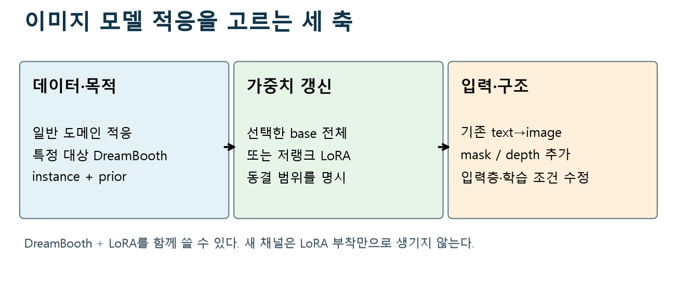
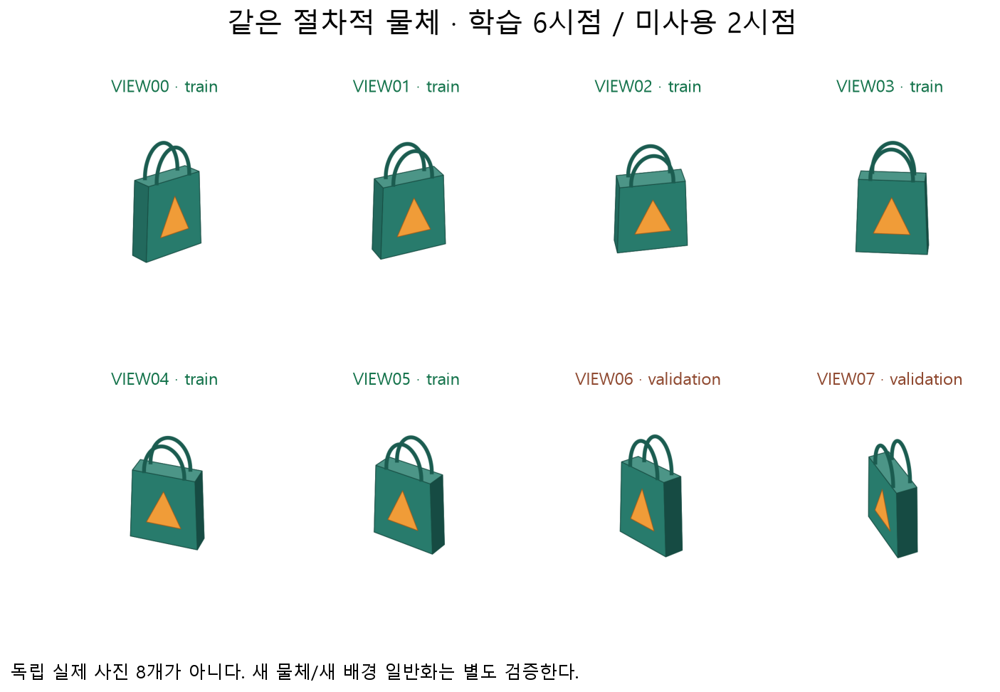
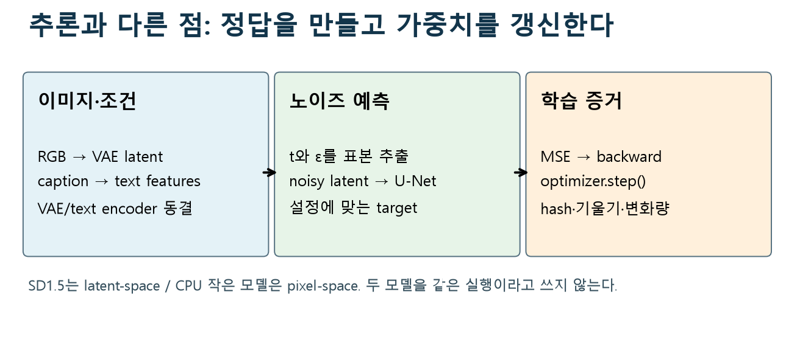
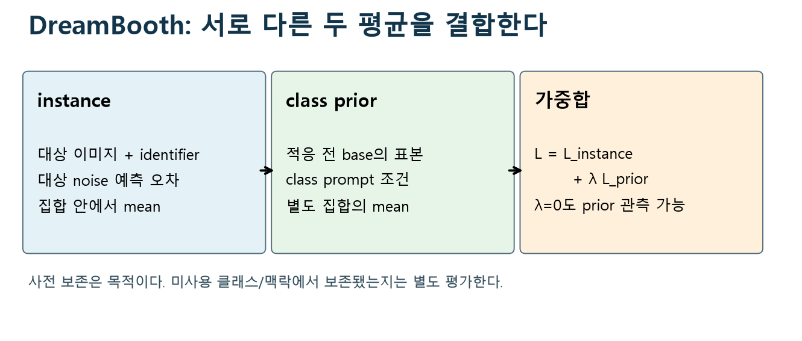
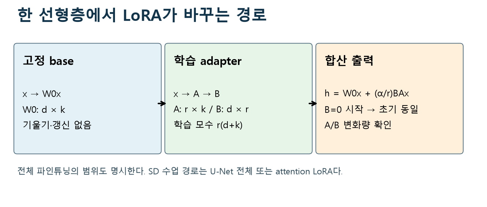
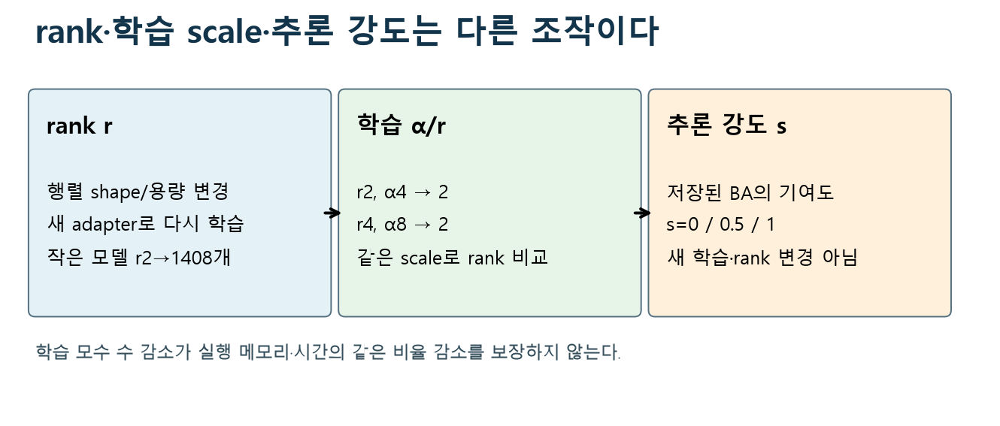
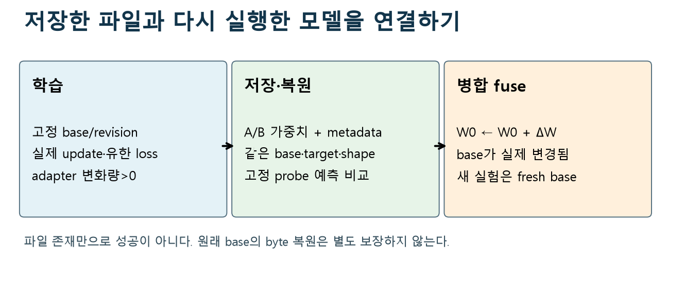
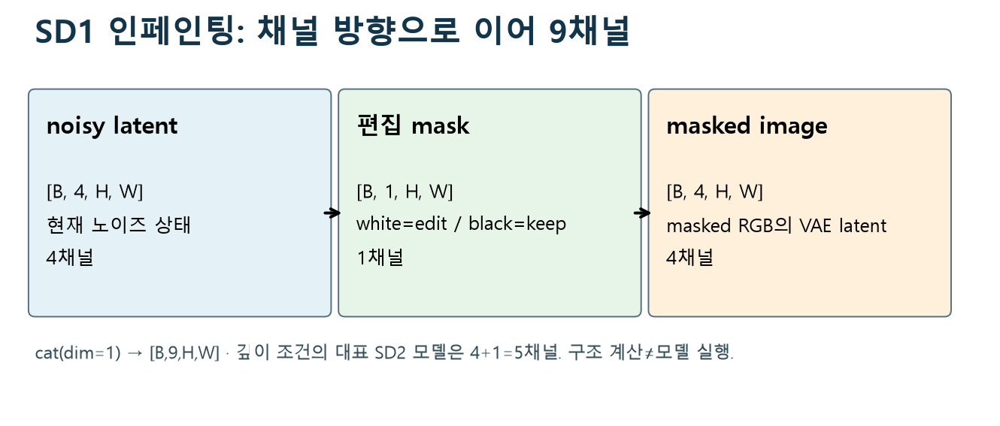
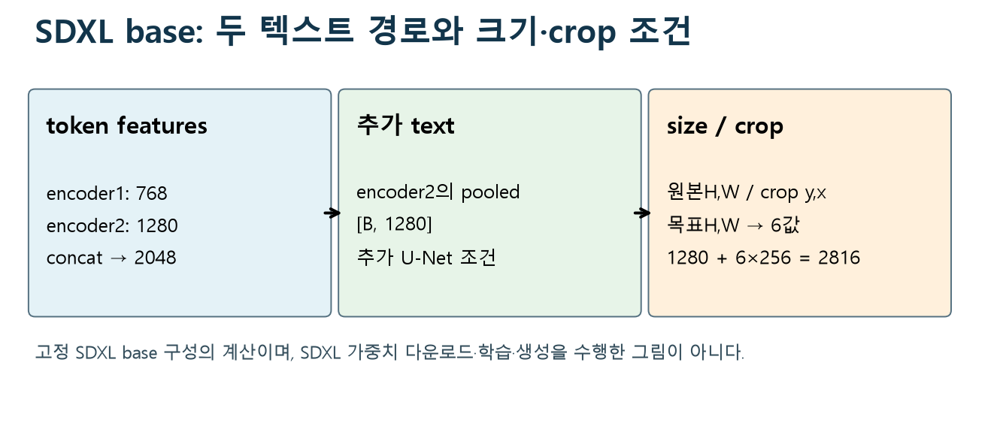
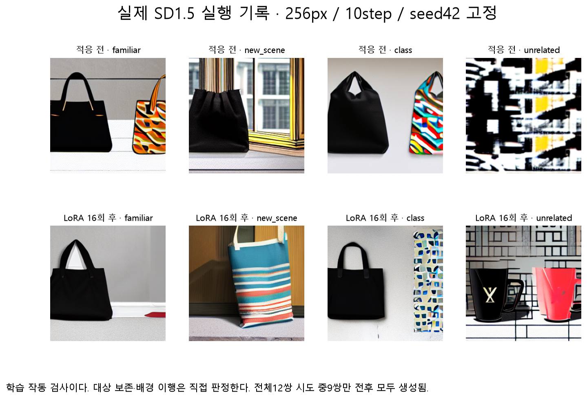

# W10B · 이미지 생성 모델에 새 대상을 가르치기

2026-11-04 · 생성형 인공지능 10주차 2차시 · 『핸즈온 생성형 AI』 7장 전체

같은 가방 사진 몇 장을 학습시킨 뒤, 그 가방을 새로운 배경에서 생성하려면 무엇이 달라져야 할까요? **어떤 데이터를 주고, 어느 가중치를 갱신하며, 무엇을 유지했는지 확인하는가**를 연결합니다. 마지막에는 직접 만든 실험 설명을 웹 앱에 연결합니다.

[Colab A · 실제 작은 모델 적응](https://colab.research.google.com/github/lunalab-ai/genAI/blob/2026-fall-w10b/notebooks/student/w10b_diffusion_adaptation.ipynb) · [Colab B · 실제 SD 기록·조건·SDXL 프로젝트](https://colab.research.google.com/github/lunalab-ai/genAI/blob/2026-fall-w10b/notebooks/student/w10b_diffusion_project.ipynb) · [활동 기록지](w10b-workbook.md) · [API와 실제 정의](https://github.com/lunalab-ai/genAI/blob/2026-fall-w10b/src/W10B-API.md)

두 Colab은 각각 Drive에 새 사본을 저장하고 첫 셀부터 실행합니다. A에서 저장한 파일을 B에 옮길 필요가 없습니다. 패키지 `luna-genai 0.1.17`, 공개 버전 `2026-fall-w10b`를 사용하며 다른 버전을 이미 import했다면 런타임을 재시작합니다. 데이터는 패키지와 함께 자동 준비합니다. 개인 사진·API 키·유료 GPU가 필수는 아닙니다. 새 성적 과제나 제출 기한은 없습니다.

## 1. 이번 장의 지도: 목적·갱신·입력을 구별하기

지난 시간에는 언어 모델의 기본 가중치를 고정하고 LoRA만 학습했습니다. 이번에도 같은 행렬 원리를 사용하지만, 예측 대상은 다음 토큰이 아니라 **이미지 또는 잠재 표현에 더한 노이즈**입니다. 텍스트는 생성할 내용을 지정하는 조건입니다.

그림 읽기: 먼저 왼쪽에서 학습하려는 목적을 고르고, 가운데에서 갱신 대상을 정한 뒤, 오른쪽에서 입력 구조를 확인합니다. 출처: 주교재 7.1–7.5를 바탕으로 새로 설계한 수업 도식.

| 질문 | 대표 선택 | 확인할 증거 |
|---|---|---|
| 무엇을 가르칠까? | 도메인·스타일 적응 / DreamBooth로 특정 대상 | 데이터·캡션·instance/class 구성 |
| 무엇을 갱신할까? | U-Net 전체 / LoRA / 선택한 텍스트 인코더 | 학습 가능 모수·기울기·전후 변화량 |
| 무엇을 입력받을까? | 텍스트 / 마스크와 이미지 / 깊이 조건 | 실제 입력 채널과 학습 데이터 |

**DreamBooth와 LoRA는 결합할 수 있습니다.** DreamBooth는 소수의 특정 대상 예제와 식별자·클래스·보존 손실을 구성하는 방식이고, LoRA는 갱신을 저랭크 행렬에 제한하는 방식입니다. ‘전체 파인튜닝, DreamBooth, LoRA 중 하나만 선택한다’고 외우면 관계를 놓치게 됩니다.

‘전체 모델’이라는 이름도 실제 코드에서 확인합니다. Diffusers의 기본 text-to-image 학습은 VAE와 텍스트 인코더를 고정하고 U-Net을 학습합니다. DreamBooth에서 텍스트 인코더의 추가 학습은 선택 사항입니다. VAE까지 언제나 모두 학습한다는 뜻은 아닙니다.

## 2. 7.1 · 이미지와 문장을 학습 문제로 만들기

### 2.1 데이터에서 먼저 확인할 것

이미지·캡션 쌍은 ‘보여 주는 것’과 ‘설명하는 것’이 맞아야 합니다. 잘못된 캡션, 비슷한 이미지의 과도한 반복, 항상 같은 배경은 모델이 배울 관계를 바꿉니다. 이미지 수가 많아도 특정 시점이나 배경으로 치우칠 수 있습니다. 교재의 이미지 수·학습 시간·VRAM 수치는 당시 예제 조건이며 모든 데이터와 모델의 보편적인 임계값은 아닙니다.

이번 데이터는 초록색 몸체, 주황색 삼각형, 두 손잡이가 있는 **자체 제작 3-D 가방의 서로 다른 카메라 렌더 8개**입니다. 실제 사진이 아닙니다. 카메라 원본 그룹을 먼저 학습 6개·검증 2개로 나눕니다. 한 원본의 증강 사본을 양쪽에 나누면 검증이 쉬워지는 누출이 생길 수 있습니다. 같은 렌더러의 단일 물체이므로 실제 사진이나 새로운 물체 전체의 일반화 성능을 보여 주는 데이터는 아닙니다.

출처: 이번 수업에서 직접 작성한 기하 모델과 카메라 렌더. 앞의 6개와 뒤의 2개를 원본 시점 단위로 나누었습니다. 그림을 회전시킨 복사본을 새 원본으로 세지 않았습니다.

### 2.2 Stable Diffusion의 한 번의 학습

이미지의 정답 픽셀을 그대로 복사하는 대신, 무작위 시각의 노이즈 제거 문제를 만듭니다. SD1 계열의 대표적인 경로는 다음과 같습니다.

1. RGB 이미지를 VAE로 인코딩하여 잠재 표현을 만듭니다.
2. 시각과 가우스 노이즈를 뽑아 잠재 표현을 흐립니다.
3. 텍스트 인코더로 프롬프트 조건을 만듭니다.
4. U-Net이 흐린 잠재 표현·시각·텍스트 조건으로 노이즈를 예측합니다.
5. 예측과 실제 노이즈의 오차를 역전파하여 선택한 가중치를 갱신합니다.

출처: 주교재 7.1·그림 7-1의 관계를 SD 학습 흐름에 맞추어 재구성했습니다. 파란 부분은 고정, 주황 부분은 선택적으로 학습하는 경로입니다. 생성 중 여러 번 수행하는 샘플링과 optimizer 업데이트를 구별하세요.

$$
z_0=s_{\mathrm{VAE}}E(x),\qquad
z_t=\sqrt{\bar\alpha_t}z_0+\sqrt{1-\bar\alpha_t}\epsilon,
\quad\epsilon\sim\mathcal N(0,I)
$$

$$
c=T(p),\qquad
\mathcal L_{\mathrm{noise}}=
\mathbb E\left[\left\lVert\epsilon-\epsilon_\theta(z_t,t,c)\right\rVert_2^2\right]
$$

여기서 이미지·캡션은 데이터, 시각과 노이즈는 학습 문제를 만드는 무작위 변수, 노이즈는 이 설정의 정답입니다. 수업 코드의 MSE는 배치·채널·공간 원소에 대한 **평균**입니다. scheduler가 `v_prediction`을 사용하면 정답도 그에 맞게 바뀌므로 무조건 노이즈를 정답으로 복사하지 않습니다.

### 완성 예제 E1 · 손으로 계산한 노이즈 MSE

정답 노이즈가 $(1,0,-1)$, 예측이 $(0.5,0.5,-0.5)$라면 제곱 오차는 각각 $0.25$입니다.

$$
\operatorname{MSE}=\frac{(1-0.5)^2+(0-0.5)^2+(-1+0.5)^2}{3}=0.25
$$

이 값은 주어진 노이즈 예측 문제의 오차입니다. 생성된 가방이 얼마나 닮았는지의 점수는 아닙니다. `backward()`는 기울기를 만들고, `optimizer.step()`이 실제 가중치를 바꿉니다. 추론에는 이 두 단계가 없습니다.

### 2.3 이번 CPU 실습의 위치

Colab A는 W06B에서 실제 6,000회 사전학습한 작은 조건부 확산 모델을 사용합니다. 입력과 출력은 `[B,1,28,28]`이고 조건은 Fashion-MNIST의 Bag 클래스 ID 8입니다. 이 조건은 **텍스트 식별자나 분류 정답이 아닙니다.** 정답은 여전히 추가한 노이즈입니다. 이 모델에는 SD의 VAE·텍스트 인코더·교차 어텐션이 없습니다.

같은 가방 렌더를 CPU 모델에서는 검은 배경의 작은 그레이스케일 실루엣으로, 실제 SD에서는 RGB/VAE 입력으로 사용합니다. 작은 실험은 전체 갱신·저랭크 갱신·사전 보존의 작동을 빠르게 관찰하도록 축소한 것입니다. 텍스트를 이용하는 실제 SD 경로는 Colab B에서 구분해 확인합니다.

## 3. 7.2 · DreamBooth: 특정 대상과 클래스의 지식 연결

일반적인 ‘가방’과 ‘이번에 보여 준 특정 가방’을 구분하려면 새 대상을 지칭하는 단서가 필요합니다. 이번 instance prompt는 `an illustration of lunabag tote bag`, class prompt는 `an illustration of a tote bag`입니다. 식별자는 대상과 연결되고 클래스 명사는 모델이 이미 알고 있는 넓은 범주와 연결됩니다.

`lunabag`라는 문자열이 토크나이저에서 반드시 한 토큰이 되는 것은 아닙니다. Colab B에서 실제 SD 토크나이저의 조각과 ID를 읽습니다. 익숙한 단어와 의미가 강하게 충돌하지 않도록 식별자를 선택하고, 같은 모델의 토크나이저를 사용합니다. **문자열을 넣는 것과 새로운 임베딩을 학습하는 것은 다른 일**입니다. Textual Inversion은 주로 새 임베딩을 학습하고 모델 본체를 고정하는 접근이며, DreamBooth의 본체/LoRA 갱신과 구별합니다.

### 3.1 왜 사전 보존 손실을 더할까?

특정 가방의 몇 장만 반복하면 일반적인 가방도 모두 그 대상처럼 생성하거나 배경을 외울 수 있습니다. 사전 보존은 **적응 전 모델이 클래스 프롬프트로 생성한 이미지**도 함께 학습 문제로 사용하여 클래스의 기존 다양성을 유지하도록 유도합니다. 모든 지식을 완벽하게 보존한다는 보장은 없습니다.

출처: 주교재 7.2·그림 7-2와 DreamBooth 원논문의 두 손실 관계를 수업용으로 재구성했습니다. 원논문의 Imagen 도식과 실제 SD의 VAE/U-Net 구성은 구별합니다. 클래스 이미지는 파인튜닝이 끝난 모델에서 뒤늦게 만든 것이 아닙니다.

$$
\mathcal L=\mathcal L_{\mathrm{instance}}+lambda\mathcal L_{\mathrm{prior}}
$$

두 항은 각각 자신의 이미지·원소 수로 평균합니다. 모든 행을 무조건 합쳐 한 번 평균하면 가중치와 분모의 의미가 달라집니다. 수업 실험은 instance와 prior 노이즈 문제를 함께 계산하며, $lambda=0$에서는 prior 항이 기울기에 기여하지 않습니다.

### 완성 예제 E2 · 손실 두 개의 가중합

instance MSE가 $0.4$, prior MSE가 $0.2$, 가중치가 $0.5$라면 다음과 같습니다.

$$
\mathcal L=0.4+0.5\times0.2=0.5
$$

가중치를 바꾸어 total loss가 커졌다는 사실만으로 실험이 나빠졌다고 판정하지 않습니다. 비교할 때는 **공통된 새 시점 MSE, 기존 클래스 MSE, 생성 결과**를 다시 평가합니다.

### 3.2 실습에서 관찰할 네 조건

Colab A는 같은 사전학습 체크포인트·분할·난수·학습량으로 `full_prior0`, `full_prior1`, `lora_prior0`, `lora_prior1`을 실행합니다. prior 이미지는 모든 적응 전에 같은 기본 모델에서 준비하며 학습용과 평가용 표본을 구분합니다.

| 조건 | 갱신 대상 | 보존 항의 가중치 |
|---|---|---:|
| base | 갱신하지 않음 | 해당 없음 |
| full_prior0 | 작은 U-Net 전체 | 0 |
| full_prior1 | 작은 U-Net 전체 | 1 |
| lora_prior0 | 선택한 선형층의 A/B | 0 |
| lora_prior1 | 선택한 선형층의 A/B | 1 |

CPU 실험의 prior는 Bag 클래스이고, 다른 클래스의 평가 표본도 따로 확인합니다. 특정 클래스 보존이 모든 기존 지식 보존과 같은지 생각해 보세요. 모든 방법이 모든 지표를 동시에 개선해야 한다는 가정은 두지 않습니다.

## 4. 7.3 · LoRA: 무엇을 적게 학습하는가?

지난 언어 모델 수업의 행렬 식은 이미지 생성 모델에서도 같습니다.

$$
W_0\in\mathbb R^{d\times k},\quad A\in\mathbb R^{r\times k},\quad B\in\mathbb R^{d\times r},\qquad
h=W_0x+\frac{\alpha}{r}BAx
$$

기본 $W_0$는 고정하고 A/B를 학습합니다. 작은 CPU 모델은 시간 특징을 투영하는 선형층을, 실제 SD 실험은 U-Net 어텐션의 `to_q`, `to_k`, `to_v`, `to_out.0`을 선택합니다. 같은 원리라도 **어느 층에 삽입했는지**는 모델마다 확인해야 합니다.

출처: 주교재 7.3·그림 7-5의 개념과 이번 작은 모델의 실제 모수 조사. 전체 142,513개, rank4 어댑터 2,816개는 이번 구조의 값이며 다른 모델의 비율이 아닙니다.

### 완성 예제 E3 · 선택한 한 층의 모수 수

입출력 차원이 모두 512이고 rank가 4라면 bias를 제외한 전체 가중치는 $512^2=262{,}144$개이고, LoRA는 $4(512+512)=4{,}096$개입니다.

$$
N_{\mathrm{full}}=dk,\qquad N_{\mathrm{LoRA}}=r(d+k)
$$

이 계산은 선택한 층의 학습 모수 수입니다. 기본 모델·활성값·VAE·텍스트 인코더가 메모리에서 사라지는 것은 아닙니다. optimizer와 gradient를 저장하는 양은 줄일 수 있지만 실제 속도·최대 메모리는 해상도·배치·장치·구현을 함께 측정합니다.

### 4.1 초기화와 실제 학습 증거

A는 작은 난수, B는 0으로 시작하면 초기 업데이트는 0입니다. 첫 역전파에서 A의 기울기가 0이어도 B에는 기울기가 생길 수 있습니다. B가 바뀐 다음에는 A도 학습할 수 있습니다. 출력 그림이 비슷해 보인다는 이유로 학습이 없었다고 결론 내리지 말고 다음을 읽습니다.

- 실제 학습 가능한 모수와 고정 모수의 수
- A/B 기울기와 optimizer 전후 변화량
- 기본 모수의 전후 해시
- 새 데이터와 기존 클래스의 공통 평가 결과
- 동일한 프롬프트·시드·샘플러 조건의 생성 결과

### 4.2 rank, 학습 스케일, 추론 스케일

출처: 주교재 7.3과 지난 W10A LoRA 식을 연결해 새로 구성한 도식. rank는 표현할 변화의 범위와 모수 수에, 학습률과 학습량은 실제 최적화에 영향을 줍니다. rank를 비교할 때는 $alpha/r$도 고정합니다.

이미 학습한 어댑터의 추론 scale만 바꾸는 것은 재학습이 아닙니다. 서로 다른 rank, 학습률, 학습량을 한꺼번에 바꾸고 rank의 효과라고 해석하지 않습니다. 높은 rank가 항상 더 좋은 결과를 보장하지 않습니다.

### 완성 예제 E4 · gradient accumulation의 단위

장치 1개에서 instance microbatch 1개와 class microbatch 1개를 처리하고, 4회 누적한 뒤 optimizer를 한 번 실행한다면 해당 업데이트에 기여한 instance는 4개, class도 4개입니다. 두 종류를 합치면 8개를 처리했지만 instance 유효 배치는 4입니다.

$$
B_{\mathrm{instance,eff}}=B_{\mathrm{instance,micro}}\times A_{\mathrm{accum}}\times N_{\mathrm{devices}}=1\times4\times1=4
$$

누적은 optimizer 업데이트 시점을 바꾸는 방법이고 gradient checkpointing은 중간 활성값을 덜 저장하고 다시 계산하는 방법입니다. 작은 GPU 배치와 큰 유효 배치를 구별하세요. 업데이트 수·epoch 수·처리 이미지 수는 서로 같은 단위가 아닙니다.

### 4.3 저장·로드·병합은 각각 다른 확인

출처: 주교재 7.3의 기본 모델 선택·LoRA 로드·선택적 병합 흐름을 재구성했습니다. 식별자와 추론 설정도 가중치와 함께 기록해야 합니다.

어댑터만 저장했다면 같은 기본 모델과 revision이 필요합니다. `load_lora_weights()`는 어댑터를 붙이는 단계이고 `fuse_lora()`는 그 변화를 기본 가중치에 합치는 단계입니다. 재로딩 전후에 같은 입력의 U-Net 예측을 비교하면 저장·복원이 맞는지 확인할 수 있습니다. 병합도 dtype에 맞는 허용 오차로 따로 확인합니다. 병합과 역병합 뒤 기본 파일 바이트가 정확히 같다고 가정하지 않습니다.

교재 예제의 `Little Tinies`는 현재 모델 카드상 SDXL 기반입니다. 제공 예제 노트북의 SD 1.4 주석을 그대로 복사하여 다른 기본 모델에 붙이지 않습니다. 모델 카드의 기반 모델과 어댑터 구조가 맞는지 먼저 확인합니다.

## 5. 7.4 · 새로운 입력을 받게 하는 구조 확장

### 5.1 인페인팅: 어디를 바꿀지 알려 주기

인페인팅은 주어진 이미지의 지정 영역을 새 내용으로 채우는 작업입니다. 이번 도식의 마스크는 흰색 1이 편집 영역, 검은색 0이 보존할 영역입니다. 마스크를 반전하면 작업 자체가 바뀝니다. UI와 라이브러리의 규약을 확인해야 합니다.

출처: 주교재 7.4.1의 입력 채널 설명을 재구성했습니다. 이미 학습된 인페인팅 모델을 사용하는 일과 새 9채널 모델을 학습하는 일은 다릅니다. 수업의 작은 텐서 조립은 실제 인페인팅 이미지 생성이 아닙니다.

### 완성 예제 E5 · 채널 축으로 합치기

배치 2에서 흐린 잠재 표현이 `[2,4,64,64]`, 마스크가 `[2,1,64,64]`, 마스킹한 RGB 이미지를 VAE로 인코딩한 표현이 `[2,4,64,64]`라면 채널 축으로 연결한 결과는 `[2,9,64,64]`입니다. 배치 축으로 붙이면 같은 의미가 되지 않습니다.

$$
4+1+4=9,\qquad z_{\mathrm{in}}=\operatorname{concat}_{\mathrm{channel}}(z_t,m,E(x_{\mathrm{masked}}))
$$

VAE 인코딩과 마스크 곱셈의 순서를 임의로 바꾸지 않습니다. 마스킹한 RGB의 인코딩과 기존 latent에 마스크를 곱한 것은 일반적으로 같지 않습니다. 또한 실제 생성에서는 마스크 밖의 픽셀도 조금 달라질 수 있으므로 ‘그 밖은 항상 바이트가 같다’는 검사를 품질 기준으로 삼지 않습니다.

### 5.2 깊이 조건: 스타일과 공간 구조의 차이

깊이 조건 모델은 추가적인 공간 조건으로 장면 구조를 반영합니다. 교재의 SD2 depth 예는 잠재 4채널에 깊이 1채널을 더하는 구조입니다. 반면 인페인팅은 마스크와 마스킹한 이미지의 정보가 필요합니다. 단순한 LoRA 삽입만으로 필요한 새 입력 채널과 학습 데이터가 자동으로 생기지는 않습니다.

ControlNet과 다른 조건 어댑터는 이 문제를 효율적으로 다루는 연결 주제입니다. 이번에는 추가 입력과 학습의 필요성을 이해하고, 다음 이미지 편집·조건 제어 수업에서 구체적인 사용을 확장합니다.

## 6. 7.5 · SDXL DreamBooth-LoRA 프로젝트 전체 보기

SDXL은 SD1.5의 설정 이름만 바꾼 모델이 아닙니다. 더 큰 U-Net, 두 텍스트 인코더와 추가 조건을 사용합니다. 실제 실행 코드를 고를 때 모델·토크나이저·조건·어댑터·메모리를 함께 확인합니다.

출처: 주교재 7.5와 SDXL-base의 공식 설정·Diffusers 0.40.0 학습 코드를 대조해 작성한 도식. 아래 차원은 해당 SDXL-base 설정의 예이며 모든 모델의 공통 차원은 아닙니다.

### 완성 예제 E6 · SDXL의 두 종류의 조건

표준 SDXL-base에서 두 토큰 특징의 폭 768과 1280을 연결하면 2048입니다. 두 번째 인코더의 pooled 특징은 1280이고, 원본 크기·crop 위치·목표 크기를 나타내는 값 6개는 각각 폭 256의 특징으로 바뀝니다.

$$
768+1280=2048,\qquad 1280+6\times256=2816
$$

토큰별 특징 `[B,77,2048]`과 pooled 특징 `[B,1280]`은 같은 텐서가 아닙니다. 예시 크기 조건은 `(1024,1024,0,0,1024,1024)`이며 원본 높이·너비, crop의 위·왼쪽 위치, 목표 높이·너비를 순서대로 읽습니다. 이 계산은 SDXL 가중치를 불러와 학습·생성했다는 뜻이 아닙니다.

### 6.1 데이터부터 재로딩까지

| 단계 | 구현과 확인 |
|---|---|
| 데이터 | instance 이미지 6개와 검증 시점 2개를 분리하고 identifier/class prompt를 기록 |
| 기본 모델 | SDXL-base와 revision을 고정하고 SD1.5 어댑터를 섞지 않음 |
| 학습 설정 | rank·학습률·업데이트 수·해상도·누적·정밀도·사전 보존을 명시 |
| 학습 경로 | VAE·두 텍스트 인코더·U-Net 기본 모수의 고정 여부와 LoRA 갱신 확인 |
| 검증 | 학습 때 없는 배경·시점과 identifier 없는 클래스·무관 대상을 비교 |
| 저장 | 기본 모델 정보와 별도 어댑터를 보존하고 같은 기반에서 재로딩 |
| 결과 설명 | 대상 보존·프롬프트 이행·배경 반복·클래스 다양성·자원을 따로 기록 |

Colab B의 기본 경로는 프로젝트 파일과 고정된 공식 스크립트의 실행 인자 목록을 준비합니다. **SDXL 학습은 기본으로 실행하지 않습니다.** 선택 실행은 지원 GPU와 추가 의존성이 필요하며, 수 GB의 가중치를 받습니다. T4에서도 모든 설정이 동작한다고 보장하지 않습니다. 실행하지 않은 경로는 그대로 미실행으로 표시합니다. 모델 Hub 업로드나 유료 서비스를 자동 호출하지 않습니다.

## 7. 실제 결과를 어떻게 읽을까?

Colab A의 기본 실험은 각 조건에서 실제 optimizer 업데이트 16회를 수행합니다. 제작 당시 CPU 관측의 일부는 다음과 같습니다. MSE는 같은 검증 이미지·시각·노이즈로 계산했으며 새로운 실행 환경에서는 작은 수치 차이가 날 수 있습니다.

| 조건 | 학습 모수 수 | 새 시점 노이즈 MSE | 기존 Bag prior MSE |
|---|---:|---:|---:|
| base | 0 | 0.035470 | 0.088074 |
| full_prior0 | 142,513 | 0.027219 | 0.103539 |
| full_prior1 | 142,513 | 0.025111 | 0.092380 |
| lora_prior0 | 2,816 | 0.035081 | 0.088100 |
| lora_prior1 | 2,816 | 0.035198 | 0.087994 |

한 열만 보고 결론 내리지 말고 어떤 변화가 일어났는지 서로 설명해 보세요. 모수 수가 적다는 장점, 새 데이터 적응, 기존 클래스 보존, 생성 품질은 별도의 질문입니다. 작은 노이즈 평가를 현실의 이미지 품질 순위로 확대하지 않습니다.

출처: 이번 수업에서 실제 실행한 SD1.5 LoRA 실험의 이미지·설정 기록. 작은 CPU 모델 그림과 구분합니다. 내용 검사에서 차단된 항목은 그림 평가 대상이 아니며 실행 기록에 상태를 남깁니다. 차단을 해제하거나 대체 그림을 성공 결과로 넣지 않습니다.

Colab B와 앱은 **사전 실행 기록을 읽는 모드**와 선택한 **현재 런타임의 실제 SD 실행**을 구별합니다. 기록 선택 버튼을 누르는 것은 SD를 새로 생성하는 일이 아닙니다. 본문에 없는 프롬프트의 결과를 기존 그림으로 대신 보여 주지도 않습니다.

비교할 때는 같은 기본 모델·데이터·분할·학습량·생성 seed·샘플러·steps·CFG를 기록합니다. rank 실험에서는 $alpha/r$를 통제합니다. 여러 seed와 새로운 맥락에서 대상의 특징과 지시 이행을 따로 봅니다. CLIP 점수 하나만으로 동일 대상 여부나 전체 품질을 확정하지 않습니다.

## 8. 7.6 · 마지막 웹 앱과 새로운 사례 설명

앱의 위젯은 값을 받고, 이벤트는 함수를 호출하며, 함수는 표·그림·JSON을 반환합니다. 재사용 모듈은 모델과 평가를 맡고, 노트북은 실험과 설명을 맡습니다. 같은 모델 객체를 재사용하므로 버튼마다 다시 학습하지 않습니다.

Colab A에서는 학습 조건과 seed를 선택해 실제 소형 모델 표본을 확인합니다. Colab B에서는 실제 SD 기록의 prompt·seed 조합, 채널·마스크, SDXL 조건 계산을 관찰합니다. 마지막에 자신의 설명 함수를 연결하고 실험 JSON을 내려받습니다. 공유 주소는 해당 Colab 런타임이 실행되는 동안 유지됩니다.

다음 사례에서 필요한 증거와 다음 실험을 스스로 설명해 보세요. “특정 가방은 닮았지만 새로운 배경에서도 학습 배경이 반복된다.” 가중치 변화만 볼 것인지, 데이터의 배경·캡션과 검증 프롬프트까지 볼 것인지 판단하고 한 조건만 바꾼 비교를 제안합니다.

교재의 연습 문제 6개와 도전 과제 1개는 [활동 기록지의 대응표](w10b-workbook.md)에 연결했습니다. 점검 질문은 먼저 자신의 말로 답하고 별도의 공개 개념 해설과 비교하세요.

## 참고자료와 구현의 범위

- 주교재 『핸즈온 생성형 AI』 7.1–7.6, 장말 연습·도전·참고자료. 스캔의 PDF 펼침 1–13 전체를 확인했으며 원자료와 출판사 완성 해답은 배포물에 넣지 않습니다.
- [DreamBooth 원논문](https://arxiv.org/html/2208.12242v2): 식별자·클래스·사전 보존의 의미.
- [Diffusers text-to-image 학습](https://huggingface.co/docs/diffusers/training/text2image), [DreamBooth](https://huggingface.co/docs/diffusers/training/dreambooth), [LoRA](https://huggingface.co/docs/diffusers/training/lora): 실제 갱신 범위와 API 연결.
- [Diffusers 0.40.0 SDXL DreamBooth-LoRA 코드](https://github.com/huggingface/diffusers/blob/v0.40.0/examples/dreambooth/train_dreambooth_lora_sdxl.py): 이번 과목의 고정 라이브러리 버전과 대조한 선택 프로젝트 경로.
- [SDXL-base 공식 설정](https://huggingface.co/stabilityai/stable-diffusion-xl-base-1.0/blob/main/unet/config.json), [인페인팅 공식 설명](https://huggingface.co/docs/diffusers/using-diffusers/inpaint), [Little Tinies 모델 카드](https://huggingface.co/alvdansen/littletinies).

원문 용어와 방법론을 유지하되 수계산·기하 데이터·비교 실험·도식과 활동은 이번 수업을 위해 새로 설계했습니다. 실행된 작은 모델, 실제 SD1.5, 저장 기록 분석, 선택 SDXL 구성/미실행 경로를 구분합니다.
