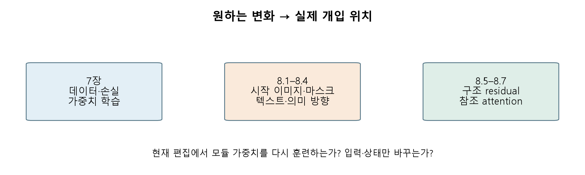
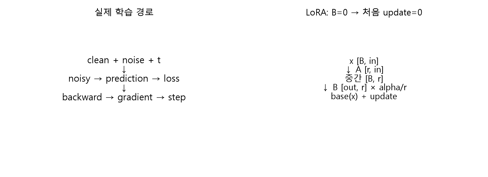
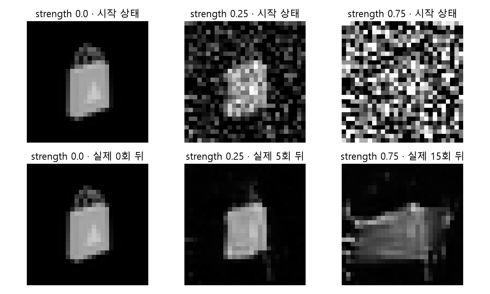
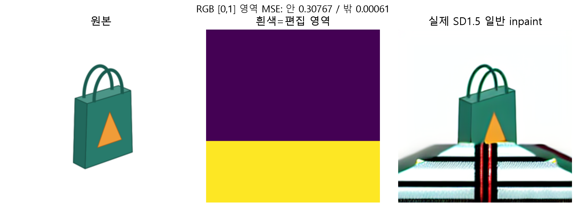
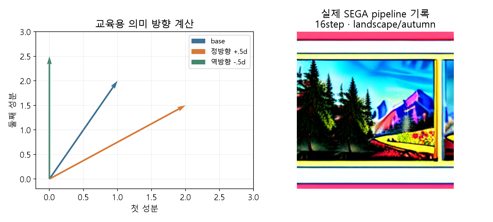
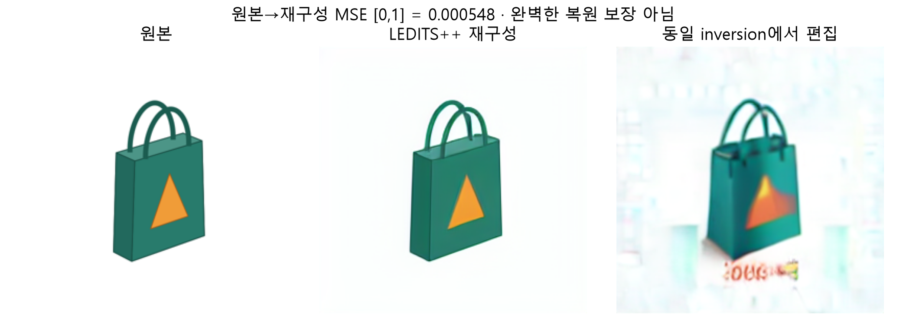
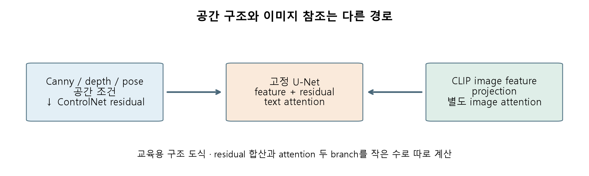
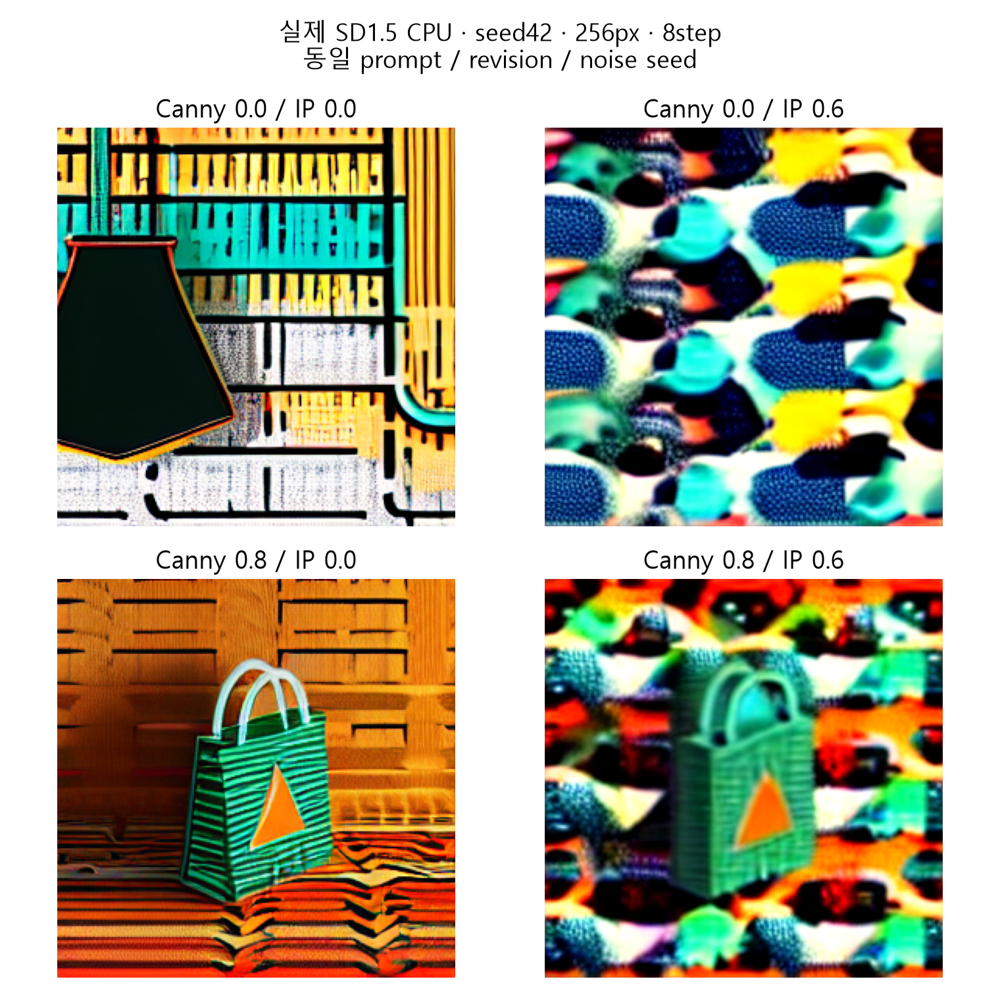
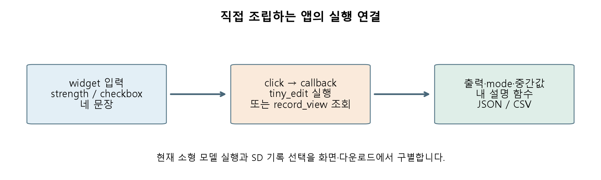

# W11A · 이미지 생성의 학습과 제어

2026년11월9일 · 생성형 인공지능 · 『핸즈온 생성형 AI』8장 전체 + 7장 실습 보완

이번 목표는 **원하는 변화가 계산의 어디에 들어가는지 설명하고, 조건 하나를 바꿔 확인하는 것**입니다. 이전 실습 A/B의 문제·데이터는 유지하고, 핵심 구현과 중간값을 같은 화면에서 읽도록 보강했습니다.

실습 순서: [7장 A 개선판](https://colab.research.google.com/github/lunalab-ai/genAI/blob/2026-fall-w11a/notebooks/student/w10b_diffusion_adaptation.ipynb) → [7장 B 개선판](https://colab.research.google.com/github/lunalab-ai/genAI/blob/2026-fall-w11a/notebooks/student/w10b_diffusion_project.ipynb) → [8장 A](https://colab.research.google.com/github/lunalab-ai/genAI/blob/2026-fall-w11a/notebooks/student/w11a_image_editing.ipynb) → [8장 B·앱](https://colab.research.google.com/github/lunalab-ai/genAI/blob/2026-fall-w11a/notebooks/student/w11a_control_project.ipynb).

각 노트북은 처음부터 독립 실행합니다. CPU 필수 경로에는 데이터·소형 사전학습 checkpoint·실제 SD 실행 기록이 자동 준비됩니다. API 키·개인 사진·유료 GPU가 필요하지 않습니다. 현재 소형 모델 실행과 전체 SD 사전 실행 기록을 구별합니다. SDXL·T4 현재 실행은 선택이며 이번 CPU 검증과 별개입니다.

## 1. 먼저 나눌 것: 가중치 학습과 생성 조건

7장에서는 학습 데이터로 **가중치**를 바꿨습니다. 8장에서는 준비된 모델에 시작 이미지·편집 영역·구조·참조 등을 주어 **생성 과정**을 제어합니다. ControlNet과 IP-Adapter 자체는 별도로 학습된 모듈이지만, 이번 편집 실습에서 그 모듈을 다시 훈련하지는 않습니다.

그림1 · 교재7–8장의 관계를 수업용으로 재구성했습니다. 왼쪽에서 오른쪽으로 읽으며 ‘어느 tensor 또는 가중치가 달라지는가’를 확인합니다. 원본 스캔을 복제한 그림이 아닙니다.

| 바꾸려는 것 | 방법 | 실제 개입 위치 |
|---|---|---|
| 새 대상을 가르치기 | 전체 파인튜닝·DreamBooth·LoRA | 학습 목적·학습 파라미터 |
| 원래 그림에서 다른 장면으로 | image2image | 시작 latent/noise·시작 timestep |
| 그림 일부를 바꾸기 | inpainting | mask·masked image·denoising 또는 후처리 |
| 텍스트의 강조·의미 바꾸기 | weighting·P2P·SEGA | embedding·attention·noise prediction |
| 이미 있는 사진의 대응 경로 찾기 | inversion | latent/noise trajectory·보정 변수 |
| 모양 또는 참조 이미지 반영 | ControlNet·IP-Adapter | 중간 residual·이미지 attention |

## 2. 7장 실습: 손실이 어떻게 실제 학습이 되는가

소형 모델은 깨끗한 이미지 $x_0$에 실제로 주입한 noise $\epsilon$를 예측합니다. class8은 Bag 조건이며 분류 정답이 아닙니다. 예측값과 noise를 비교하고, gradient를 계산한 뒤 optimizer가 학습 가능한 파라미터를 갱신합니다.

$$x_t=\sqrt{\bar\alpha_t}x_0+\sqrt{1-\bar\alpha_t}\epsilon$$

$$L_{instance}=\frac{1}{N_iD}\sum_{i=1}^{N_i}\sum_{j=1}^{D}(\hat\epsilon_{ij}-\epsilon_{ij})^2$$

$$L=L_{instance}+\lambda L_{prior}$$

$N_i$는 instance 수, $D$는 한 표본의 noise 원소 수입니다. 실제 `mse_loss`는 표본과 픽셀/latent 원소 전체를 평균냅니다. instance와 prior는 각 집합 안에서 따로 평균냅니다.

작은 예: instance 제곱오차가 .25와1이면 평균 .625입니다. prior 제곱오차가 .5와.5이면 평균 .5입니다. $\lambda=.5$일 때 합은 $.625+.5\times.5=.875$입니다. 두 집합 전체를 한 번에 평균내는 것과 다릅니다.

그림2 · 수업 추가 계산 예. `zero_grad → prediction → loss → backward → step`의 순서를 읽습니다. `backward()`는 gradient를 계산하며 `optimizer.step()`이 가중치를 바꿉니다. loss 한 개만 보고 품질 개선을 단정하지 않습니다.

LoRA는 $W_0$를 고정하고 작은 두 행렬을 학습합니다.

$$y=W_0x+\frac{\alpha}{r}BAx,\quad A\in\mathbb R^{r\times d_{in}},\ B\in\mathbb R^{d_{out}\times r}$$

예: 입력4·출력3·rank2이면 전체 행렬12개, LoRA는 $2(4+3)=14$개입니다. 작은 층에서는 오히려 늘 수 있습니다. LoRA가 항상 더 작다는 주장 대신 실제 차원을 계산해야 합니다. 큰 입력768·출력256·rank8은 8,192개로 전체196,608개보다 작습니다. $\alpha=16,r=8$의 scale은2입니다.

실습 A에서는 B를0으로 초기화합니다. 첫 출력은 base와 같고, 첫 A gradient가0이어도 구현 실패가 아닙니다. B가0인 상태의 연쇄법칙 때문입니다. **base hash 불변·adapter 변화·유한 gradient·실제 update·저장/복원 probe**를 함께 확인합니다. SD 실습의 target은 scheduler가 `epsilon`인지 `v_prediction`인지 확인합니다. 이 두 target을 섞으면 같은 학습이 아닙니다.

## 3. 8.1 · image2image: 어디서 denoising을 시작할까

입력 이미지를 VAE latent로 바꾸고, 선택한 timestep까지 noise를 섞은 뒤 그 지점부터 denoising합니다. strength가 커지면 대체로 더 많은 noise를 넣는 시점에서 시작해 원본에서 멀어질 여지가 커집니다. strength는 이미지 유사도나 품질 점수가 아닙니다.

수계산: $\bar\alpha_t=.64,x_0=.5,\epsilon=-1$이면 $x_t=.8(.5)+.6(-1)=-.2$입니다. 여기서 .64는 noise scheduler의 값이고, API의 strength .64와 같은 값이 아닙니다.

그림3 · 현재 소형 pretrained denoiser의 실제 계산입니다. strength별 시작 상태와 최종 결과를 같은 seed로 비교합니다. 28×28 class-conditioned pixel 모델이므로 텍스트 기반 SDXL 결과로 해석하지 않습니다.

수업 helper `tiny_edit`는 steps20에서 strength .25면 마지막5개, .75면 마지막15개 timestep을 실행합니다. strength0은 명시적인 identity 분기입니다. Diffusers의 각 pipeline이0을 허용한다는 뜻은 아닙니다. 동일한 strength라도 전체 step 수와 scheduler가 다르면 실제 timestep이 달라집니다.

실습 A에서 입력 `[1,1,28,28]`, prediction의 같은 shape, timestep·noise RMS·다음 상태 RMS를 확인합니다. 알고리즘을 한 번 실행하고, strength 하나를 바꾼 뒤 호출 수와 변화를 비교합니다.

## 4. 8.2 · inpainting: 마스크의 안과 밖을 따로 보기

mask1(흰색)은 편집 영역,0(검정)은 유지하려는 영역입니다. masked image는 편집 영역을 가린 원본입니다. 교재의 전용 latent inpainting 모델은 noisy latent4 + mask1 + masked-image latent4를 받아9채널이 됩니다. 기존4채널 입력에 LoRA만 붙인다고9채널 모델이 되지 않습니다.

$$y=(1-m)x+m\tilde x$$

이 식은 **최종 이미지 합성**입니다. 원본 .2, 편집값 .8, mask .25이면 $.75(.2)+.25(.8)=.35$입니다. mask0/1끝점을 넣어 어떤 영역이 살아남는지 검증하면 반전 오류를 쉽게 찾습니다.

그림4 · 직접 만든 가방 이미지와 실제 SD1.5 일반4채널 inpaint 기록입니다. 교재의 SDXL 전용9채널 실행과 구별합니다. 표의 MSE는 RGB를[0,1]로 바꾼 영역별 평균이며 빈 영역은0이 아니라 미정의로 표시합니다.

Diffusers inpainting만 호출하면 검정 영역도 VAE 재구성 등으로 변할 수 있습니다. 정확한 바깥 픽셀 보존이 필요하면 최종 overlay를 별도로 적용합니다. 반대로 소형 helper는 각 단계에서 검정 영역을 명시적으로 복원하므로 바깥 MSE가0입니다. **두 구현의 보존 성질을 섞어 설명하지 않습니다.**

## 5. 8.3 · prompt weighting, P2P, SEGA의 차이

Prompt weighting은 텍스트 조건의 일부를 강조·완화합니다. 문법과 구현은 라이브러리에 따라 다릅니다. Compel은 구문 분석·긴 prompt 처리·조건 결합을 지원합니다. 수업의 `weighted_embedding`은 **동일 shape 텐서의 선형 결합만** 보여 주는 계산 예이며 Compel의 AND 전체를 복제하지 않습니다.

예: $e_1=(1,0),e_2=(0,2)$를 .75와.25로 합치면 $(.75,.5)$입니다. 이 계수는 그림 면적75%/25%를 보장하는 확률이 아닙니다.

그림5 · SEGA의 의미 방향을 교육용 작은 벡터로 분해했습니다. 오른쪽 실제 SemanticStableDiffusionPipeline 기록과 구별합니다. helper는 warmup·momentum·여러 concept의 전체 처리를 생략합니다.

| 방법 | 무엇을 조작하는가 | 알아둘 한계 |
|---|---|---|
| Prompt-to-Prompt | 생성 중 token cross-attention map을 재사용/교체 | 원래 배치 보존을 시도하지만 모든 편집 성공 보장 없음 |
| Attend-and-Excite | 약하게 주목된 token의 attention을 보강 | 누락 감소 목적이며 정확한 개수/관계 보장 아님 |
| SEGA | concept와 base의 noise prediction 차이를 선택·가감 | scale·threshold·warmup 등에 민감 |

$$d=\epsilon_{concept}-\epsilon_{base},\qquad \epsilon'=\epsilon_{base}+s d_{selected}$$

새 수계산 예: base $(1,2)$, concept $(3,1)$이면 방향은 $(2,-1)$입니다. scale .5에서 정방향은 $(2,1.5)$, 역방향은 $(0,2.5)$입니다. scale0은 base로 돌아갑니다. 실제 의미가 항상 완벽히 분리되는 것은 아닙니다.

## 6. 8.4 · inversion과 지시 기반 편집

새 이미지 생성은 noise에서 출발합니다. 이미 있는 사진을 편집하려면 그 사진과 대응되는 latent/noise 경로를 추정해야 합니다. 이를 inversion이라 부릅니다. 단순 VAE encode 한 번과 denoising trajectory 전체를 추정하는 것은 다릅니다.

DDIM inversion은 역방향 경로를 근사합니다. Null-text inversion은 unconditional embedding을 최적화해 복원을 보정합니다. LEDITS++는 효율적인 inversion과 semantic editing을 결합합니다. 구현과 조건에 따라 오차가 남으므로 **완벽한 재구성**을 일반 성질로 쓰지 않습니다.

그림6 · 실제 LEDITS++ SD1.5 CPU 실행 기록입니다. 원본→재구성의 MSE와 편집 성공을 따로 봅니다. 편집 후 원본과 차이가 커졌다는 사실만으로 실패라고 할 수 없습니다. 원하는 색 변경도 차이를 만듭니다.

InstructPix2Pix는 입력 이미지와 ‘가방을 빨갛게 바꾸기’ 같은 지시를 함께 사용합니다. 이미지 유지 강도와 텍스트 지시 강도를 따로 조절하며, 한쪽 강도를 높인다고 무조건 좋아지지 않습니다. 교재의 CosXL은 더 큰 별도 모델 계열입니다. 수업 기록은 **InstructPix2Pix SD1.5**이며 CosXL 실행 결과가 아닙니다.

## 7. 8.5 · ControlNet: 공간 구조를 조건으로 넣기

텍스트만으로 물체의 정확한 윤곽·자세를 지정하기는 어렵습니다. ControlNet은 edge/depth/pose 같은 공간 조건을 feature로 바꾸고 학습된 residual을 U-Net 여러 블록에 주입합니다. base 모델 전체를 수업 중 다시 학습하는 과정은 아닙니다.

$$h'=h+s_c r$$

수계산: $h=(1,2),r=(.2,-.4),s_c=2$이면 $(1.4,1.2)$입니다. 이 식은 residual 합산 원리를 보여 주는 것이며 ControlNet 전체를 구현한 것은 아닙니다.

그림7 · 교재8.5–8.6을 바탕으로 개입 위치를 재구성했습니다. Canny의 흰 선이 물체 색이 되는 것은 아닙니다. 선은 공간 구조 조건입니다. depth는 거리 구조, pose는 관절 배치를 나타내며 각각 맞는 전처리·학습 가중치가 필요합니다.

수업의 실제 실행은 **SD1.5 + Canny ControlNet**입니다. 교재 SDXL depth 예제와 backend·해상도·조건이 다릅니다. depth용 모델에 Canny 이미지를 넣고 같은 방법이라고 부르지 않습니다. 조건 scale0의 의미와 해당 pipeline의 계산 여부도 구별합니다.

## 8. 8.6 · CLIP 이미지 변형, IP-Adapter, 스타일·구조

CLIP image encoder는 이미지의 의미 특징을 만듭니다. text encoder의 token sequence, VAE의 공간 latent와 역할이 다릅니다. CLIP image feature는 의미적 유사성을 다루지만 픽셀마다 정확한 위치를 알려 주는 depth map은 아닙니다. CLIP 조건 이미지 변형은 원본의 가능한 다른 모습을 만들려는 작업입니다.

IP-Adapter는 이미지 feature를 projection해 별도 image cross-attention 경로를 추가합니다. 단순히 참조 사진을 원본 위에 붙이거나 VAE latent로 이어 붙이는 방식과 다릅니다.

$$A_t=\operatorname{softmax}(QK_t^T/\sqrt d)V_t,\quad
A_i=\operatorname{softmax}(QK_i^T/\sqrt d)V_i,\quad A=A_t+s_iA_i$$

작은 예: Q가0이면 두 token의 attention은 각각 .5입니다. text value2·4의 결과는3, image value10·14의 결과는12입니다. image scale .5면 결과는9입니다. 네 token을 한 softmax에 넣은 평균7.5와 다릅니다.

스타일과 구조를 서로 다른 블록에 주입하려는 설정도 있습니다. 교재 SDXL 예제의 스타일은 실제 설정 `up.block_0`, 구조는 `down.block_2`를 확인해야 합니다. 주석에 mid block이라고 쓰여 있어도 실제 코드를 우선합니다. 이 SDXL block 경로를 SD1.5에 그대로 복사하지 않습니다. 특정 블록 설정도 스타일·내용을 완전히 분리한다는 보장은 아닙니다.

## 9. 8.7 · 두 기술을 조합하고 통제하기

목표 예: **윤곽은 가방처럼 유지하고, 참조 이미지의 색·패턴을 반영하기**. ControlNet Canny로 구조를, IP-Adapter로 참조 특징을 넣습니다. 두 조건의 개별 효과를 보려면 ‘없음/구조만/참조만/둘 다’ 네 셀이 필요합니다.

그림8 · 실제 SD1.5 CPU·float32·256px·8step 기록입니다. source는 자체 제작 가방, reference는 자체 기하학 무늬입니다. 네 셀의 prompt·seed·revision·step을 고정했습니다. 짧은 저해상도 표본이므로 품질·일반화 보장의 근거가 아닙니다. 관찰되지 않은 효과를 있었다고 쓰지 않습니다.

프로젝트 기록은 ‘무슨 그림인가’만 쓰지 않습니다. 목표, 두 방법의 선택 이유, 각 조건의 입력, 고정한 항목, 바꾼 인자, 실제 관측, 실패 사례와 다음 실험을 적습니다. 출력이 좋지 않아도 두 조건을 구별하고 검증 가능한 다음 실험을 설계했다면 방법을 이해한 것입니다.

## 10. 앱을 조립하고 원리를 설명하기

그림9 · 실제 `image_editing_app.py`의 연결을 재구성했습니다. 첫 탭은 현재 소형 모델 denoising, 둘째는 사전 SD 기록 조회입니다. 실행 모드는 결과와 JSON에 함께 표시합니다.

8장 B에서 직접 수행합니다. ① 기본 callback의 입력·반환을 확인합니다. ② 소형 모델 strength .6→.3을 바꿔 실제 trace12행→6행을 확인합니다. ③ 네 문장을 만드는 자신의 `learner_note`를 `note_fn`에 연결합니다. ④ 앱에서 기록 셀을 고르고 설명을 적어 JSON·CSV를 내려받습니다. checkbox로 저장된 그림을 고르는 행동은 새 SD 생성이 아닙니다.

공유 앱 주소는 실행 중인 런타임 동안만 유지됩니다. Colab 인라인 JavaScript 표시 오류가 나면 새 셀에서 `print(app.share_url)`을 실행해 그 주소를 새 탭으로 엽니다. 패키지를 이미 import한 뒤 다른 버전을 설치했다면 런타임을 재시작합니다.

## 11. 8.8 · 정리와 책임 있는 활용

선택 기준은 ‘편집할 대상이 무엇인가’입니다. 시작 상태는 image2image, 영역은 inpainting, 의미는 weighting/SEGA, 원본 대응 경로는 inversion, 변경 지시는 InstructPix2Pix, 공간 구조는 ControlNet, 이미지 참조는 IP-Adapter로 연결합니다. 함께 사용할 때는 한 조건씩 비교하고 출처·설정·한계를 기록합니다.

타인 사진·개인정보를 기본 데이터로 요구하지 않습니다. 실제 인물의 합성·오해를 부르는 편집, 원본·생성물의 권리와 출처를 고려합니다. 안전 필터를 해제하지 않으며 차단된 출력은 성공 사례나 숨겨진 점수로 대체하지 않습니다.

이번 자료의 계산·도식은 교재 개념을 설명하기 위해 새로 설계했습니다. **교재 범위**: 8.1–8.8, 장말5문항과 결합 프로젝트. **추가 해설**: 소형 수계산·실행 trace·2×2통제·소스 발췌. **현재 API 보완**: 완벽한 inversion 보장 삭제, mask 바깥 보존 구분, SDXL 실제 block 설정 확인, `height` 오타 수정.

주요 근거: 『핸즈온 생성형 AI』7장 실습·8장325–355쪽 및 출판사8장 예제의 관련 구현. 공개 API는 [img2img](https://huggingface.co/docs/diffusers/using-diffusers/img2img), [inpaint](https://huggingface.co/docs/diffusers/using-diffusers/inpaint), [ControlNet](https://huggingface.co/docs/diffusers/using-diffusers/controlnet), [IP-Adapter](https://huggingface.co/docs/diffusers/using-diffusers/ip_adapter), [LEDITS++](https://huggingface.co/docs/diffusers/api/pipelines/ledits_pp)를2026-11-08 확인했습니다. 모델·라이브러리 버전이 달라지면 인자와 지원 경로를 다시 확인해야 합니다.
