# W11B · 오디오가 문자·음성·음악이 되는 과정

2026년11월11일 · 『핸즈온 생성형 AI』9장 전체(357–423쪽)

이번 수업에서 설명할 수 있어야 할 것은 세 가지입니다. **소리를 어떤 배열로 바꾸는가, 그 배열에서 모델이 무엇을 예측하는가, 결과를 어떤 기준으로 확인하는가**입니다. 긴 모델 목록은 이 세 질문으로 묶어 읽습니다.

실습은 [A·표현과 인식](https://colab.research.google.com/github/lunalab-ai/genAI/blob/2026-fall-w11b-r1/notebooks/student/w11b_audio_understanding.ipynb), [B·생성과 음성 프로젝트](https://colab.research.google.com/github/lunalab-ai/genAI/blob/2026-fall-w11b-r1/notebooks/student/w11b_audio_generation.ipynb)입니다. 각각 새 사본에서 첫 셀부터 실행합니다. 핵심 함수는 본문에서 수정하며 실제 모델·앱에 전달됩니다. 설치와 파일 입출력만 접어 두었습니다. CPU 기본 경로에 API 키·개인 음성·유료 GPU가 필요하지 않습니다. 첫 모델 다운로드는 네트워크가 필요합니다.

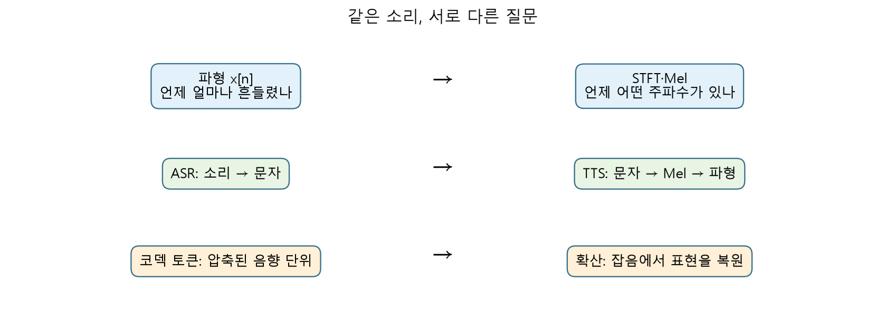

## 1. 소리는 시간 순서의 숫자다 · 9.1

마이크는 공기 압력의 변화를 전기 신호로 받고 일정 간격으로 숫자를 기록합니다. 파형의 가로축은 시간, 세로축은 진폭입니다. **진폭이 크다**와 **높은 소리다**는 다른 말입니다. 진폭은 흔들림의 크기, 주파수는 1초 동안 반복하는 횟수입니다. 주파수 단위는 Hz입니다.

샘플링 레이트 $f_s$는 1초에 기록한 값의 개수입니다. 길이가 $N$개면 재생 시간은 다음과 같습니다.

$$
T=\frac{N}{f_s}
$$

**풀이 예시.** 16kHz로 기록한32000개는32000/16000=2초입니다. 값은 그대로 두고 rate만8000으로 재생하면4초가 되어 느리고 낮게 들립니다. 실제 resampling은 저역통과 필터와 새 시간축의 값 계산을 수행하여 원래 시간을 유지합니다. 8kHz를16kHz로 바꾸어도 원래 없던 고주파 정보가 생기지는 않습니다.

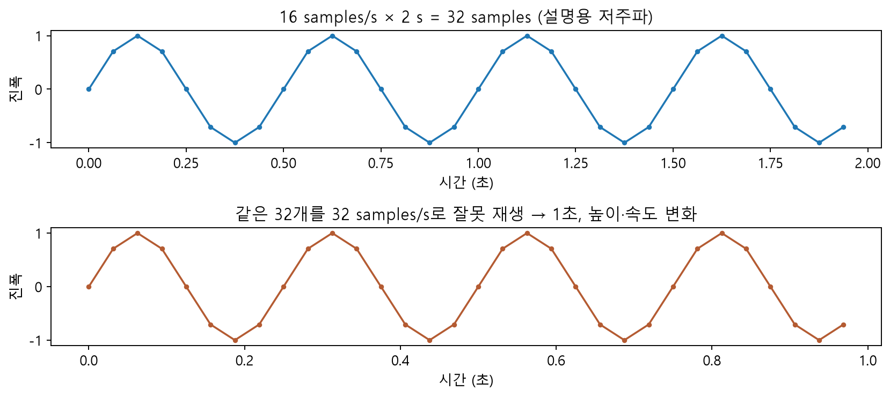

Nyquist 조건은 분석할 최고 주파수의 두 배보다 높은 rate를 요구합니다. 예를 들어16kHz의 표현 가능한 상한은8kHz 부근입니다. 장치의 필터·양자화·환경 소음까지 완벽해진다는 뜻은 아닙니다. stereo는 시간축 옆에 채널축이 하나 더 있습니다. 실습은 채널을 평균하여 mono로 통일합니다.

**A에서 볼 것:** `len(wave)`, `sampling_rate`, `wave.shape`. 공개 예제는93680개/16000Hz=5.855초입니다. rate는 모델에 입력할 때도 실제 데이터와 일치해야 합니다.

## 2. FFT는 “얼마나 흔들리나”를 주파수별로 나눈다 · 9.1

한 음은 여러 주파수의 성분이 겹쳐진 결과입니다. Fourier 변환은 파형과 각 주파수의 사인·코사인이 얼마나 닮았는지 계산합니다. 모든 값을 손으로 암기할 필요는 없습니다. 입력과 출력의 축을 먼저 확인합니다.

$$
X[k]=\sum_{n=0}^{N-1}x[n]e^{-j2\pi kn/N}
$$

여기서 $n$은 시간 샘플 위치, $k$는 주파수 칸, $j$는 허수 단위입니다. 복소수의 크기는 성분의 세기, 각도는 위상입니다. FFT는 이 합을 효율적으로 계산하는 알고리즘입니다. 실수 파형의 `rfft`는 대칭을 이용해 양의 주파수 쪽만 반환합니다.

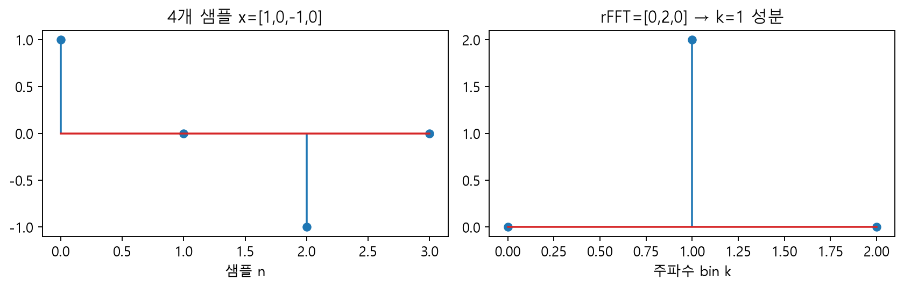

**풀이 예시.** $x=[1,0,-1,0]$의 rFFT는 $[0,2,0]$입니다. $k=1$에서1과−1이 해당 복소 기저와 곱해져2로 더해집니다. $f_s=8$Hz이면 bin 간격은8/4=2Hz이므로2Hz 성분입니다. 이 저주파 예시는 계산 설명용이며 실제 음성 주파수 예제가 아닙니다.

Magnitude는 $|X[k]|$, power는 $|X[k]|^2$입니다. power를 dB로 나타낼 때는 $10\log_{10}$, magnitude에는 $20\log_{10}$을 사용합니다. 기준값이 없는 상대 그림을 물리적 음압 dB로 읽으면 안 됩니다. 위상을 버린 magnitude 그림만으로 원래 파형이 유일하게 정해지지도 않습니다.

## 3. STFT는 짧은 창을 움직이며 FFT를 한다 · 9.1

문장 전체를 한 번 변환하면 어떤 주파수가 **언제** 나왔는지 알기 어렵습니다. STFT(Short-Time Fourier Transform)는 짧은 구간마다 창 함수를 곱하고 FFT를 반복합니다. 창 가장자리의 불연속을 줄이기 위해 Hann 창을 사용합니다.

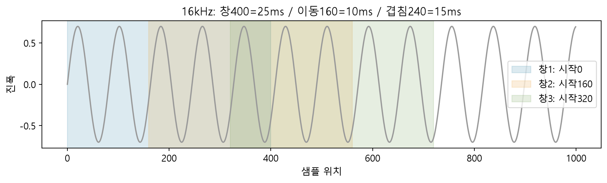

**풀이 예시.** 16kHz에서 창400개는400/16000=.025초=25ms입니다. hop160개는10ms의 이동입니다. 겹치는 부분은400−160=240개=15ms입니다. hop 자체가 겹침 길이는 아닙니다. padding 없이1600개를 처리하면 완전한 창의 수는 $1+\lfloor(1600-400)/160\rfloor=8$입니다.

STFT 배열은 `(frequency, time)`입니다. `n_fft=400`의 rFFT는201개 주파수 칸입니다. bin 간격은16000/400=40Hz입니다. hop만320으로 바꾸면 시간 칸은 줄지만 주파수 칸의 간격은 그대로입니다. 창 길이가 길면 주파수를 세밀하게 구별하는 데 유리하고 짧은 변화의 위치는 흐려질 수 있습니다.

**A에서 수정할 것:** `frame_signal`과 `stft_power`의 본문. 프레임 복사 → Hann 곱 → rFFT → power → 축 전환 순서를 출력으로 확인합니다. FFT 내부의 빠른 연산은 NumPy를 사용합니다.

## 4. Mel·log-Mel·MFCC는 같은 그림이 아니다 · 9.1

사람의 청각은 낮은 주파수 차이에 상대적으로 민감합니다. Mel 필터뱅크는 주파수 칸들을 여러 삼각형 필터로 가중 합산합니다. 선형 주파수201칸을 Mel80칸으로 묶는다고 이해하면 출발하기 쉽습니다. **Mel은 세로축을 단순히 그림에서 늘여 놓는 작업이 아닙니다.**

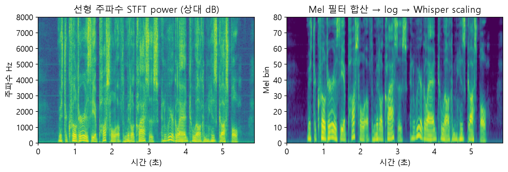

행렬로 쓰면 `(80,201) @ (201,time) → (80,time)`입니다. 매우 작은 값에 로그를 바로 취하지 않도록 작은 하한을 두고 log를 계산합니다. Whisper 전처리는 추가로 dynamic range clipping과 scaling을 수행합니다. MFCC는 log-Mel에 DCT를 적용한 별도의 계수입니다. Whisper가 MFCC를 입력받는다고 혼동하지 마세요.

**풀이 예시.** Whisper-tiny는16kHz·30초 입력에서 `(1,80,3000)`을 받습니다. 맨 앞1은 batch,80은 Mel,3000은 시간 칸입니다. 5.855초 샘플도 나머지 부분을 padding하므로3000이 됩니다. 이것을 “3000개 음성 특징” 또는 “80개의 시간점”으로 뒤집어 읽지 않습니다.

**A에서 검증할 것:** 직접 만든 `whisper_logmel`과 공식 processor의 최대 차이를 계산합니다. Mel 수·hop·chunk 길이를 바꾸어 배열은 만들 수 있지만, 사전학습 모델의 입력 계약까지 자동으로 바뀌지는 않습니다. 장말 도전1과 연결됩니다.

## 5. CTC는 정렬을 모르는 음성을 문자와 연결한다 · 9.2

음성에는 “이 프레임부터 이 글자”라는 정답 경계가 보통 없습니다. CTC(Connectionist Temporal Classification)는 프레임별 토큰 점수를 만들고, 여러 시간 정렬 경로가 같은 문자로 접히도록 학습합니다. **blank는 아직 글자를 출력하지 않는 특별한 기호이며 띄어쓰기가 아닙니다.**

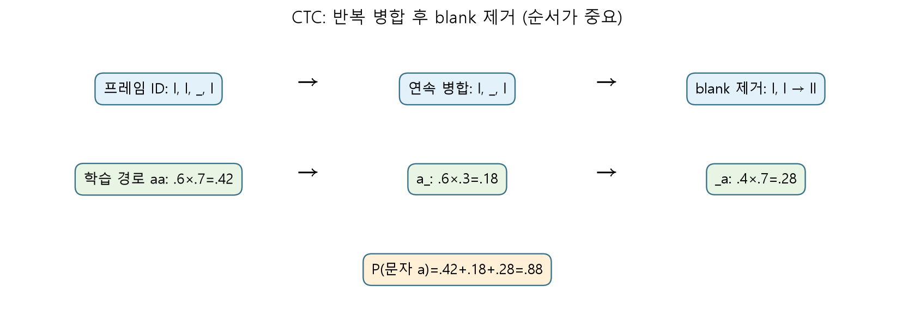

**Greedy 추론 풀이.** `l,l,blank,l` → 연속 동일 ID 병합 `l,blank,l` → blank 제거 `ll`. blank를 먼저 제거하면 `lll`을 `l`로 합쳐 버려 두 글자를 잃습니다. 단어 구분자 `|`는 tokenizer에서 별도로 공백으로 바꿉니다.

**학습 확률 풀이.** 두 프레임에서 문자a의 확률이 .6,.7, blank가 .4,.3이라고 합시다. a를 만드는 경로는 aa(.42), a_blank(.18), blank_a(.28)입니다. 따라서 $P(a)=.88$입니다. 가장 확률이 큰 경로 .42만 선택하는 greedy 추론과 학습의 경로 합산은 다릅니다. 실습의 `ctc_decode`는 greedy 접기이며 CTC loss 전체 구현은 아닙니다.

Wav2Vec2.0은 자기지도 사전학습으로 음성 표현을 배운 후 CTC 인식에 적응할 수 있습니다. HuBERT는 반복적으로 얻은 숨은 단위의 군집 목표를 사용하고, XLSR 계열은 여러 언어의 표현 공유를 확장합니다. 사전학습 목적·데이터와 최종 문자 인식 fine-tuning을 구별합니다. 외부 n-gram 언어 모델은 acoustic score와 언어적 빈도를 결합해 후보를 고를 수 있습니다. 외부 LM이 없다는 이유로 모델이 언어적 규칙을 전혀 학습하지 않았다고 단정하지 않습니다.

## 6. Whisper는 음성 표현을 보며 다음 문자 토큰을 생성한다 · 9.2

Whisper는 log-Mel을 encoder로 처리하고, decoder가 앞서 출력한 토큰과 음성 표현을 이용해 다음 토큰을 생성합니다. CTC처럼 프레임별 argmax를 접는 방식과 다릅니다. 언어·작업 토큰은 전사와 번역 같은 동작을 제어합니다. 언어와 모델 크기를 실제 목적에 맞게 확인해야 합니다.

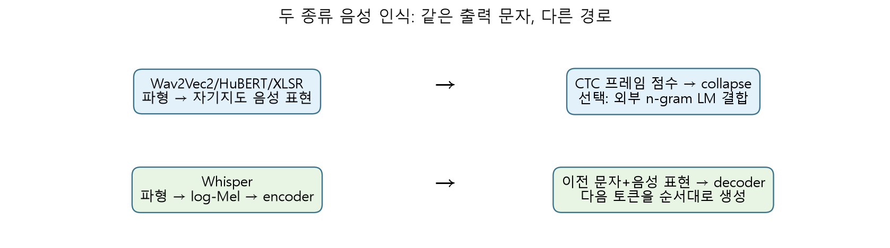

**실제 예제 결과.** 같은 공개 영어 샘플에서 Wav2Vec2는 `MISTER QUILTER ...`, Whisper-tiny는 `Mr. Quilter ...`로 출력했습니다. 대소문자·구두점과 약어 처리에 따라 점수가 달라집니다. 한 문장의 결과로 두 모델의 일반 성능 순위를 정할 수 없습니다. 영어 소형 실습 결과를 한국어 성능으로 해석하지도 않습니다.

**A에서 수정할 것:** 자신의 `ctc_decode`를 실제 Wav2Vec2 출력 ID에 전달하고, 자신의 `whisper_logmel`을 실제 Whisper에 전달합니다. 잘못된 shape는 명시적으로 중단합니다. 설치 실패나 추론 실패를 가짜 문장으로 대체하지 않습니다.

## 7. WER·CER를 손으로 세고 코드로 확인한다 · 9.2·9.4

기준 문장을 정하고 인식 문장을 최소 편집으로 맞춥니다. 대치 S, 삭제 D, 삽입 I를 셉니다. 분모 N은 **기준 문장**의 단어 수입니다.

$$
\mathrm{WER}=\frac{S+D+I}{N}
$$

**풀이 예시.** 기준 `we can hear the model`은5단어입니다. 인식 `we hear a model`에서는 can 삭제1, the→a 대치1이므로2/5=.4=40%입니다. 다음 표의 각 칸은 두 문장의 앞부분끼리 맞추는 최소 비용입니다.

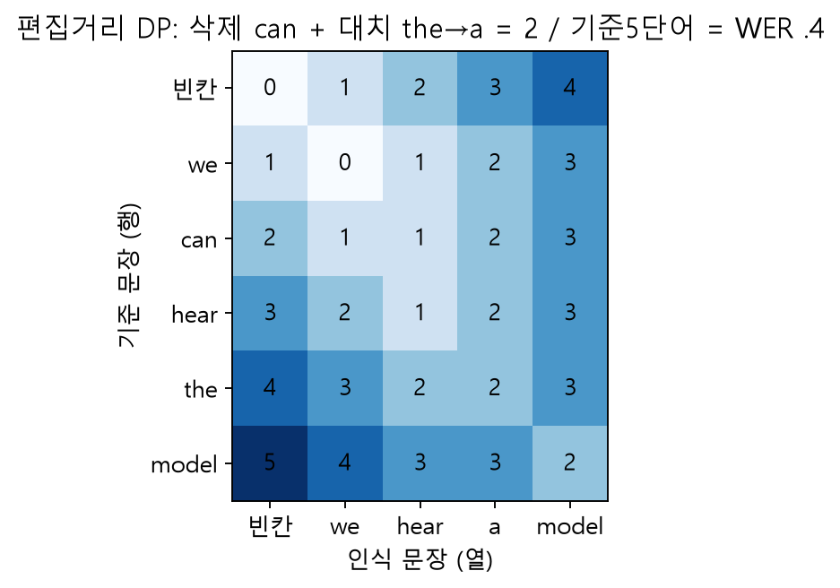

DP는 현재 칸에서 삭제·삽입·대치 또는 일치의 비용 중 최소를 선택합니다. `edit_alignment`의 중간 표와 역추적 결과를 확인합니다. 최적 정렬이 여럿이면 S,D,I의 조합은 달라질 수 있지만 최소 총비용은 같습니다. 삽입이 많으면 WER은100%를 넘습니다. 기준이 비었을 때는 분모가 없어 별도 정책이 필요합니다.

CER은 문자 단위의 같은 계산입니다. 실습은 Unicode NFC·casefold·구두점 공백화 후, CER에서 공백을 제외합니다. 한국어는 어절 분절과 띄어쓰기 정책을 명시해야 합니다. 모델끼리 다른 정규화를 쓰면 비교가 공정하지 않습니다. `Mr.`를 `Mister`로 확장할지는 사전에 고정할 평가 정책입니다.

## 8. TTS는 문자에서 Mel을 만들고 vocoder로 소리를 만든다 · 9.3.1

TTS(Text-to-Speech)는 읽을 문장을 소리로 바꾸는 작업입니다. SpeechT5는 텍스트·음성 입력용 prenet, 공통 encoder·decoder, 텍스트·음성 출력용 postnet의6개 네트워크로 설명할 수 있습니다. 실제 TTS checkpoint는 해당 작업에 필요한 경로를 실행합니다.

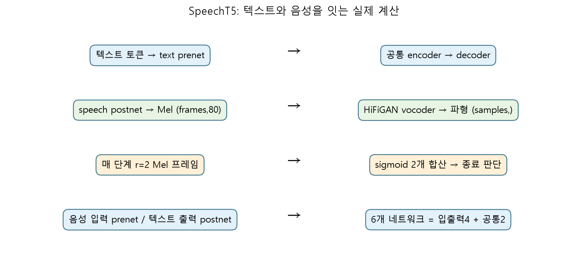

텍스트는 토큰 ID가 되고 decoder는 앞선 음성 프레임과 encoder 정보를 보며 다음 Mel 프레임을 예측합니다. 화자 임베딩은 발화 특성을 조건으로 제공합니다. 실습은 공개 연구용 고정 임베딩을 사용하며 개인 목소리 복제가 필요하지 않습니다. vocoder인 HiFiGAN은 Mel에서 파형을 만듭니다. **인식 decoder·음성 생성 decoder·vocoder는 각각 하는 일이 다릅니다.** VITS는 변분 추론·정규화 흐름·적대적 학습을 결합하는 다른 TTS 설계입니다.

**풀이 예시.** 실제 `We can hear the model.` 합성에서 Mel은 `(72,80)`, 최종 파형은18432개/16kHz=1.152초였습니다. 이 checkpoint의 vocoder는 Mel 한 프레임당256개 파형 샘플을 만듭니다. 이 수치는 해당 설정의 결과이며 모든 TTS의 고정 규칙은 아닙니다.

## 9. 종료 조건은 실제 생성 길이와 반복을 바꾼다 · 9.3.1

현재 SpeechT5 구현은 한 단계에서 `reduction_factor=2`개의 Mel 프레임을 내고 sigmoid 출력2개의 합산 점수를 threshold와 비교합니다. 이 합은0–2 범위이므로1.1을 단일 확률110%로 읽으면 안 됩니다. threshold는 vocoder의 인자가 아니라 **decoder 생성 루프의 종료 기준**입니다.

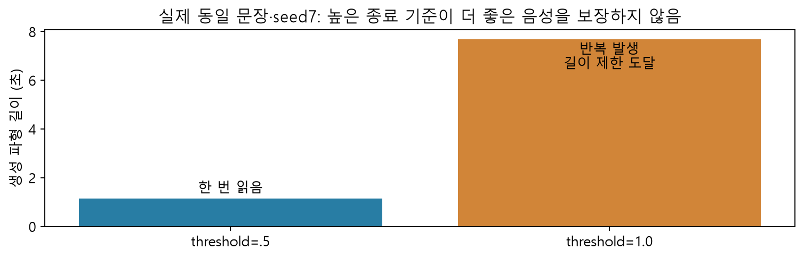

**실제 비교.** 같은 문장·seed7에서 .5는1.152초,1.0은7.68초로 길어졌으며 문장 반복이 관찰됐습니다. 더 높은 기준이 더 정확한 발음을 보장하지 않습니다. 길이 제한으로 끝난 것과 종료점수를 충족한 것을 CSV의 `reason`으로 구별합니다. seed를 고정해도 모델·라이브러리·장치가 달라지면 완전한 bit 일치는 보장하지 않습니다.

**B에서 수정할 것:** 실제 encoder·decoder를 호출하는 `decode_speecht5` 반복문과 `stop_rule`. 모델 가중치는 그대로 두고 종료 규칙을 바꿉니다. 수정 함수는 `synthesize(...,decoder_fn=...,stop_fn=...)`과 앱에 전달합니다. 조기 종료 검증용 음성이 정상 품질 예제는 아닙니다.

## 10. 음성·음악을 정수 토큰으로 표현할 수도 있다 · 9.3.2–9.3.4

EnCodec 같은 neural codec은 파형을 encoder로 압축한 뒤 RVQ(Residual Vector Quantization)를 적용합니다. 첫 코드북이 가장 가까운 벡터를 고르고, 남은 잔차를 다음 코드북이 근사합니다. decoder는 여러 코드의 합을 받아 다시 파형으로 만듭니다.

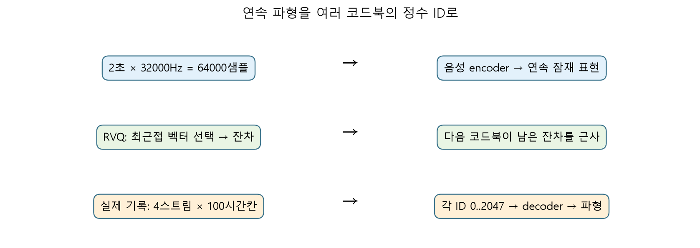

**RVQ 풀이 예시.** 목표(1.7,1.1), 첫 코드북{(0,0),(1,1)}, 두 번째{(0,0),(.5,0)}이면 첫 선택(1,1), 잔차(.7,.1), 두 번째(.5,0), 재구성(1.5,1), 마지막 잔차(.2,.1)입니다. MSE는(.04+.01)/2=.025입니다. 이2차원 계산은 원리용이며 전체 EnCodec 신경망이 아닙니다.

실제 기록에서는2초·32kHz·64000샘플이 `(chunk1,batch1,codebook4,time100)`의 정수 배열로 바뀌었습니다. 각 코드북 크기는2048입니다. “모든 EnCodec은4개 코드북·1024항목”처럼 일반화하지 않습니다. raw token 저장 용량은 배열 dtype과 압축 형식에 달려 있으므로 단순 칸 수를 실제 파일 압축률과 혼동하지 않습니다.

| 계열 | 핵심 연결 | 읽을 때 구별할 점 |
|---|---|---|
| Bark | 텍스트 조건에서 의미·음향 단계로 음성 및 비언어 소리 생성 | TTS 문장 읽기와 일반 소리 표현의 차이 |
| AudioLM | 자기지도 의미 단위와 codec 음향 단위를 계층적으로 연결 | 원래 음성 continuation과 텍스트 지시를 구별 |
| MusicLM | MuLan 음악-텍스트 공통 표현을 이용한 음악 생성 | 훈련 시 음악 조건과 추론 시 텍스트 조건의 연결 |
| AudioGen | 텍스트 조건의 일반 오디오 생성 | 음악·음성만을 위한 모델은 아님 |
| MusicGen | 텍스트 조건으로 여러 codec stream의 다음 토큰 예측 | 지연 패턴·codec decoder로 시간 파형 복원 |

B에는 실제 MusicGen 두 prompt의 사전 생성 WAV와 revision·seed·길이 기록이 있습니다. 같은 seed·100토큰에서 `calm piano`와 `bright acoustic guitar` 조건을 비교합니다. 관측 길이는1.94초입니다. token 수를 곧바로 정확한 초 수로 바꾸면 지연 패턴 등의 차이를 놓칠 수 있습니다.

두 코드북·두 시간칸의 작은 **지연 패턴 예시**는 다음과 같습니다. 모델의 생성 순서 칸과 오디오의 시간칸을 구별합니다. 실제 MusicGen은 해당 설정의 여러 스트림으로 확장합니다.

| 스트림 | 생성 순서0 | 생성 순서1 | 생성 순서2 |
|---|---|---|---|
| 코드북0 | 시간0의ID | 시간1의ID | 종료/빈칸 |
| 코드북1 | 시작/빈칸 | 시간0의ID | 시간1의ID |

복원 전에 지연을 풀어 같은 시간의 여러 코드북 ID를 묶습니다. 한 열을 그대로 한 오디오 시간칸이라고 읽으면 안 됩니다.

## 11. 오디오 확산은 “무슨 공간의 잡음인가”부터 묻는다 · 9.3.5–9.3.7

확산은 데이터를 점차 잡음으로 만들고, 모델이 거꾸로 복원하도록 학습합니다. 7장의 기본 원리는 오디오에서도 이어집니다. 다만 파형·spectrogram·VAE latent·이산 토큰은 서로 다른 공간입니다.

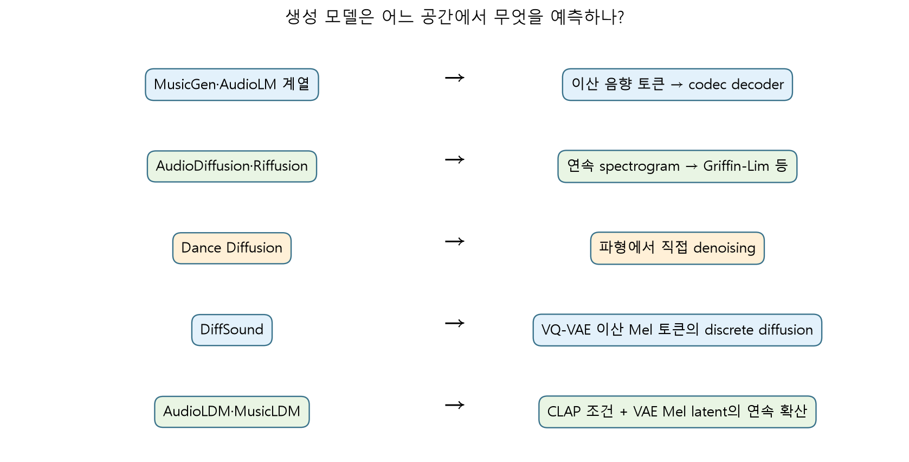

| 방법 | 복원하는 공간과 조건 | 파형으로 돌아오는 경로 |
|---|---|---|
| AudioDiffusion | 주로 Mel spectrogram의 연속 확산 | Griffin-Lim 등 해당 파이프라인의 복원 |
| Riffusion | spectrogram 이미지 생성·변형 | 스펙트럼을 음성 신호로 복원; 원래 위상과는 별도 |
| Dance Diffusion | 파형에서 직접 확산 | 생성 파형; spectrogram vocoder와 구별 |
| DiffSound | BERT/CLIP 텍스트 조건, VQ-VAE 이산 Mel 토큰의 discrete diffusion | VQ decoder·vocoder |
| AudioLDM | CLAP 조건을 받는 VAE의 Mel latent 연속 확산 | VAE decoder·vocoder |
| MusicLDM | 음악에 맞춘 CLAP·HiFiGAN과 latent diffusion, beat-synchronous mixup | Mel·vocoder |

**보충 확인:** 교재가 비슷한 흐름으로 묶어 설명하는 부분을 원 논문과 구별했습니다. DiffSound는 CLAP 기반 연속 확산이 아니며, AudioLDM도 CLAP 임베딩 자체를 denoise하는 것은 아닙니다. CLAP은 텍스트·오디오 정합의 조건, 생성 대상은 VAE Mel latent입니다. MusicLM의 MuLan과 AudioLDM의 CLAP은 역할이 비슷한 공통 표현 계열이지만 동일한 모델은 아닙니다.

B의 AudioDiffusion WAV는 seed7·10steps로 **실제 사전 실행한 기록**입니다. 낮은 step의 메커니즘 시연이며 품질 벤치마크가 아닙니다. 별도 소형 Conv1d 실습에서는 직접 만든 사인파+잡음으로 noise MSE 학습을 실행합니다. 고정 batch loss 감소는 대형 Dance Diffusion 재현이나 새로운 음악의 품질 향상 증거가 아닙니다.

## 12. 무엇을 잘했다는 것인지 먼저 정한다 · 9.4·9.5

| 질문 | 사용할 수 있는 관측 | 이 관측만으로 알 수 없는 것 |
|---|---|---|
| 문장을 잘 인식했나? | 같은 정규화의 WER·CER | 음색·자연스러움 |
| 텍스트와 소리가 맞나? | CLAP 유사도·사람의 정합 판단 | 사실성·권리·전체 음질 |
| 소리가 자연스럽나? | 프로토콜을 정한 청취·MOS | 저작권 허용 여부 |
| 생성 분포가 실제와 비슷한가? | 여러 샘플의 FAD 등 분포 지표 | 한 파일의 정답·개별 품질 보증 |
| 앱이 실제로 연결됐나? | 단계별 텍스트·WAV·설정·trace | 응답의 사실 정확성 |

합성 음성을 ASR로 다시 읽는 것은 발음·반복을 살피는 보조 점검입니다. ASR 자체도 틀릴 수 있습니다. 청취 실험은 평가자·척도·음량·조건·표본 수를 고정합니다. WER을 음악 평가 점수로 쓰지 않습니다.

생성 음성에는 화자 동의·사칭·편향 문제가 있고, 음악에는 학습 데이터와 출력의 권리 문제가 있습니다. 모델·데이터 라이선스를 각각 확인합니다. 실습은 공개 샘플과 고정 연구용 조건을 사용합니다. 생성물을 실제 사람의 발언으로 표시하지 않습니다. 실시간 생성·감정 제어·멀티모달 연결의 발전 가능성과 현재 소형 예제의 한계를 함께 읽습니다.

## 13. 누적 프로젝트: 듣고 새 문장을 만든 뒤 말하게 한다 · 9.6

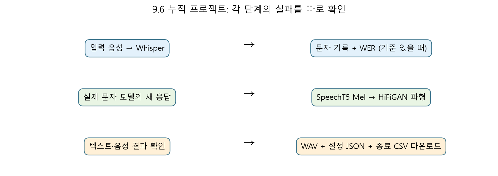

B의 앱은 입력 음성 → Whisper → 실제 문자 모델의 새 continuation → SpeechT5 → HiFiGAN을 연결합니다. 기존 텍스트·이미지 생성 수업의 “모델 결과를 다음 단계의 입력으로 쓴다”는 구조를 음성에 확장합니다. 필수 경로는 음성 입출력입니다. 선택 이미지 버튼은 이전 수업의 소형 편집 모듈을 실제 호출합니다. 음성에서 이미지 요청 의도를 자동 분류하는 기능은 아닙니다.

앱에서 원래 인식 문장, 새 문자 모델 응답, 최종 음성을 따로 봅니다. ASR이 잘됐어도 문자 모델의 답은 틀릴 수 있고, 답이 좋아도 TTS가 반복할 수 있습니다. 실패 위치를 하나의 “AI 오류”로 합치지 마세요. WAV·설정 JSON·종료 CSV를 내려받아 같은 실행의 결과인지 대조합니다. 공유 주소는 현재 Colab 런타임 동안만 유지됩니다.

## 14. 장말 개념·도전의 연결 지도 · 9.7·연습문제

다음은 교재 문제의 **요지와 실습 연결**입니다. 문제 원문의 복제가 아닙니다. 먼저 자신의 말로 설명한 뒤 계산 기록지와 연결하세요.

| 개념 묶음 | 설명할 질문 | 확인 위치 |
|---|---|---|
| 1–2 파형·spectrogram·Mel | 시간/주파수/지각 축은 어떻게 다른가? | A1–A2, 노트1–4 |
| 3 CTC | 반복과 blank는 어떻게 접히나? | A3, 노트5 |
| 4 샘플링 | 8k와16k에서 시간·주파수 상한은? | A1 |
| 5 외부 n-gram LM | 음향 점수에 무엇을 더하나? | 노트5 |
| 6 인식 구조 | encoder-only CTC와 encoder-decoder 차이는? | 노트6 |
| 7 오류율 | WER와CER의 분모·분절 기준은? | A4 |
| 8–9 SpeechT5·vocoder |6개 모듈과Mel→파형의 역할은? | B1, 노트8–9 |
| 10 EnCodec | residual codebook은 무엇을 압축하나? | B2 |
| 11 MuLan·CLAP | 공통 표현이 조건 연결을 어떻게 돕나? | B3, 노트10–11 |
| 도전1 입력 특징 | feature 수·hop·chunk를 바꿔 shape 예상 | A2 실제 계산 |
| 도전2 음성 변환 | 입력 음성·화자 조건·작업 checkpoint 구별 | 아래 확장 설계 |
| 도전3 확산 학습 | 데이터·잡음·가중치 갱신·새 데이터 평가 | B4 소형 학습 + 확장 설계 |

음성 변환은 같은 문장을 다른 조건으로 TTS하는 것과 다릅니다. SpeechT5의 speech-to-speech 변환 checkpoint와 입력 음성 경로가 필요합니다. 확장은 동의받은 공개 음성, 고정 입력, 두 화자 조건, 내용 보존과 음색 변화의 별도 평가로 설계합니다. 이번 기본 TTS checkpoint가 음성 변환까지 실행했다고 표시하지 않습니다. Dance Diffusion 전체 학습은 공개 권리 데이터·모델 설정·충분한 자원·독립 평가가 추가로 필요합니다.

## 15. 참고자료와 출처

교재의 순서·용어·모델 범위는 『핸즈온 생성형 AI』9장에 따릅니다. 그림13개와 수계산 예제는 수업용으로 새로 작성했습니다. 원문 그림·원본 노트북을 공개 배포하지 않습니다. 실제 실행 파일의 모델revision·seed·데이터 출처·라이선스는 실습 패키지 `assets/w11b/manifest.json`과 `NOTICE.txt`에 있습니다.

- [Whisper 공식 모델](https://huggingface.co/openai/whisper-tiny), [Wav2Vec2 공식 문서](https://huggingface.co/docs/transformers/model_doc/wav2vec2)
- [SpeechT5 공식 문서](https://huggingface.co/docs/transformers/model_doc/speecht5), [EnCodec 공식 모델](https://huggingface.co/docs/transformers/model_doc/encodec)
- [MusicGen 공식 모델 카드·라이선스](https://huggingface.co/facebook/musicgen-small), [LibriSpeech 데이터](https://www.openslr.org/12/)
- [AudioLM 원 논문](https://arxiv.org/abs/2209.03143), [DiffSound 원 논문](https://arxiv.org/abs/2207.09983)
- [AudioLDM 원 논문](https://arxiv.org/abs/2301.12503), [MusicLDM 원 논문](https://arxiv.org/abs/2308.01546)

