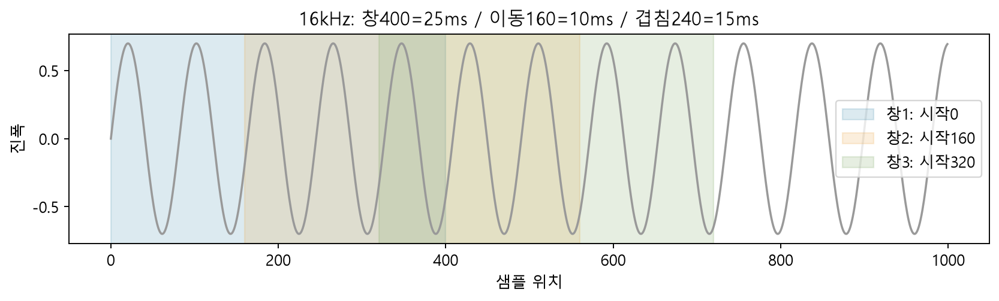
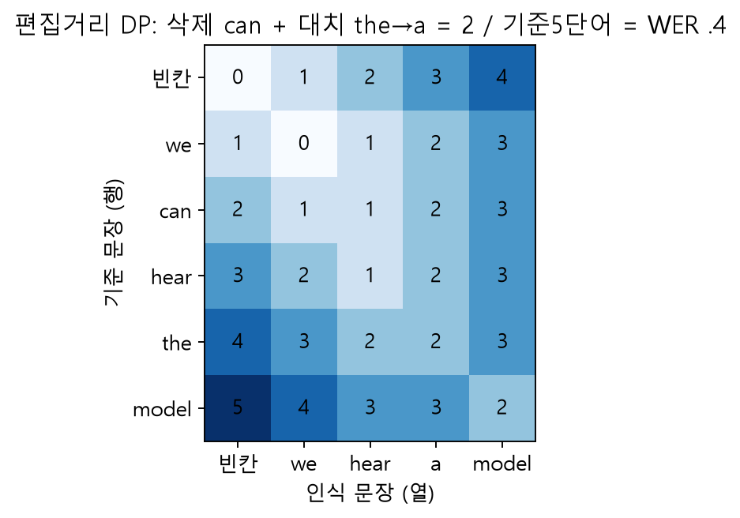

# W11B · 예측·계산·실행 기록지

2026년11월11일 · 주교재9장 · A/B 새 Colab 사본에서 사용합니다. 결과 숫자와 그 이유를 함께 적으세요. 실습의 독립 문제 완성 코드는 이 기록지에 포함하지 않습니다. 아래 풀이 예시와 다른 새 사례는 직접 풀어 봅니다.

## 1. 시간과 샘플 수 · A1

**풀이 예시:** 16kHz·32000개이면2초. rate만8000으로 바꾸면4초. 실제8000Hz로 resample하면16000개·2초입니다.

새 사례9A1: 8000Hz·24000개 → 시간 ___초 / 16000Hz라는 라벨만 붙이면 ___초 / 실제 resample 후 ___개, ___초.

| 확인할 것 | 실행 전 예상 | 실행 후 관측 | 차이를 설명하는 이유 |
|---|---|---|---|
| 길이와 샘플 수 | 내 기록: | 내 기록: | 내 설명: |
| rate 라벨 변경 청취 | 내 기록: | 내 기록: | 내 설명: |
| 원래 없던 고주파 | 내 기록: | 내 기록: | 내 설명: |

## 2. 창·hop·Mel 배열 · A1–A2

**풀이 예시:** 16000Hz,창400=25ms,hop160=10ms,겹침240=15ms. padding 없이1600개면8프레임. `rfft400`은201bins. Whisper-tiny 기본은(1,80,3000)입니다.

새 사례9A2: Mel40,hop320,30초 → 예상shape ___ . 모델이 요구하는shape ___ . 둘이 다를 때 모델의 입력 계약을 어떻게 설명할까요?

실제 샘플93680개가30초로 padding될 때 “실제 발화”와 “입력 배열의 전체 시간축”은 각각 무엇인가요? n_fft와hop 중 주파수bin 간격을 바꾸는 것은 무엇인가요?

내 계산·중간값: __________________________________________________________

내 설명·한계: ___________________________________________________________

## 3. CTC의 두 단계 · A3

**풀이 예시:** `l,l,blank,l` → `l,blank,l` → `ll`. 먼저 연속 병합, 나중에blank 제거입니다. blank와단어 구분자는 서로 다릅니다.

새 사례9A3: [A,A,blank,A,|,|,B]의 첫 단계 ___ / 최종 문자 ___ . blank를 먼저 없애면 ___ .

학습에서는 같은 문장으로 접히는 여러 경로의 확률을 합합니다. 추론의argmax 한 경로와 구별해 한 문장으로 쓰세요.

실제 Wav2Vec2 출력 첫30개ID: ______________________________________________

수정한decoder를 전달했을 때 바뀐 출력: ______________________________________

## 4. 편집거리와 평가 규칙 · A4

**풀이 예시:** 기준 `we can hear the model`, 인식 `we hear a model` → 삭제can,대치the→a. S1,D1,I0,N5,WER.4입니다.

새 사례9A4: 기준 `we hear music`, 인식 `we really hear loud music` → S___,D___,I___,N___,WER___ .

| 같은 음성 | 인식 문장 | 정규화 규칙 | WER | CER |
|---|---|---|---|---|
| CTC | 내 기록: | 내 기록: | 내 기록: | 내 기록: |
| Whisper | 내 기록: | 내 기록: | 내 기록: | 내 기록: |

`Mr.`와`Mister`를 같은 단어로 처리할지 먼저 정해야 하는 이유: ___________________

한 샘플의 점수로 일반 모델 순위를 정할 수 없는 이유: ___________________________

## 5. Mel 생성과 종료점수 · B1

**풀이 예시:** 실제 기본 문장은Mel72×80 → 파형18432개/16000Hz=1.152초였습니다. r=2이면36단계가72프레임을 만듭니다. 합산 종료점수는2개의sigmoid 합입니다.

| 고정할 조건 | 바꿀 조건 | 비교할 중간값 | 비교할 최종 결과 |
|---|---|---|---|
| 문장·seed·모델 | threshold | step,score,reason | 길이·반복·청취 |

9B1 변경 전·후: threshold ___→___ / Mel ___→___ / 초 ___→___ / 마지막reason ___→___ .

가장 높은score ___ . 왜 이 값이 단일 확률을 뜻하지 않나요? ______________________

본문에서 실제 수정한 줄과 앱에 전달한 함수 이름: ______________________________

## 6. RVQ·음악·확산 · B2–B4

**풀이 예시:** 목표(1.7,1.1), codebook1에서(1,1),잔차(.7,.1),codebook2에서(.5,0),재구성(1.5,1),MSE.025.

9B2 새 목표(1.4,.9): 첫선택 ___ / 잔차 ___ / 두번째 ___ / 재구성 ___ / MSE ___ . 실제EnCodec의4×100은 어떤 축인가요? ____________________________

9B3 음악 두 기록: 고정 ___ / 바뀐 것 ___ / 들은 차이 ___ / 결론의 한계 ___ . 이 파일은 지금 생성했나요, 사전 실제 실행 기록인가요? ___ .

확산 대상 공간을 연결하세요: Dance Diffusion ___ / DiffSound ___ / AudioLDM ___ . CLAP은 조건인가요, denoise대상 자체인가요? ___ .

9B4 실제소형학습: 바뀐 가중치 ___ / 정답 noise shape ___ / 첫loss ___ / 마지막loss ___ . 고정batch감소를 일반 음악 품질로 해석하면 안 되는 이유 ___ .

## 7. 실제 프로젝트의 실패 위치 · B5

| 단계 | 이번 실행 결과 | 성공 판정에 쓴 근거 | 남은 한계 |
|---|---|---|---|
| 입력→인식문자 | 내 기록: | 내 기록: | 내 설명: |
| 문자모델의 새응답 | 내 기록: | 내 기록: | 내 설명: |
| 새응답→음성 | 내 기록: | 내 기록: | 내 설명: |
| WAV·JSON·CSV | 내 기록: | 내 기록: | 내 설명: |

수정한함수→앱→다운로드가 같은 실행임을 어떻게 확인했나요? _____________________

## 8. 복습 점검 · 별도 개념 해설과 비교

1. 샘플링 레이트를 바꾸는 것과 라벨만 바꾸는 것은 어떻게 다른가요?
2. hop을 두 배로 바꾸면 시간축과 주파수축은 어떻게 달라지나요?
3. CTC에서 blank를 먼저 제거하면 왜 반복 글자를 잃을 수 있나요?
4. WER의 분모는 무엇이며100%를 넘을 수 있나요?
5. SpeechT5 decoder와 vocoder의 역할은 어떻게 다른가요?
6. CLAP 조건과 AudioLDM이 denoise하는 대상은 같은가요?

장말11개개념과3개도전의 연결은 강의노트14절을 확인하세요. 내 말로 가장 잘 설명한 개념 하나 ___ / 아직 헷갈리는 개념 하나 ___ / 다음에 바꿔 볼 조건 하나 ___ .

이 기록지는 수업 실습·자기점검용이며 새 성적 과제나 제출 기한은 없습니다.
