# 소리를 생성해 듣고, 생성형 AI의 발전과 최신 동향 읽기

2026년 11월 16일 · 생성형 인공지능 12주차 1차시 · 주교재 9장 실습과 10장 전체(425–447쪽)

[A · 오디오 생성 Colab](https://colab.research.google.com/github/lunalab-ai/genAI/blob/2026-fall-w12a/notebooks/student/w12a_sound_studio.ipynb) · [B · 10장 실습 Colab](https://colab.research.google.com/github/lunalab-ai/genAI/blob/2026-fall-w12a/notebooks/student/w12a_frontiers.ipynb) · [학생 자료 ZIP](https://github.com/lunalab-ai/genAI/releases/download/2026-fall-w12a/w12a-student-files.zip)

## 9장 실습 · 두 소리에서 증거 찾기

먼저 [안내 음성 A](https://cdn.jsdelivr.net/gh/lunalab-ai/genAI@2026-fall-w12a/src/luna_genai/assets/w12a/voice-a.wav)와 [안내 음성 B](https://cdn.jsdelivr.net/gh/lunalab-ai/genAI@2026-fall-w12a/src/luna_genai/assets/w12a/voice-b.wav)를 듣습니다. 어느 쪽이 같은 구절을 반복하나요? ZIP에서 `course/notion/w12a/listen.html`을 열면 설치 없이 모든 소리를 듣고 같은 음원의 그림을 볼 수 있습니다. 이어 Colab A에서 직접 효과음과 새 음성·음악을 만듭니다.

### 같은 WAV를 보는 세 가지 방법

파형은 시간별 진폭을 표시합니다. STFT는 파형을 짧은 구간으로 잘라 각 구간의 주파수 성분을 계산합니다. 로그 멜 스펙트로그램은 주파수 성분을 멜 대역으로 묶고 로그로 압축해 표시합니다. 아래 그림 한 행의 세 패널은 모두 **같은 소리**에서 계산했습니다.

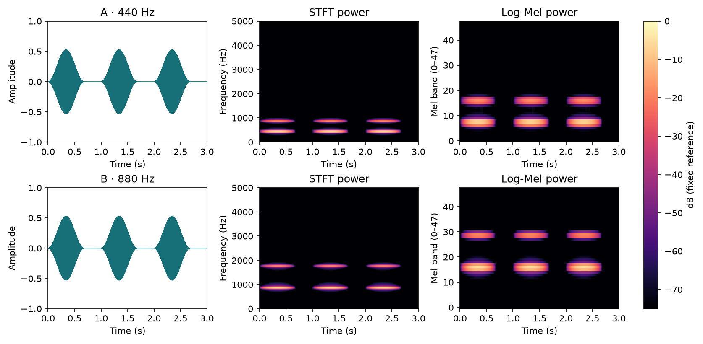

기본주파수를 두 배로 올리면 기본음과 배음의 밝은 띠가 위로 이동합니다. 반면 **같은 WAV**에서 분석 창만 바꾸면 재생 소리는 그대로입니다. 샘플링 레이트가 16,000 Hz일 때 창 256과 1024의 bin 간격은 각각 $16000/256=62.5$ Hz와 $16000/1024=15.625$ Hz입니다. 두 그림에서 창을 128샘플씩 옮기면 계산 시점의 간격은 둘 다 8 ms입니다. 긴 창은 인접 주파수를 더 잘 가를 수 있지만 순간적인 변화를 더 긴 구간에 걸쳐 평균화합니다.

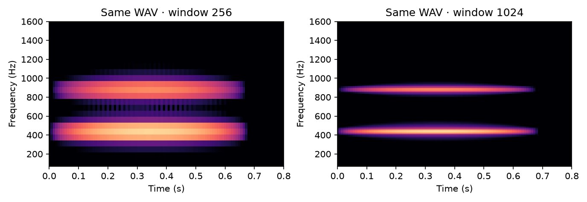

### 종료 조건과 악기 조건을 바꿔 실제로 생성

SpeechT5는 텍스트에서 멜 프레임을 만들고 HiFiGAN은 프레임에서 파형을 복원합니다. 작업 예제에서는 한 단계에 두 종료값이 나옵니다. 두 값의 합이 임계값을 넘는지를 직접 계산합니다. 아래 사전 생성 예시에서는 문장과 화자·시드를 고정하고 임계값만 바꿨을 때 1.152초와 7.680초의 소리가 나왔습니다. Colab A에서 새로 생성하고 길이와 반복 구간을 기록합니다. [SpeechT5 모델 카드](https://huggingface.co/microsoft/speecht5_tts)

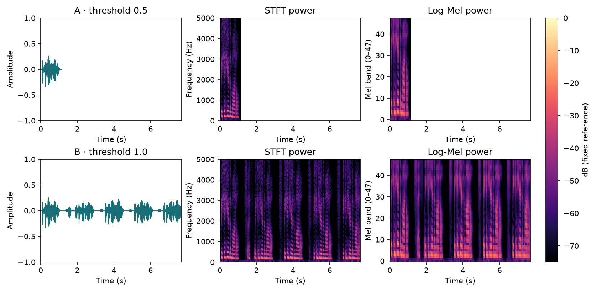

MusicGen은 텍스트에 맞는 음향 토큰을 예측하고 오디오 코덱의 디코더로 소리를 만듭니다. [피아노 WAV](https://cdn.jsdelivr.net/gh/lunalab-ai/genAI@2026-fall-w12a/src/luna_genai/assets/w12a/music-piano.wav)와 [어쿠스틱 기타 WAV](https://cdn.jsdelivr.net/gh/lunalab-ai/genAI@2026-fall-w12a/src/luna_genai/assets/w12a/music-guitar.wav)는 시드·길이 설정을 고정하고 프롬프트에서 악기 표현만 바꾼 실제 사전 생성 결과입니다. 음색 차이가 두 그림의 어느 시간과 대역에 나타나는지 찾습니다. [MusicGen 모델 카드](https://huggingface.co/facebook/musicgen-small)

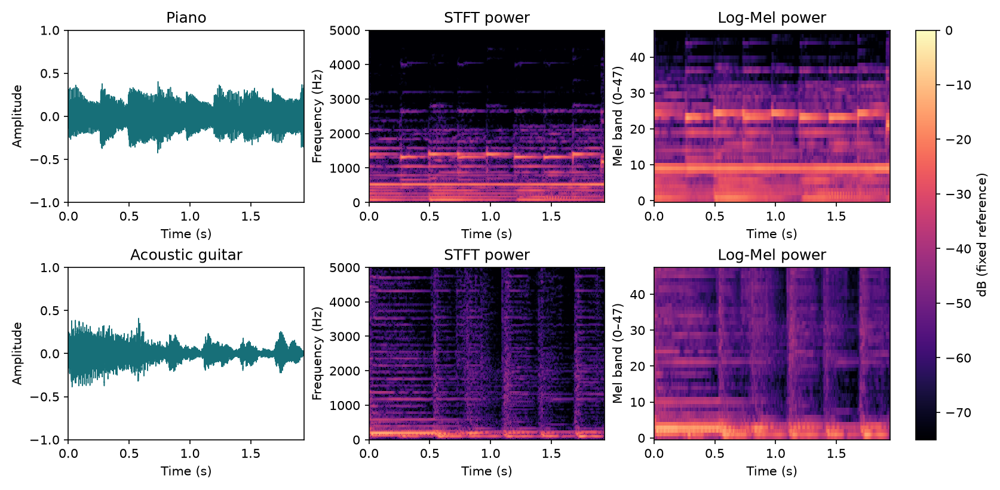

## 10.1 선호도 최적화 · 어느 답변을 학습시키나요?

학생이 “축제는 어디에서 열려요?”라고 묻습니다. A는 제공된 공지의 장소를 답합니다. B는 장소와 함께 문서에 없는 시간을 덧붙입니다. 이 비교에서 기록하는 것은 두 답변 가운데 어느 쪽을 더 선호하는지입니다. 전형적 RLHF는 사람의 비교로 보상 모델을 만들고 그 보상에 맞춰 답변 정책을 최적화합니다. RLAIF는 비교·평가에 AI 피드백을 사용합니다.

DPO의 한 쌍 실습에서는 현재 정책과 기준 정책의 로그확률 차이를 두 답변에 대해 각각 구합니다. 선호 답변 A의 차이가 $+0.5$, 다른 답변 B의 차이가 $-0.2$라면 마진은 $0.7$입니다. $\beta=0.5$일 때 로짓은 $0.35$입니다. B를 선호하면 부호가 반대로 바뀌고 손실도 달라집니다. IPO는 선호 마진에 다른 목적을 두고, KTO는 개별 결과의 바람직함 표시를 사용할 수 있습니다. 교재의 이미지 전후 예시와 연결되는 DDPO는 생성 이미지의 평가를 확산 모델 최적화에 사용합니다. [DPO 원논문](https://arxiv.org/abs/2305.18290) · [DDPO 원논문](https://arxiv.org/abs/2305.13301)

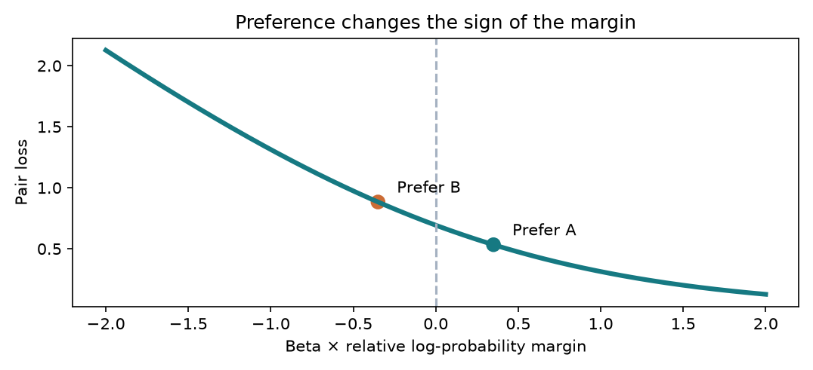

## 10.2 긴 컨텍스트 · 길게 읽을 수 있으면 중간 근거도 잘 찾나요?

8토큰 그림에서 마지막 위치가 읽을 수 있는 칸을 세어 봅시다. 전체 인과 어텐션은 앞쪽 8칸, 창 길이 3은 끝의 3칸을 봅니다. 슬라이딩 윈도와 Longformer의 국소·전역 패턴은 **볼 위치**를 바꿉니다. Attention sink는 초기의 일부 토큰을 남기는 방식입니다. FlashAttention은 같은 어텐션을 계산하면서 메모리 간 데이터 이동을 줄입니다. RoPE는 위치 정보를 회전에 담고, Mamba의 상태 공간 모델이나 RWKV는 정보를 순차 상태에 전달하는 설계를 사용합니다.

입력을 길게 받는 능력과 근거를 제대로 찾는 능력을 나눠 평가합니다. 같은 축제 장소 문장을 맨 앞·가운데·맨 끝으로 옮기고 질문과 나머지 문장을 고정하면 답변이 근거 위치에 민감한지 비교할 수 있습니다. [Lost in the Middle](https://arxiv.org/abs/2307.03172) · [FlashAttention 원논문](https://arxiv.org/abs/2205.14135)

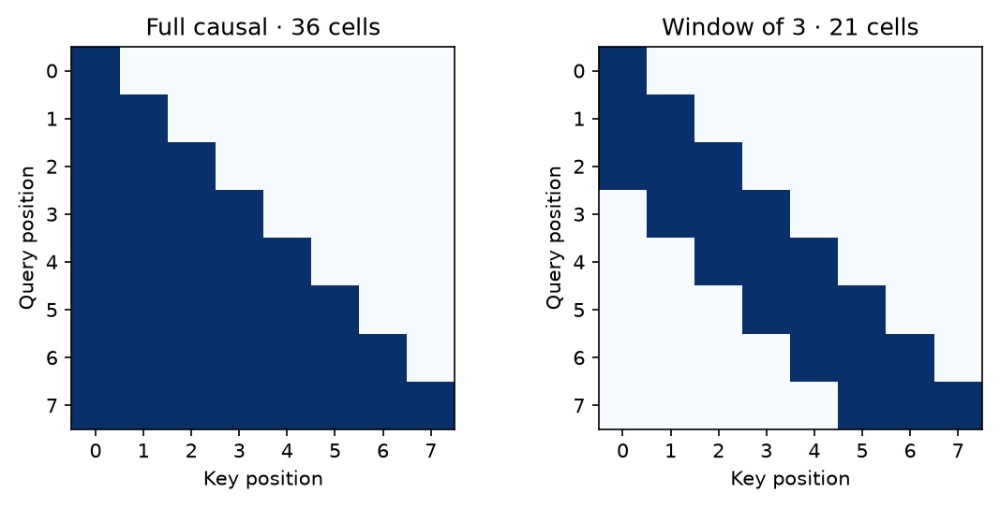

## 10.3 전문가 혼합(MoE) · 토큰마다 누구를 호출하나요?

라우터는 토큰마다 점수가 높은 전문가 $k$개를 고르고 선택된 점수를 가중치로 바꿉니다. 아래 네 토큰에 `top_k=1`을 적용하면 A는 세 번 호출되고 C·D는 호출되지 않습니다. $k=2$로 바꾸어 부하와 계산량의 변화를 비교하세요. 모든 전문가의 가중치는 저장하더라도 한 토큰의 경로에는 일부만 활성화됩니다. Mixtral 논문은 전체 47B와 토큰당 활성 13B를 구분합니다. 실제 속도에는 배치, 메모리, 전문가 간 통신도 영향을 줍니다. [Mixtral 원논문](https://arxiv.org/abs/2401.04088)

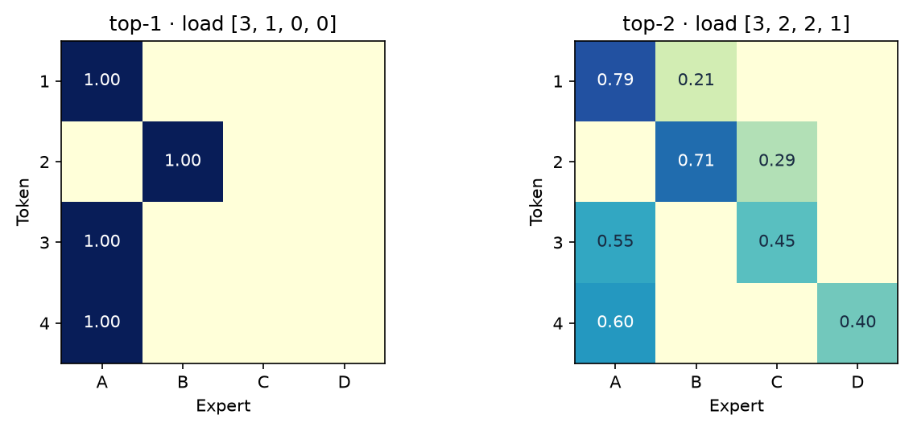

## 10.4 최적화와 양자화 · 어떤 비용을 줄이나요?

4비트와 8비트에 같은 가중치 벡터를 넣습니다. 스케일을 정하고 정수 코드로 반올림한 뒤 복원하면 값이 어떻게 달라졌는지 볼 수 있습니다. 이 실습은 균일 양자화의 작은 예입니다. 실제 메모리·지연과 품질은 하드웨어와 커널, 스케일을 적용하는 단위에도 좌우됩니다.

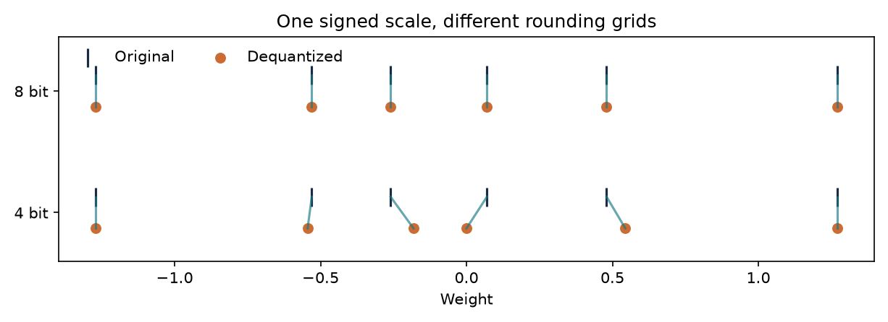

추측 디코딩에서는 초안 모델이 토큰을 제안하고 목표 모델이 묶어서 확인합니다. 후보의 목표 확률 $p=0.2$, 초안 확률 $q=0.5$라면 승인 확률은 $\min(1,p/q)=0.4$입니다. 뽑힌 수가 0.35면 승인하고 0.60이면 거절합니다. 거절 때는 두 분포의 양의 차이로 만든 보정 분포에서 새 토큰을 뽑습니다. Medusa는 여러 생성 헤드로 후보를 제안하는 접근입니다. [추측 디코딩 원논문](https://arxiv.org/abs/2211.17192)

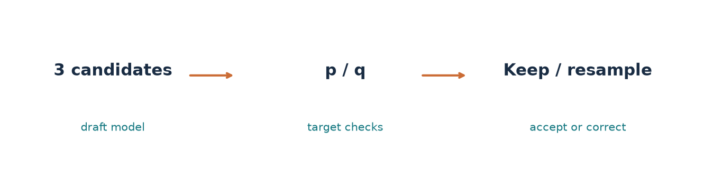

## 10.5 데이터 · 어떤 문장이 남고 어떤 문장이 사라지나요?

“Rain venue changed”는 짧지만 축제 운영에는 중요합니다. 네 단어 미만인 문장을 제거하면 사라집니다. 문장 길이, 중복, 언어, 개인정보·권리 기준을 적용할 때는 제거한 예와 남긴 예를 모두 점검합니다. 교재의 FineWeb은 웹 문서 필터링과 중복 제거, Phi 계열과 Cosmopedia는 선별하거나 합성한 교육성 데이터의 사례입니다. 합성 데이터도 오류, 문체 쏠림, 모델 편향과 원자료의 사용 조건을 확인합니다. [FineWeb 원논문](https://arxiv.org/abs/2406.17557) · [Cosmopedia 데이터 카드](https://huggingface.co/datasets/HuggingFaceTB/cosmopedia)

## 10.6 단일 모델로 해결할 수 있나요?

| 축제 안내의 요구 | 먼저 시험할 방법 | 확인할 비용과 실패 |
|---|---|---|
| 같은 정보의 답변 형식만 고정 | 프롬프트와 몇 개의 예시 | 새로운 질문에서도 형식을 지키는가 |
| 매일 바뀌는 장소와 시간에 출처 표시 | 최신 운영문서를 찾는 RAG | 오래된 문서 또는 잘못된 근거가 검색되는가 |
| 반복 업무에서 고유한 형식·판단 기준 학습 | 라벨을 모아 미세조정 | 드문 사례와 분포 변화에서 성능이 유지되는가 |
| 기존 모델이 학습하지 못한 입력·언어에 대규모 자체 데이터 | 사전학습부터 검토 | 데이터 권리, 연산 비용, 운영·평가 기반이 있는가 |

예시 한 건과 실패 한 건을 먼저 정하고 비용·개인정보·운영 지연을 함께 비교합니다. API와 자체 호스팅은 데이터가 이동하는 위치, 인프라 유지비, 응답 시간 요구에 따라 비교할 수 있습니다.

## 10.7 컴퓨터 비전 · 같은 사진, 네 가지 출력

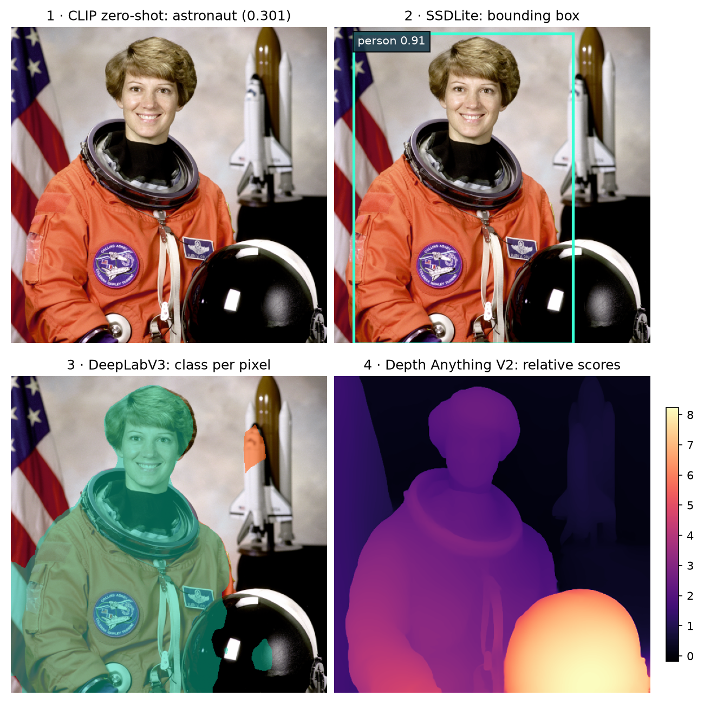

NASA의 Eileen Collins 사진을 실제 모델에 넣은 결과입니다. 분류는 후보 중 사진 전체를 설명하는 라벨을 고릅니다. 탐지는 `person` 상자와 점수를 반환합니다. 의미 분할은 픽셀마다 클래스가 있고, 인스턴스 분할과 파놉틱 분할에서는 같은 클래스의 개체들을 구별할 수도 있습니다. 그림의 분할 모델이 주황색으로 덧칠한 작은 영역은 모델의 추가 추정이므로 정답으로 읽지 않습니다. 깊이 패널의 수치는 상대 깊이의 단서입니다. 미터 단위가 필요하면 모델·카메라 가정을 별도로 확인합니다. 교재의 YOLOv10과 Depth Pro는 각각 탐지와 깊이의 사례입니다. [NASA 사진 출처](https://scikit-image.org/docs/stable/api/skimage.data.html#skimage.data.astronaut) · [Depth Pro](https://machinelearning.apple.com/research/depth-pro) · [Depth Anything V2 Small](https://huggingface.co/depth-anything/Depth-Anything-V2-Small-hf)

## 10.8 3D 컴퓨터 비전 · 새 시점에서 무엇이 보이나요?

메시는 표면을 정점과 면으로 표현합니다. NeRF는 공간 위치와 시선 방향을 이용해 색과 밀도를 모델링하고 광선을 따라 합성합니다. 3D Gaussian Splatting은 공간의 색·불투명도·모양을 가진 가우시안을 화면에 투영합니다. 같은 장면을 옆에서 볼 때 가까운 물체와 먼 배경이 다른 속도로 이동하는 것처럼 보입니다. 아래 도해에서 같은 번호가 어디로 이동하는지 본 뒤 원저자 영상에서 가려짐과 새 시점을 확인하세요. [3D Gaussian Splatting 공식 영상](https://www.youtube.com/watch?v=T_kXY43VZnk) · [원저자 비교 갤러리](https://repo-sam.inria.fr/fungraph/3d-gaussian-splatting/#video)

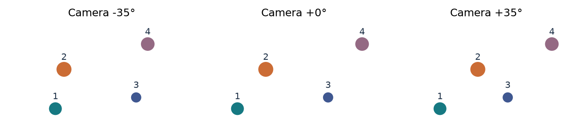

## 10.9 비디오 생성 · 장면이 다음 프레임에도 이어지나요?

텍스트→비디오(T2V)는 문장으로 장면과 움직임을 만들고 이미지→비디오(I2V)는 첫 장면을 정해 움직임을 만듭니다. 비디오→비디오(V2V)는 입력 영상의 구조 또는 움직임을 조건으로 사용합니다. AnimateDiff는 이미지 모델에 움직임 모듈을 연결하고, Deforum은 프레임 간 변환을 활용하는 사례입니다. Mochi와 Sora는 비디오를 직접 생성하는 모델 사례입니다.

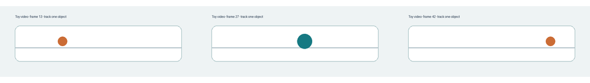

위 그림 가운데 프레임에서는 같은 공의 색과 크기가 달라집니다. 실제 영상에서도 관찰 물체 하나를 택해 가려지기 전·가려진 중간·다시 나타난 뒤를 비교하세요. Sora 원저자의 보고서는 연속성이 유지되는 예와 유리 깨짐·물체 상태 변화에서의 실패 사례를 함께 보여 줍니다. [Sora 원저자 영상과 논의](https://openai.com/index/video-generation-models-as-world-simulators/#discussion) · [Mochi 제작자 프로젝트](https://github.com/genmoai/mochi)

## 10.10 멀티모달리티 · 비교 점수, 문장, 위치는 서로 다른 출력

CLIP은 이미지와 문장을 벡터로 만들고 코사인 점수로 비교합니다. 후보에서 “an astronaut in an orange spacesuit”를 빼면 같은 사진에서 “a person wearing an orange jacket”의 순위가 올라옵니다. BLIP는 캡션을 생성합니다. 실습 사진에서 “a young man in an orange space suit holding a helmet”이라고 생성했는데, 사진 원출처와 성별 묘사가 맞지 않습니다. SmolVLM은 우주복 색 질문에 “Orange.”라고 응답했습니다. Molmo의 공식 시연은 질문 응답에 위치 표시와 개수 세기도 연결합니다.

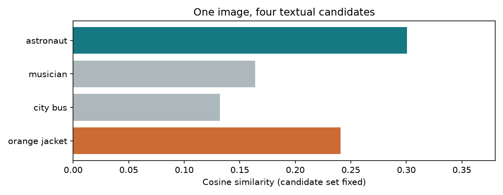

분류·검색은 후보 목록에 민감하고, 캡션은 사진에서 확인되지 않는 표현을 보탤 수 있습니다. 시각 질문 답변에서 위치·개수·색을 구별하여 검증하세요. [CLIP](https://huggingface.co/openai/clip-vit-base-patch32) · [BLIP](https://huggingface.co/Salesforce/blip-image-captioning-base) · [SmolVLM](https://huggingface.co/HuggingFaceTB/SmolVLM-256M-Instruct) · [Molmo 공식 시연](https://allenai.org/blog/molmo)

## 10.11 커뮤니티 · 데모를 수업에 가져오기 전에

프로젝트 하나를 고르고 **입력, 출력, 직접 확인한 한계, 모델 버전, 실행 환경, 라이선스**를 적습니다. 모델 가중치·소스 코드·데이터의 조건이 다른지 확인하세요. 시연 영상에서 확인한 사실과 내 환경에서 재현한 결과도 기록에 구분합니다.

**마지막 질문.** 오늘 바꾼 설정 한 줄을 선택하세요. 입력·고정 조건·변경한 조건·관찰한 결과를 한 문장씩 설명하세요.
